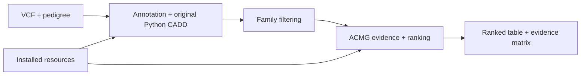

# PriVA

PriVA annotates SNVs and short indels, applies family-aware filters and ACMG/AMP evidence rules, and produces transcript-level variant rankings. Structural variants and CNVs are outside this workflow.



**Installation and scientific execution are separate.** The supplied configuration does not select a qualified raw-annotation CADD profile. Raw annotation requires an explicitly qualified profile and its matching model/prescore evidence. Prepared SpliceAI2 resources are for annotation inspection; they do not enable the legacy ACMG/ClinVar/CADD scientific route.

## Install

Use Linux, Bash, standard GNU tools, network access and Micromamba, Mamba or Conda. Begin configuration in the checkout; run analyses from an external directory as shown below. Choose storage with capacity for genome-wide resources and temporary builds; some cache stages require substantial memory. Use paths without spaces or shell metacharacters.

The tree below shows the default storage locations and how each resource is prepared. Blue path names and tokens follow the YAML configuration; the labels distinguish downloads, builds, manual inputs, bundled snapshots and package exports. Bundled data stay in the checkout; fresh CADD environments use the existing Mamba root.

[](docs/installation_layout.svg)

[Open the full-size SVG](docs/installation_layout.svg). Supplied originals are preserved; managed copies and converted outputs use the configured cache folders. Explicit reference/mapping paths and completed legacy software retain their selected locations.

1. Copy the configuration:

   ```bash
   PRIVA_ROOT="$(pwd)"
   cp "$PRIVA_ROOT/config.yaml" ../priva.local.yaml
   PRIVA_CONFIG="$(realpath ../priva.local.yaml)"
   ```

2. Edit that copy before installation:

   | Setting | Required choice |
   |---|---|
   | `cache_root` | Existing, writable, dedicated absolute directory outside the checkout for acquired and derived resources |
   | `tmp_dir` | Existing, writable absolute directory outside the checkout for temporary work |
   | `assembly` | `hg19`/`GRCh37` or `hg38`/`GRCh38` |
   | `vep_installed_version` | Numeric VEP major, for example `"116"`; software, plugins and caches must agree |
   | `ref_genome` | Optional existing assembly-correct indexed FASTA; empty selects managed acquisition |
   | `primateai_prescore` | Completed publisher PrimateAI file for the selected assembly |
   | `spliceai_snv_prescore`, `spliceai_indel_prescore` | Completed publisher files appropriate to the selected assembly/profile |

   Obtain restricted publisher resources under their own registration and license terms. The installer can prompt for unset manual inputs from an interactive terminal; noninteractive installation requires those paths in advance. Selecting an explicit invalid file does not request a replacement download.

3. Run the installer in an allocation suitable for its downloads and cache builds:

   ```bash
   bash "$PRIVA_ROOT/scripts/install_utils.sh" main_install "$PRIVA_CONFIG"
   ```

The installer creates or prepares `priva_acmg`, uses bundled snapshots where supplied, downloads/builds other resources beneath `cache_root`, and updates managed paths in the selected configuration. Workflow inputs are not required for installation. Rerun the same command with the same configuration to reuse completed resources and continue interrupted preparation.

Activate `priva_acmg` with the environment manager used for installation before running analysis, for example `micromamba activate priva_acmg` or `conda activate priva_acmg`.

CADD raw/PHRED calculation uses the separate `cadd-python2` Mamba environment with the original upstream Python and scientific packages. The workflow runs its interpreter in a child process, then continues in `priva_acmg`; no manual activation or switch back is required. Failures propagate to the calling task while the main environment remains intact.

```text
priva_acmg → CADD Python child process → priva_acmg
```

Fresh native installs place `cadd-*` environments beside `priva_acmg` under the existing Mamba root and their launch wrappers under that root's `share/priva/cadd-1.7.2/`. Completed older installations are reused in place. CADD annotation feature tools additionally retain their separately pinned `cadd-esm-python`, `cadd-regseq-python` and, for GRCh38, `cadd-mmsplice-python` environments.

At completion, the installer exports the packages actually installed, including version/build pins and pip dependencies, to `cache_root/priva_acmg.installed.yml` and `cache_root/cadd-*.installed.yml`. These portable YAML files omit host prefixes and environment variables. To repeat only this export:

```bash
bash "$PRIVA_ROOT/scripts/install_utils.sh" priva_export_installed_environment --config "$PRIVA_CONFIG"
```

Small HGNC snapshots and assembly/release-specific transcript mappings remain bundled under [`data/hgnc`](data/hgnc/README.md). Default installation selects the mapping for the configured assembly and VEP major; explicitly supplied mappings stay selected. Different versions have distinct filenames.

## Prepare inputs

Create an external run directory, then run analysis from there:

```bash
mkdir -p "$PRIVA_ROOT/../priva-runs/original"
PRIVA_OUT="$(realpath "$PRIVA_ROOT/../priva-runs/original")"
cd "$PRIVA_OUT"
```

Set `input_vcf`, `ped_file`, `output_dir`, `threads` and `threads_per_fam` in the installed configuration. Set `output_dir` to the actual absolute path held by `PRIVA_OUT`, not the literal variable name. Keep `input_vcf` outside the checkout too: annotation creates intermediates beside it. Keep the reference assembly, VCF alleles, annotation resources and transcript mapping consistent. Optional control/cohort inputs must follow their configured missing-input policy.

Use a tab-delimited pedigree with these first six columns:

```text
#FamilyID	IndividualID	PaternalID	MaternalID	Sex	Phenotype
FAM1	proband	father	mother	0	2
FAM1	father	0	0	1	0
FAM1	mother	0	0	2	0
```

Sample identifiers must match the VCF. Put the affected proband first within each family; the first affected row supplies the proband. Sex is `1` male, `2` female or `0` unknown. Phenotype is `2` affected, `1` unaffected, or `0`/`-9` unknown. Preserve unknown values rather than treating them as unaffected or reference genotypes.

## Run

The annotation interface is:

```bash
bash "$PRIVA_ROOT/scripts/annotation_vcf.sh" main_workflow --config "$PRIVA_CONFIG"
```

This command requires the qualified raw scientific profile described above. An installed CADD candidate is insufficient; select the qualified profile through `cadd_profile` or `--cadd-profile`. CADD uses the original Python implementation with shared official VEP annotations.

For family filtering and prioritization, use the complete matching annotated VCF and transcript-aware CADD table from a compatible scientific profile. A PHRED-only score file is insufficient. The example assumes configuration `input_vcf` has basename `cohort.vcf.gz`, `output_dir` equals the absolute `PRIVA_OUT` path, and that external directory contains `cohort.anno.vcf.gz`, its index and `cohort.anno.cadd.tsv`:

```bash
bash "$PRIVA_ROOT/scripts/filtration_vcf_per_fam.sh" main_filtration \
  -v "$PRIVA_OUT/cohort.anno.vcf.gz" -f FAM1 -c "$PRIVA_CONFIG"

bash "$PRIVA_ROOT/scripts/prioritization_vcf_per_fam.sh" main_prioritization \
  -i "$PRIVA_OUT/cohort.anno.FAM1.filtered.vcf.gz" \
  -t "$PRIVA_OUT/cohort.anno.FAM1.filtered.cadd.tsv" \
  -f FAM1 -c "$PRIVA_CONFIG"
```

`main_workflow` performs annotation/CADD; filtering and prioritization are separate commands. Preserve the paired annotation/CADD identities and the original pedigree order when reusing prepared inputs.

## Read the outputs

| Output | Meaning |
|---|---|
| `*.anno.vcf.gz` and index | Cohort annotations |
| `*.anno.cadd.tsv` | Matching allele/transcript CADD results |
| `*.FAMILY.filtered.vcf.gz` and `*.filtered.cadd.tsv` | Retained family variants and paired CADD rows |
| `*.FAMILY.filtered.tsv` | Annotated, ranked transcript rows with `ACMG_criteria`, `ACMG_quant_score`, `ACMG_class`, `sort_index` and `variant_rank` |
| `*.FAMILY.filtered.acmg.tsv` | ACMG evidence matrix and frequency-rule audit fields |

`ACMG_quant_score` is the posterior under PriVA's ACMG evidence model. `sort_index` also reflects control, inheritance, gene-list and expression weighting; it is a ranking score. Read `variant_rank` alongside the allele/variant identifier and transcript columns: multiple rows can describe one variant. The default `apply_clingen_override: true` allows curated ClinGen criteria to replace PriVA-derived criteria. Rankings require evidence review and do not by themselves establish a diagnosis.

## Resource compatibility and licensing

- Match assembly and annotation release throughout. The managed VEP116 transcript mapping uses Ensembl BioMart116; the GRCh37 export retains its GRCh37 annotation-base75 lineage and is not a GRCh38 fallback.
- [HCSeeker](data/HCSeeker/README.md) starts from GRCh38 protein-coordinate regions; its GRCh37 table is a derived protein-coordinate transfer. [gnomAD RMC](data/gnomAD_RMC/README.md) starts from GRCh37 regional constraint; the GRCh38 table is derived in protein space, not a genomic-coordinate liftover.
- [GoFCards](data/gofcards/README.md) starts from GRCh37 variant records, with derived GRCh38 representations and curated mechanism/condition resources. Exact variant evidence does not establish that every variant in a gene has the same mechanism.
- Changing VEP, mappings, SpliceAI generation, model assets or scientific settings can change interpretation. Resource installation does not qualify a changed profile. Preserve resource provenance with each analysis.
- See [LICENSE](LICENSE) for Apache 2.0 with the Commons Clause condition and commercial licensing, including clinical/diagnostic applications. Third-party data and software retain their own terms, including the [CADD license](bin/cadd/CADD-LICENSE).
