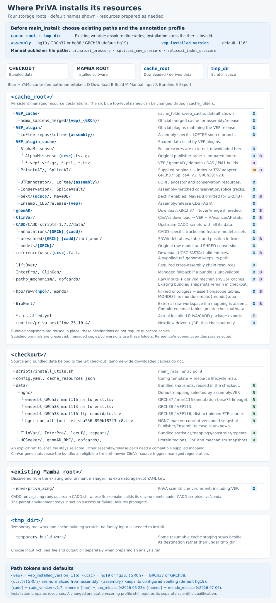

# PriVA

A comprehensive pipeline for ACMG/AMP-based variant interpretation and variant prioritization in genetic analysis.

## Overview

This repository contains scripts and configuration files for an automated variant prioritization pipeline based on the ACMG/AMP guidelines. PriVA combines transcript-level annotation, population and functional data, gene-disease mechanism and inheritance context, and family information to evaluate ACMG/AMP criteria and produce ranked variant lists for each family. Annotation resources are deployed once and can be refreshed; each cohort run then performs annotation, family-level filtering, criteria matching, and prioritization.


## Requirements

- Conda/Mamba for environment management
- Sufficient disk space for annotation resources (>1TB)
- Reference genome file (or let the installer download and index the assembly-matched FASTA)

## Pedigree File Requirements

If a valid pedigree table is provided, please note:
1. The family sample ID should be consistent between the pedigree table and the VCF file.
2. The proband of the family should stay as the first record of the family in the pedigree table
3. Every family should have a unique identifier in the pedigree table

## Installation

The github repository includes an one-stop installation BASH script (`scripts/install_utils.sh`) that helps deploy all required dependencies on your host system, with the help from a configuration YAML file (e.g., `config.yaml`). This YAML file is specifying the paths to external annotation dependencies.

**Carefully read comments in `config.yaml` to prepare for execution of install_utils.sh and PriVA**

Before the first run, create the directories selected by `cache_root` and
`tmp_dir`, then set those existing absolute paths, `assembly`, and
`vep_installed_version` (default `"116"`) in your copy of `config.yaml`.
Prepare the matching manual publisher files described below. The installer
stops if either storage directory is missing or unusable.

Install the environment, VEP/plugins, and annotation resources in one run:

```bash
bash scripts/install_utils.sh main_install /path/to/config.yaml
conda activate priva_acmg  # Or activate with the Mamba/Micromamba used to install.
```

`main_install` creates or prepares `priva_acmg` from `acmg_conda_rough.yml`
and selects the configured VEP major. A separate VEP installation call is not
required. Rerun the same command to reuse compatible completed resources and
continue interrupted preparation.

For the matching official VEP116 UTRAnnotator module, the installer deploys
deterministic reporting of all calculated UTR effects and retains the original
module and patch. The biological calculations are unchanged; other VEP releases
are left unchanged. See [`data/vep`](data/vep/README.md).

The cache tree shows default folder names, YAML-controlled assembly/release
parts, and whether each resource is downloaded, calculated, manually supplied,
or bundled. Bundled snapshots stay in the checkout; acquired and derived caches
use `cache_root`. Optional `cache_folders` entries rename its six main folders.

[](docs/installation_layout.svg)

[Open the full-size cache tree](docs/installation_layout.svg).

CADD scores come from upstream `CADD.sh` with all of CADD's own data (see
[Running PriVA](#running-priva)). It runs as a child process with its own
Snakemake-built environments while the workflow continues in `priva_acmg`;
users do not need to switch environments manually. Fresh installs use the
existing Mamba root, and completed older installations are reused in place.
At completion, `cache_root/*.installed.yml` records the actually installed
PriVA/CADD packages without host prefixes.

`main_install` also deploys the gene-mechanism resources used by ACMG step 3 in
dependency order: pinned HPO/MONDO data, the broader LOF/non-LOF mechanism
cache, exact normalized GoFCards variants, the canonical non-LOF/ClinVar VCV
cache, and the integrated HPO-framed condition cache. All builders, parsers,
schemas, and outputs are inside the PriVA tree; `llm_gene_reranker` is not an
installation dependency.

The complete canonical JSON and ClinVar VCV/RCV/SCV field contract is documented
in `GENE_NONLOF_MECHANISM_JSON_STRUCTURE.md` and enforced by the bundled JSON
Schema.

The supported full manual refresh is the same entry point as installation:

```bash
bash scripts/install_utils.sh main_install path/to/config.yaml
```

Users who want automatic refreshes should schedule that command with their own
cron or cluster scheduler. PriVA does not install a separate weekly job. Each
run checks source-specific refresh intervals and rebuilds downstream caches only
when an input checksum or implementation file changes. A forced mechanism
refresh can be requested with `PRIVA_FORCE_ALL_CACHES=1`.
The root [`cache_resources.json`](cache_resources.json) records which resources
are bundled snapshots and which have maintained acquisition/refresh routes.

The mechanism stages can also be run independently for debugging:

```bash
bash scripts/install_utils.sh gene_pathogenic_mechanism_cache_install path/to/config.yaml
bash scripts/install_utils.sh gofcards_exact_gof_cache_install path/to/config.yaml
bash scripts/install_utils.sh gene_nonlof_mechanism_cache_install path/to/config.yaml sources-only
bash scripts/install_utils.sh gofcards_clinvar_injection_install path/to/config.yaml
bash scripts/install_utils.sh gene_nonlof_mechanism_cache_install path/to/config.yaml
bash scripts/install_utils.sh mondo_hpo_scope_install path/to/config.yaml
bash scripts/install_utils.sh hpo_condition_mechanism_cache_install path/to/config.yaml
bash scripts/install_utils.sh mechanism_resource_install path/to/config.yaml
```

The GoFCards steps must run in the order shown. `gofcards_exact_gof_cache_install`
writes only a build intermediate; `gofcards_clinvar_injection_install` turns that
into the one deployed cache every consumer reads. The `sources-only` call in
between downloads the weekly ClinVar VCV XML that injection needs, because the
component that owns that download is the non-LOF builder, and the non-LOF
builder's ordinary run cannot start until injection has finished. See
`docs/GOFCARDS_CACHE_SCHEMA.md` for the full ordering.

The integrated JSON is published by writing and validating a complete temporary
snapshot before atomically replacing the live cache. It nests external
mechanism histories and variants under an HPO gene/condition only through exact
OMIM, ORPHA, or MONDO identifiers; unresolved records remain under the gene's
`unmapped_evidence` section.

The MONDO/HPO installer downloads pinned releases, builds one disease-scope
registry, and adds the resulting scope and provenance fields to each HPO
assertion. Confirmed non-monogenic diseases are excluded from PriVA's flattened
inheritance/penetrance context. Neoplastic diseases without positive hereditary
evidence remain review-required rather than being assumed somatic-only. Manual
decisions are stored in `data/mondo/disease_scope_overrides.tsv` and take
precedence when the registry is rebuilt.

## Smoke test

The smoke test uses the bundled 20-variant annotation/CADD fixtures in
`example/smoke_data/` and runs PriVA's filtering, ACMG assignment, and ranking.
Activate `priva_acmg` first. If needed, create it with
`mamba env create -f acmg_conda_rough.yml`; full resource installation is not
required for this prepared-input test.

```bash
conda activate priva_acmg  # Or use your Mamba/Micromamba activation command.
./example/run_smoke_test.sh hg19
./example/run_smoke_test.sh hg38
```

Each run creates a fresh temporary directory and prints its output path. Add
`--output-dir /path/to/empty/smoke-directory` to choose an external destination;
existing results and bundled inputs are preserved. Named `run`, `prepare`, and
`validate` subcommands are also available; see `--help`.

This is a sites-only fixture test. New VEP annotation, original CADD model
calculation, and family/public-data acceptance remain separate checks.

The smoke test does not require Git LFS on current `main`; all current smoke assets are stored as normal Git files.

## Configuration File
The `config.yaml` file in the PriVA repo contains all the parameters you need. Most of them can be automatically handled by the BASH script `install_utils.sh`. Here we list the items need to be specified by users prior to executing `install_utils.sh`

- CACHE ROOT: `cache_root`, an existing writable absolute directory outside the checkout for acquired and derived annotation resources.
- TEMPORARY DIRECTORY: `tmp_dir`, an existing writable absolute directory outside the checkout for temporary work.
- REF GENOME ASSEMBLY: `assembly` (`hg19`/`GRCh37` or `hg38`/`GRCh38`). `ref_genome` is optional: supply an assembly-correct FASTA or leave it empty for managed download and indexing.
- VEP RELEASE: `vep_installed_version`, the requested numeric major (default `"116"`); VEP, plugins, cache, and transcript mapping must be compatible.

The installer derives `vep_cache_dir`, `vep_plugins_dir`,
`vep_plugins_cachedir`, `gnomad_vcf_dir`, `clinvar_vcf_dir`, and
`cadd_parent_dir` from `cache_root` and `cache_folders`, and saves them in the
selected YAML. Do not set these managed directories separately. Small HGNC
snapshots and assembly/release-specific transcript mappings remain under
[`data/hgnc`](data/hgnc/README.md); an explicitly supplied mapping stays selected.

After specifying these settings and the manual inputs below, execute `main_install`.

**Special annotation resources need manual download**
SpliceAI and PrimateAI require completed publisher downloads under their own
access and license terms. Supply assembly-matched paths in `primateai_prescore`,
`spliceai_snv_prescore`, and `spliceai_indel_prescore`. An interactive installer
can prompt for unset paths; noninteractive runs need them set beforehand.
Incomplete files must not be supplied.

GRCh37/hg19 uses SpliceAI v1; GRCh38/hg38 installation prepares SpliceAI2.
The decompressed header identifies the input format: VCF inputs are reused;
SpliceAI2 TSVs are automatically adapted to indexed VCF without changing the
existing YAML keys. The official VEP SpliceAI plugin attaches a score only when
its gene name equals the transcript's gene name in VEP's cache, so the adapter
also writes each score under the gene's name in the GENCODE release of VEP's
Ensembl release when a gene was renamed (for example CENPJ, now CPAP). The
SpliceAI2 source manifest pins that annotation, a GENCODE GTF or GFF3 whose
header names GRCh38 and VEP's Ensembl release, as `vep_gene_annotation`.
PriVA's splicing and ACMG rules apply the thresholds the
SpliceAI2 authors recommend (0.1, 0.25 and 0.5 in place of SpliceAI v1's 0.2, 0.5
and 0.8; see [spliceai_cutoffs.py](scripts/spliceai_cutoffs.py)).
SpliceAI v1 GRCh38 files can still be used by pointing the same two keys at them;
the SNV and indel files must be the same version.

There are also items in `config.yaml` that needs to be specified for each PriVA exectuion:

- INPUT_VCF: `input_vcf`, which supposed to be a cohort VCF file
- PEDIGREE_FILE: `ped_file`, which is the pedigree file corresponding to the cohort VCF file. 
- OUTPUT_DIR: `output_dir`, which is the directory containing all the output annotation files
- HUB_CACHE_FILEs: `hub_file_dir`, parent folder storing the hub cache files; `hub_vcf_file`, hub annotated VCF file for annotation caching; `hub_cadd_file`, hub annotated CADD TSV for CADD annotation caching
- ALLELE_FREQUENCY_THRESHOLDS: `extreme_rare_PAF`, the extreme rare population allele frequency threshold for PM2; `af_cutoff`, population allele frequency threshold distinguishing common and rare variants
- DISEASE_INCIDENCE: `exp_disease_incidence`, the expected incidence of the disease
- ALT_DISEASE_PAT_VARs: `alt_disease_vcf`, Abs path to the VCF file containing the variants from alternative disease patients, used for BP5
- CONTROL_VARs: `control_vcf`, abs path to the VCF containing variants from control samples
- PP1_RESOURCES: `pp1_vcf`, abs path to the VCF containing patients (as well as family members) from the same disease, for family consegregation; `pp1_ped`, pedigree file corresponding to `pp1_vcf`
- COMPUTATION_RESOURCES: `threads`, total CPUs assigned to PriVA execution; `threads_per_fam`, per fam processing (step2 and step3) are executed in parallel across all families, this specify how many CPUs to use per family.


## Running PriVA

The recommended way to run the pipeline is using Snakemake, which manages dependencies and execution order.

CADD scores come from the upstream `CADD.sh` in `cadd_base_dir`, which performs
its own annotation and the original raw/PHRED scoring. Its Snakemake workflow
needs a `conda` executable on `PATH` to create the pinned rule environments
under `cadd_base_dir/envs/conda`; `main_install` creates them by scoring CADD's
bundled test variants. A separately installed conda belongs after the activated
`priva_acmg` environment on `PATH`, so that its own Python cannot shadow the
CADD environments.

`main_install` (`CADD_install`) downloads CADD-scripts, its genome annotations
and its prescored variants the original way: each file only when it is missing,
with its MD5 checked once right after the download, so reinstalling does not
re-read the roughly 1 TB of CADD data. It then replaces two of the scripts
`CADD.sh` runs with PriVA's copies in
[`scripts/cadd_scripts`](scripts/cadd_scripts/README.md) (CADD license), which
write the same output faster: the prescore lookup (`extract_scored.py`) starts
each lookup from a position index (`TABLE.posidx`) that `main_install` builds
once next to each prescored table and reads nearby variants in one pass, and
`MMSplice.py` saves the exon table it reads from CADD's Ensembl 110 GTF and
reloads it on later runs. Building a position index reads its table once, in
parallel over `threads`. `python scripts/cadd_scripts_install.py --source
CADD_DIR --state` shows whether PriVA's copies are installed.

**Prerequisites:**

1. Activate Conda Environment: Ensure the `priva_acmg` conda environment (or the one created during installation) is activated:
   ```bash
   conda activate priva_acmg
   ```
2. Configuration File: Have your `config.yaml` file ready with all necessary paths and parameters correctly specified.

**Running the Pipeline:**

Navigate to your working directory (or specify absolute paths in the command).
The config file can be duplicated and customized for batch-specific runs.
Keep `input_vcf` and `output_dir` outside the checkout: annotation creates
intermediates beside the input. Use the configured `output_dir` as the working
directory for the commands below.

**Basic Command:**

```bash
snakemake --snakefile /path/to/your/PriVA/Snakefile \
          --configfile /path/to/your/config.yaml \
          --cores <number_of_cores>
```

* `--snakefile`: Path to the pipeline's `Snakefile`.
* `--configfile`: Path to your specific configuration file.
* `--cores` (or `-j`): Maximum number of CPU cores Snakemake can use.

**Bash Function Wrapper Example:**

You can wrap the Snakemake command in a bash function for easier execution. Add this function to your `.bashrc` or `.bash_profile`, or save it in a script file and source it.

```bash
run_priva_pipeline() {
    # --- Configuration ---
    local snakefile_path="/path/to/your/PriVA/Snakefile" # CHANGE THIS to the actual path
    local default_config="/path/to/your/default_config.yaml" # Optional: Set a default config
    local default_cores=8
    local default_log_dir="snakemake_logs"

    # --- Argument Parsing ---
    local config_file="${1:-$default_config}"
    local num_cores="${2:-$default_cores}"
    local timestamp=$(date +"%Y%m%d_%H%M%S")
    local log_dir="${3:-$default_log_dir}"
    local log_file="${log_dir}/priva_run_${timestamp}.log"

    # --- Input Validation ---
    if [[ ! -f "$snakefile_path" ]]; then
        echo "ERROR: Snakefile not found at $snakefile_path"
        return 1
    fi
    if [[ -z "$config_file" ]] || [[ ! -f "$config_file" ]]; then
        echo "ERROR: Config file not found or not specified: '$config_file'"
        echo "Usage: run_priva_pipeline <config_file_path> [num_cores] [log_directory]"
        return 1
    fi
    if ! [[ "$num_cores" =~ ^[0-9]+$ ]] || [[ "$num_cores" -lt 1 ]]; then
        echo "ERROR: Number of cores must be a positive integer: '$num_cores'"
        return 1
    fi

    # --- Environment Check ---
    if [[ -z "$CONDA_DEFAULT_ENV" ]] || [[ "$CONDA_DEFAULT_ENV" != "priva_acmg" ]]; then
        echo "WARNING: Conda environment 'priva_acmg' might not be active. Attempting to activate..."
        conda activate priva_acmg
        if [[ $? -ne 0 ]]; then
            echo "ERROR: Failed to activate conda environment 'priva_acmg'. Please activate it manually."
            return 1
        fi
        echo "Activated conda environment 'priva_acmg'."
    fi

    # --- Execution ---
    echo "Starting PriVA pipeline..."
    echo "Snakefile: $snakefile_path"
    echo "Config File: $config_file"
    echo "Cores: $num_cores"
    mkdir -p "$log_dir"
    echo "Log File: $log_file"
    echo "-----------------------------------------"

    nohup snakemake --snakefile "$snakefile_path" \
                    --configfile "$config_file" \
                    --cores "$num_cores" \
                    --printshellcmds \
                    --rerun-incomplete \
                    --verbose \
                    > "$log_file" 2>&1 &

    local job_pid=$!
    echo "Pipeline submitted in the background. PID: $job_pid"
    echo "Monitor progress with: tail -f $log_file"
    echo "-----------------------------------------"
}

# --- How to use the function ---
# 1. Source the script or add the function to your .bashrc/.bash_profile
# 2. Run it:
#    run_priva_pipeline /path/to/my_experiment_config.yaml 16 /path/to/my/logs
#    # Or using defaults:
#    run_priva_pipeline /path/to/my_experiment_config.yaml
```


**Explanation of the Function:**

1. **Configuration:** Set the path to your `Snakefile` and optionally a default config file path.
2. **Arguments:** Takes the config file path (required), number of cores (optional, defaults to 8), and log directory (optional, defaults to `snakemake_logs`) as arguments.
3. **Validation:** Checks if the Snakefile and config file exist and if the core count is valid.
4. **Environment Check:** Verifies if the `priva_acmg` conda environment is active and tries to activate it if not.
5. **Execution:** Creates a log directory, constructs the `snakemake` command with useful options (`--printshellcmds`, `--verbose`, `--rerun-incomplete`), and runs it in the background using `nohup`. It prints the PID and log file location for monitoring.

**Comprehensive Example Command (from original README):**

This shows a full command often used for running on a cluster or server:

```bash
# Activate environment first!
# conda activate priva_acmg

nohup snakemake --snakefile /path/to/PriVA/Snakefile \
                --cores 50 \
                --configfile /path/to/config.yaml \
                --printshellcmds \
                --verbose \
                > /path/to/snakemake_pipeline.log 2>&1 &
```

* `nohup ... &`: Runs the command in the background, detached from the terminal, logging output to the specified file.
* `--printshellcmds`: Shows the actual shell commands being executed by Snakemake.
* `--verbose`: Provides more detailed output from Snakemake.

For family-specific analysis, ensure your pedigree file (`ped_file` in `config.yaml`) is properly formatted and specified in the config file.


## Annotation Resources

The pipeline integrates multiple annotation resources to comprehensively evaluate variant pathogenicity:

1. **Splicing disruption effect**: 
   - SpliceAI (VEP_plugin)
   - SpliceVault (VEP_Plugin)

2. **5-UTR uORF disruption effect**: 
   - UTRannotator (VEP_plugin)

3. **General Deleterious effect prediction**: 
   - CADD (standalone client)
   - PrimateAI (VEP_plugin)
   - AlphaMissense (VEP_plugin)
   - LOFTEE (VEP_plugin)

4. **Haplo-insufficiency**: 
   - LOEUF (VEP_plugin)
   - AlphaMissense_mean_score_per_gene

5. **Transcript disruption effect prediction**: 
   - VEP

6. **Clinical variants**: 
   - ClinVar VCF (bcftools annotate)

7. **Population-wise allele frequency + number of homozygous carriers**: 
   - gnomADv4 VCFs (bcftools annotate)

8. **Conservation**: 
   - Conservation (VEP_plugin)


## Pipeline Structure

The pipeline consists of three main steps:

1. **Annotation**: Annotates variants with multiple resources (Rule `annotate_variants`)
   - VEP annotation with plugins
   - CADD scoring
   - gnomAD frequency annotation
   - ClinVar annotation

2. **Filtration**: Filters variants based on family information (if available) (Rules `filter_variants_per_family` / `filter_variants_no_family`)
   - Family-specific filtering when pedigree is provided
   - General filtering without family information

3. **Prioritization**: Prioritizes variants according to ACMG guidelines (Rules `prioritize_variants_per_family` / `prioritize_variants_no_family`)
   - Generates TSV output with prioritized variants
   - Produces ACMG-specific reports


## Output Files

The pipeline produces several output files in the directory specified by `output_dir` in your `config.yaml`:

1. Annotated VCF files (`<input_base>.anno.vcf.gz`)
2. CADD score files (`<input_base>.anno.cadd.tsv`)
3. Filtered VCF files (`<input_base>.anno.filtered.vcf.gz` or `<input_base>.anno.<family>.filtered.vcf.gz`)
4. Prioritized variant tables (`<input_base>.anno.filtered.tsv` or `<input_base>.anno.<family>.filtered.tsv`)
5. ACMG-classified variant tables (`<input_base>.anno.filtered.acmg.tsv` or `<input_base>.anno.<family>.filtered.acmg.tsv`)

Where `<input_base>` is derived from your `input_vcf` filename, and `<family>` corresponds to family IDs found in your `ped_file`.

## Workflow Modes

The pipeline automatically adapts based on the presence of the `ped_file` specified in the `config.yaml`:

- **With family information**: If `ped_file` exists, uses pedigree data to perform family-specific filtering and prioritization for each family listed.
- **Without family information**: If `ped_file` does not exist or is not specified, performs general filtering and prioritization on the entire VCF.

## License

PriVA is licensed under the Apache License 2.0 with Commons Clause. This means:
- You can use, modify, and share it freely for academic and clinical research.
- Commercial use is prohibited without my permission, including selling PriVA as a product or involving PriVA as a part of charging service.

## Contact

Maintainer: yangyxt@hku.hk, yangyxt@gmail.com
