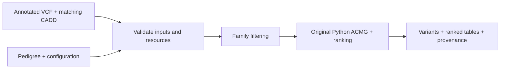

# PriVA-nextflow

PriVA-nextflow is an experimental single-family orchestration layer around PriVA's existing Python scientific implementation. It consumes SNV/short-indel annotations and produces family-filtered variants, ACMG evidence and transcript-level rankings. It is not a structural-variant/CNV workflow.



**Real `--mode raw` execution is disabled**, including after successful installation. The executable path is the compatibility interface for preannotated inputs: it requires the complete original VCF/CADD pair from a compatible scientific profile, not arbitrary annotations. Prepared SpliceAI2 caches are for annotation inspection and do not qualify legacy ACMG/ClinVar/CADD use. Installation, stub execution and successful scheduling do not establish family or scientific-profile qualification.

## Install

Use Linux x86-64, Bash, standard GNU tools, network access and Micromamba, Mamba or Conda. Begin in this checkout; the commands below move to an external run directory before launching Nextflow. Keep source, input and storage paths free of spaces or shell metacharacters. Genome-wide resource acquisition and cache building need suitable disk, memory and batch resources.

```bash
PRIVA_ROOT="$(pwd)"
cp "$PRIVA_ROOT/config.yaml" ../priva-nextflow.local.yaml
PRIVA_CONFIG="$(realpath ../priva-nextflow.local.yaml)"
```

Edit the copy before installation:

| Setting | Required choice |
|---|---|
| `cache_root` | Existing, writable, dedicated absolute resource directory outside the checkout |
| `tmp_dir` | Existing, writable absolute temporary-work directory outside the checkout |
| `assembly` | `hg19`/`GRCh37` or `hg38`/`GRCh38` |
| `vep_installed_version` | Numeric VEP major, for example `"116"`; match software, plugins and caches |
| `ref_genome` | Optional existing assembly-correct indexed FASTA; empty selects managed acquisition |
| `primateai_prescore` | Completed publisher PrimateAI file for the selected assembly |
| `spliceai_snv_prescore`, `spliceai_indel_prescore` | Completed publisher files appropriate to the selected assembly/profile |

Obtain restricted publisher files under their own registration and license terms. Interactive installation can prompt for unset manual paths; noninteractive installation needs them beforehand.

```bash
bash "$PRIVA_ROOT/scripts/install_utils.sh" main_install "$PRIVA_CONFIG"
```

This prepares `priva_acmg`, reuses bundled snapshots, acquires/builds other resources beneath `cache_root`, and updates managed paths in the selected configuration. It also installs the pinned Nextflow25.10.4 driver and private JRE beneath `cache_root/runtime/priva-nextflow-25.10.4`. No family input is required at this stage. Rerun the same command to reuse completed preparation.

Activate `priva_acmg` using the chosen environment manager. Set these shell variables to your existing cache directory and a durable directory for run products:

```bash
PRIVA_CACHE="$(yq -r '.cache_root' "$PRIVA_CONFIG")"
mkdir -p "$PRIVA_ROOT/../priva-runs/nextflow"
PRIVA_RUNS="$(realpath "$PRIVA_ROOT/../priva-runs/nextflow")"
PRIVA_NF="$PRIVA_CACHE/runtime/priva-nextflow-25.10.4/bin/nextflow"
cd "$PRIVA_RUNS"
"$PRIVA_NF" run "$PRIVA_ROOT/main.nf" --help
```

The cache path is read from the installed configuration. Keep this external launch directory so `.nextflow` state, logs and run products stay outside the checkout. The driver is separate from the scientific environment.

## Prepare a compatible annotated input

- Supply one BGZF `*.vcf.gz` with its adjacent `.tbi`, complete compatible `CSQ` annotations, and the matching uncompressed transcript-aware CADD TSV. Its first row needs unique `#Chrom`, `Pos`, `Ref`, `Alt`, `PHRED` and `FeatureID` columns. Preserve any additional original columns.
- Retain the full cohort VCF and pedigree; select one family through `--family`. Every PED sample must occur in the VCF, sample identifiers must be unique, and family/sample names must be safe file-name tokens.
- Use a tab-delimited PED with at least the standard six columns: family, individual, father, mother, sex, phenotype. Put the affected proband first within the selected family. Sex is `0` unknown, `1` male or `2` female; phenotype is `0`/`-9` unknown, `1` unaffected or `2` affected. Unknown values remain unknown.
- Match `--assembly`, the installed configuration, annotations and resources. Keep the legacy scientific profile, transcript mappings and original SpliceAI-v1 interpretation compatible; do not substitute a v2-marked input.

Create a manifest of the existing resources. This inventories resources; it does not install them or qualify a new scientific profile:

```bash
python3 "$PRIVA_ROOT/bin/priva_task.py" manifest \
  --config "$PRIVA_CONFIG" --legacy-root "$PRIVA_ROOT" --mode annotated \
  --vcf-hub-mode off --cadd-hub-mode off \
  --output "$PRIVA_RUNS/resources.json"
```

Set `PRIVA_SOFTWARE_ID` to the stable identity of the exact environment lock or tested container used for this run. For example, with Micromamba:

```bash
micromamba env export --name priva_acmg --explicit > "$PRIVA_RUNS/environment.explicit.txt"
PRIVA_SOFTWARE_ID="conda-explicit-sha256:$(sha256sum "$PRIVA_RUNS/environment.explicit.txt" | cut -d ' ' -f 1)"
```

Use the equivalent explicit lock from your manager when using Mamba/Conda. Keep the identity unchanged only while that environment remains unchanged.

## Run one family

After preparing a compatible pair and reviewing the experimental execution boundary above:

```bash
"$PRIVA_NF" run "$PRIVA_ROOT/main.nf" -profile local \
  --mode annotated \
  --input "$(realpath inputs/cohort.anno.vcf.gz)" \
  --cadd "$(realpath inputs/cohort.anno.cadd.tsv)" \
  --ped "$(realpath inputs/family.ped)" --family FAM1 --assembly hg19 \
  --legacy_config "$PRIVA_CONFIG" \
  --resource_manifest "$PRIVA_RUNS/resources.json" \
  --software_id "$PRIVA_SOFTWARE_ID" \
  --vcf_hub_mode off --cadd_hub_mode off \
  --outdir "$PRIVA_RUNS/FAM1" -work-dir "$PRIVA_RUNS/work"
```

The example `inputs/` paths are relative to the external `PRIVA_RUNS` directory; replace them with your actual input paths, family and assembly. The annotated route does not rerun VEP or regenerate CADD. Use a new output directory for changed inputs, source, resources or settings. For the same run, retain the external launch/work directories and Nextflow cache, and append `-resume`; launch-time resource checks still apply to a fully cached run.

| Profile/option | Scope |
|---|---|
| `-profile local` | Execute tasks in the active scientific environment |
| `-profile slurm` | Submit tasks to Slurm; set `--slurm_queue` and optional `--slurm_account` for the site |
| `--annotation_cpus`, `--family_cpus` | Task CPU allocations; corresponding memory/time parameters are in `nextflow.config` |
| `-profile apptainer` | Requires an explicitly selected tested `--container_image` and matching software identity |
| `-profile task_readonly` | Optional Linux Bubblewrap task filesystem boundary; it cannot be combined with `apptainer` and does not enable raw execution |
| `-profile test -stub-run` | Synthetic wiring only; its outputs are not scientific results |

## Read the outputs

| Directory | Contents |
|---|---|
| `variants/` | Family-filtered VCF/index and matching CADD table |
| `prioritization/` | `*.filtered.tsv` ranked transcript rows and `*.filtered.acmg.tsv` evidence matrix |
| `pipeline_info/` | Input/resource bundle, phase provenance and Nextflow execution reports |

`ACMG_criteria` records applied evidence; `ACMG_quant_score` is the posterior under PriVA's ACMG model; `ACMG_class` is its classification. `sort_index` additionally includes control, inheritance, gene-list and expression weighting. Read `variant_rank` with allele/variant identifiers and transcript columns, since several transcript rows can represent one variant. The default `apply_clingen_override: true` uses curated ClinGen criteria in place of PriVA-derived criteria where available. These outputs support evidence review, not a diagnosis by themselves.

## Scientific resources and optional Rust tools

Managed VEP116 mappings use Ensembl BioMart116; GRCh37 retains its GRCh37 annotation-base75 lineage and is not a GRCh38 fallback. [HCSeeker](data/HCSeeker/README.md) originates in GRCh38 protein space; [gnomAD RMC](data/gnomAD_RMC/README.md) originates in GRCh37, with derived opposite-assembly protein-coordinate tables. [GoFCards](data/gofcards/README.md) starts from GRCh37 variant records and includes derived GRCh38 representations; exact variant evidence is not a whole-gene mechanism assertion. Preserve assembly, transcript and source provenance when choosing these resources.

CADD uses the original Python implementation. Optional PriVA-owned Rust procedures have declared typed input boundaries; the family workflow still uses Python. To build the procedure CLI with the pinned Rust toolchain:

```bash
export CARGO_TARGET_DIR="$PRIVA_RUNS/rust-build"
(cd "$PRIVA_ROOT/rust" && cargo build --release --locked)
"$CARGO_TARGET_DIR/release/priva" coerce-pext --help
```

See [LICENSE](LICENSE) for Apache 2.0 with the Commons Clause condition and commercial licensing, including clinical/diagnostic applications. Third-party resources retain their own terms, including the [CADD license](bin/cadd/CADD-LICENSE).
