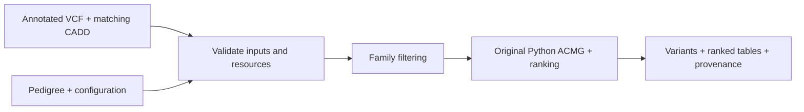
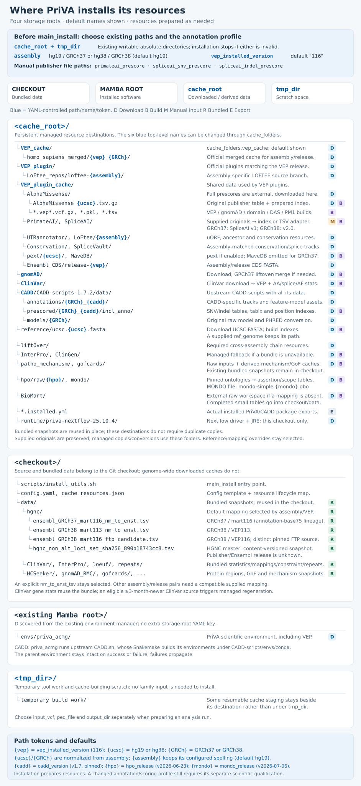

# PriVA-nextflow

PriVA-nextflow is an experimental single-family orchestration layer around PriVA's existing Python scientific implementation. It consumes SNV/short-indel annotations and produces family-filtered variants, ACMG evidence and transcript-level rankings. It is not a structural-variant/CNV workflow.



**Real `--mode raw` execution is disabled**, including after successful installation. The executable path is the compatibility interface for preannotated inputs: it requires the complete original VCF/CADD pair from a compatible scientific profile, not arbitrary annotations. SpliceAI v1 and prepared SpliceAI2 caches each use their own splicing and ACMG cutoffs ([spliceai_cutoffs.py](scripts/spliceai_cutoffs.py)); SpliceAI2 uses its authors' recommended thresholds (0.1, 0.25 and 0.5 in place of SpliceAI v1's 0.2, 0.5 and 0.8). Installation, stub execution and successful scheduling do not establish family or scientific-profile qualification.

## Install

Use Linux x86-64, Bash, standard GNU tools, network access and Micromamba, Mamba or Conda. Begin in this checkout; the commands below move to an external run directory before launching Nextflow. Keep source, input and storage paths free of spaces or shell metacharacters. Genome-wide resource acquisition and cache building need suitable disk, memory and batch resources.

The tree below shows the default storage locations and how each resource is prepared. Blue path names and tokens follow the YAML configuration; the labels distinguish downloads, builds, manual inputs, bundled snapshots and package exports. Bundled data stay in the checkout; fresh CADD environments use the existing Mamba root. The Nextflow driver and JRE have their own cache-root entry.

[](docs/installation_layout.svg)

[Open the full-size SVG](docs/installation_layout.svg). Supplied originals are preserved; managed copies and converted outputs use the configured cache folders. Explicit reference/mapping paths and completed legacy software retain their selected locations.

```bash
PRIVA_ROOT="$(pwd)"
cp "$PRIVA_ROOT/config.yaml" ../priva-nextflow.local.yaml
PRIVA_CONFIG="$(realpath ../priva-nextflow.local.yaml)"
```

Edit the copy before installation:

| Setting | Required choice |
|---|---|
| `cache_root` | Existing, writable, dedicated absolute resource directory outside the checkout |
| `tmp_dir` | Existing, writable absolute temporary-work directory outside the checkout |
| `assembly` | `hg19`/`GRCh37` or `hg38`/`GRCh38` |
| `vep_installed_version` | Numeric VEP major, for example `"116"`; match software, plugins and caches |
| `ref_genome` | Optional existing assembly-correct indexed FASTA; empty selects managed acquisition |
| `primateai_prescore` | Completed publisher PrimateAI file for the selected assembly |
| `spliceai_snv_prescore`, `spliceai_indel_prescore` | Completed publisher files appropriate to the selected assembly/profile |

Obtain restricted publisher files under their own registration and license terms. Interactive installation can prompt for unset manual paths; noninteractive installation needs them beforehand.

```bash
bash "$PRIVA_ROOT/scripts/install_utils.sh" main_install "$PRIVA_CONFIG"
```

This prepares `priva_acmg`, reuses bundled snapshots, acquires/builds other resources beneath `cache_root`, and updates managed paths in the selected configuration. It also installs the pinned Nextflow25.10.4 driver and private JRE beneath `cache_root/runtime/priva-nextflow-25.10.4`. It builds the PriVA program `priva` (saved as `priva_binary`) and the ClinVar PM5 index (saved as `clinvar_pm5_index`); see [the PriVA program](#scientific-resources-and-the-priva-program). No family input is required at this stage. Rerun the same command to reuse completed preparation.

The Rust workflow reads checked `.rkyv` caches using the existing configuration keys. InterPro and assembly-specific ClinGen archives are bundled. The larger ClinVar gene archive is generated during installation from the bundled pickle under `cache_root`, along with conversions of the other prepared caches. Original pickles remain available to the cache builders. Installation publishes native paths after conversion succeeds and reuses completed conversions on later runs; changing the storage format does not require repeating VEP annotation. See [cache formats and installation](rust/CACHE_FORMATS.md#6-distribution-and-installation).

Building `priva` also needs `pkg-config` and Expat's static development library
(`expat >=2.6.0` in the supplied environment recipe; `libexpat1-dev` on Debian or
Ubuntu). The installer discovers the active Python environment's package metadata
and records the selected library version and SHA256 in the build profile. Expat
is linked into the executable, so running `priva` needs no separate XML library.
Redistributions must retain the [Expat](rust/src/EXPAT_LICENSE) and
[CPython](rust/src/PYTHON_LICENSE) notices with the program.

To rebuild only the InterPro member-signature mapping from an already acquired,
version-pinned XML file, use the optional procedure:

```bash
"$PRIVA_BINARY" interpro-mapping build \
  --xml /path/to/interpro.xml.gz --output /path/to/interpro.mapping.rkyv
```

It preserves duplicate member entries, GO terms, source text handling and nested
element clearing, using Expat and the CPython 3.12 codec fallback profile. The
archive publishes atomically after complete readback; failure retains the prior
output. This procedure does not download data or replace the installer's separate
VCF-format inventory/report workflow. Custom Python-registered codecs are outside
the standalone source profile. Qualify a new XML/parser profile before adopting it.

For the matching official VEP116 UTRAnnotator module, the installer deploys
deterministic reporting of all calculated UTR effects and retains the original
module and patch. The biological calculations are unchanged; other VEP releases
are left unchanged. See [`data/vep`](data/vep/README.md).

CADD scores come from upstream `CADD.sh` (CADD-scripts v1.7.2) with all of CADD's own data. `main_install` installs it the original way, each file downloaded only when missing with its MD5 checked once, then replaces two of its scripts with PriVA's faster copies in [`scripts/cadd_scripts`](scripts/cadd_scripts/README.md): the prescore lookup starts from a position index built once beside each prescored table, and MMSplice reloads a saved exon table. Both write the same output as upstream. `CADD.sh` runs as a child process whose Snakemake builds its own environments under `cadd_base_dir/envs/conda`; its Snakemake needs a `conda` program (24.7.1 or later) on `PATH`. The standalone `cadd.nf` runs the same `CADD.sh` on one VCF and writes the CADD table that `--mode annotated` accepts:

Fresh `priva_acmg` environments include Conda. For existing environments, the
installer checks `PATH`, `CONDA_EXE`, then `cadd_parent_dir/conda_frontend`.
If none supplies compatible Conda, it uses the selected Micromamba/Mamba/Conda
to create that separate tool-only frontend with Conda 24.9.2 from conda-forge.
Existing scientific environments and their package exports remain unchanged.
CADD callers discover the same frontend without replacing the active Python.
With `priva_acmg` active, prepare only this prerequisite with
`bash scripts/install_utils.sh CADD_conda_install --config /path/to/config.yaml`
after the configuration's cache paths have been prepared. An incomplete frontend
is retained and reported; it is never overwritten or mistaken for a ready one.

```bash
nextflow run "$PRIVA_ROOT/cadd.nf" -c "$PRIVA_ROOT/conf/cadd.config" \
  --input "$(realpath inputs/cohort.vcf.gz)" --assembly GRCh38 \
  --cadd_base_dir "$PRIVA_CACHE/CADD/CADD-scripts-1.7.2" --outdir "$(realpath cadd_out)"
```

At completion, the installer exports the packages actually installed, including version/build pins and pip dependencies, to `cache_root/priva_acmg.installed.yml` and, for each environment `CADD.sh` built, `cache_root/cadd-*.installed.yml`. These portable YAML files omit host prefixes and environment variables. To repeat only this export:

```bash
bash "$PRIVA_ROOT/scripts/install_utils.sh" priva_export_installed_environment --config "$PRIVA_CONFIG"
```

Small HGNC snapshots and assembly/release-specific transcript mappings remain bundled under [`data/hgnc`](data/hgnc/README.md). Default installation selects the mapping for the configured assembly and VEP major; explicitly supplied mappings stay selected. Different versions have distinct filenames.

Activate `priva_acmg` using the chosen environment manager. Set these shell variables to your existing cache directory and a durable directory for run products:

```bash
PRIVA_CACHE="$(yq -r '.cache_root' "$PRIVA_CONFIG")"
mkdir -p "$PRIVA_ROOT/../priva-runs/nextflow"
PRIVA_RUNS="$(realpath "$PRIVA_ROOT/../priva-runs/nextflow")"
PRIVA_NF="$PRIVA_CACHE/runtime/priva-nextflow-25.10.4/bin/nextflow"
cd "$PRIVA_RUNS"
"$PRIVA_NF" run "$PRIVA_ROOT/main.nf" --help
```

The cache path is read from the installed configuration. Keep this external launch directory so `.nextflow` state, logs and run products stay outside the checkout. The driver is separate from the scientific environment.

## Prepare a compatible annotated input

- Supply one BGZF `*.vcf.gz` with its adjacent `.tbi`, complete compatible `CSQ` annotations, and the matching uncompressed transcript-aware CADD TSV. Its first row needs unique `#Chrom`, `Pos`, `Ref`, `Alt`, `PHRED` and `FeatureID` columns. Preserve any additional original columns.
- Retain the full cohort VCF and pedigree; select one family through `--family`. Every PED sample must occur in the VCF, sample identifiers must be unique, and family/sample names must be safe file-name tokens.
- Use a tab-delimited PED with at least the standard six columns: family, individual, father, mother, sex, phenotype. Put the affected proband first within the selected family. Sex is `0` unknown, `1` male or `2` female; phenotype is `0`/`-9` unknown, `1` unaffected or `2` affected. Unknown values remain unknown.
- Match `--assembly`, the installed configuration, annotations and resources. Keep the legacy scientific profile and transcript mappings compatible. The SpliceAI SNV and indel files must be the same version (v1 or SpliceAI2); each version uses its own cutoffs.

Create a manifest of the existing resources. This inventories resources; it does not install them or qualify a new scientific profile:

```bash
python3 "$PRIVA_ROOT/bin/priva_task.py" manifest \
  --config "$PRIVA_CONFIG" --legacy-root "$PRIVA_ROOT" --mode annotated \
  --vcf-hub-mode off --cadd-hub-mode off \
  --output "$PRIVA_RUNS/resources.json"
```

Set `PRIVA_SOFTWARE_ID` to the stable identity of the exact environment lock or tested container used for this run. For example, with Micromamba:

```bash
micromamba env export --name priva_acmg --explicit > "$PRIVA_RUNS/environment.explicit.txt"
PRIVA_SOFTWARE_ID="conda-explicit-sha256:$(sha256sum "$PRIVA_RUNS/environment.explicit.txt" | cut -d ' ' -f 1)"
```

Use the equivalent explicit lock from your manager when using Mamba/Conda. Keep the identity unchanged only while that environment remains unchanged.

## Run one family

After preparing a compatible pair and reviewing the experimental execution boundary above:

```bash
"$PRIVA_NF" run "$PRIVA_ROOT/main.nf" -profile local \
  --mode annotated \
  --input "$(realpath inputs/cohort.anno.vcf.gz)" \
  --cadd "$(realpath inputs/cohort.anno.cadd.tsv)" \
  --ped "$(realpath inputs/family.ped)" --family FAM1 --assembly hg19 \
  --legacy_config "$PRIVA_CONFIG" \
  --resource_manifest "$PRIVA_RUNS/resources.json" \
  --software_id "$PRIVA_SOFTWARE_ID" \
  --vcf_hub_mode off --cadd_hub_mode off \
  --outdir "$PRIVA_RUNS/FAM1" -work-dir "$PRIVA_RUNS/work"
```

The example `inputs/` paths are relative to the external `PRIVA_RUNS` directory; replace them with your actual input paths, family and assembly. The annotated route does not rerun VEP or regenerate CADD. Use a new output directory for changed inputs, source, resources or settings. For the same run, retain the external launch/work directories and Nextflow cache, and append `-resume`; launch-time resource checks still apply to a fully cached run.

| Profile/option | Scope |
|---|---|
| `-profile local` | Execute tasks in the active scientific environment |
| `-profile slurm` | Submit tasks to Slurm; set `--slurm_queue` and optional `--slurm_account` for the site |
| `--annotation_cpus`, `--family_cpus` | Task CPU allocations; corresponding memory/time parameters are in `nextflow.config` |
| `-profile apptainer` | Requires an explicitly selected tested `--container_image` and matching software identity |
| `-profile task_readonly` | Optional Linux Bubblewrap task filesystem boundary; it cannot be combined with `apptainer` and does not enable raw execution |
| `-profile test -stub-run` | Synthetic wiring only; its outputs are not scientific results |

Keep scientific worker counts in the legacy configuration's `threads` and
`threads_per_fam`; set task CPU allocations independently. Family tasks need at
least `threads_per_fam` CPUs. Raw VEP profiles need `threads + 2` CPUs, for
example 24 CPUs for 22 configured forks; raw execution remains gated.

## Read the outputs

| Directory | Contents |
|---|---|
| `variants/` | Family-filtered VCF/index and matching CADD table |
| `prioritization/` | `*.filtered.tsv` ranked transcript rows and `*.filtered.acmg.tsv` evidence matrix |
| `pipeline_info/` | Input/resource bundle, phase provenance and Nextflow execution reports |

`ACMG_criteria` records applied evidence; `ACMG_quant_score` is the posterior under PriVA's ACMG model; `ACMG_class` is its classification. `sort_index` additionally includes control, inheritance, gene-list and expression weighting. Read `variant_rank` with allele/variant identifiers and transcript columns, since several transcript rows can represent one variant. The default `apply_clingen_override: true` uses curated ClinGen criteria in place of PriVA-derived criteria where available. These outputs support evidence review, not a diagnosis by themselves.

## Scientific resources and the PriVA program

Managed VEP116 mappings use Ensembl BioMart116; GRCh37 retains its GRCh37 annotation-base75 lineage and is not a GRCh38 fallback. [HCSeeker](data/HCSeeker/README.md) originates in GRCh38 protein space; [gnomAD RMC](data/gnomAD_RMC/README.md) originates in GRCh37, with derived opposite-assembly protein-coordinate tables. [GoFCards](data/gofcards/README.md) starts from GRCh37 variant records and includes derived GRCh38 representations; exact variant evidence is not a whole-gene mechanism assertion. Preserve assembly, transcript and source provenance when choosing these resources.

PriVA's own pipeline steps run in one compiled program, `priva`, built from [`rust/`](rust/CONVERSION.md): variant IDs, the CADD hub cache, family filtering, the combined annotation table, the SpliceAI version check and cache registration, splicing and UTR interpretation, and the whole ACMG step (criteria, scoring and ranking). CADD scores come from upstream `CADD.sh`. [`rust/CONVERSION.md`](rust/CONVERSION.md) records how each step was compared with the Python script it replaces. PM5 deliberately follows residue rules that the Python script does not have; it reads an index of the confident pathogenic ClinVar protein changes (`clinvar_pm5_index`), which `main_install` builds from the VEP-annotated ClinVar VCF.

`main_install` builds `priva` beneath `cache_root/runtime/priva-rust/<identity>/bin/priva` and saves that path as `priva_binary` in the configuration. New installations include the source-derived dependency notices in the sibling `licenses/` directory; keep these notices with the executable when distributing it. The pipeline scripts look for the program in this order: the environment variable `PRIVA_BINARY`, the configuration key `priva_binary`, then `priva` on `PATH`. Snakemake runs recompute an output that is older than the program. The Nextflow resource manifest pins the program's SHA-256; a rebuilt program needs a new manifest and output directory. Inspect the installed program and its build record with:

```bash
python "$PRIVA_ROOT/scripts/bootstrap_priva_rust.py" check \
  --source-root "$PRIVA_ROOT" --cache-root "$PRIVA_CACHE"
```

For a manual build with the pinned Rust toolchain, then select it for one shell session:

```bash
export CARGO_TARGET_DIR="$PRIVA_RUNS/rust-build"
(cd "$PRIVA_ROOT/rust" && cargo build --release --locked --bin priva)
export PRIVA_BINARY="$CARGO_TARGET_DIR/release/priva"
"$PRIVA_BINARY" --version
```

For an explicit AlphaMissense table conversion, use:

```bash
"$PRIVA_BINARY" alphamissense-vcf build \
  --input AlphaMissense_hg38.tsv.gz --output AlphaMissense_hg38.vcf.gz
```

This optional procedure retains the original table projection, index contig
order, duplicate rows and literal score strings. It requires BGZF input with an
index at `INPUT.tbi` and `bgzip`/`tabix` on `PATH`; it does not change installer
calls. Paths are passed literally to those programs. As with the original
Python procedure, child command failures are reported but do not make the
conversion command fail: validate the resulting VCF and index before use.

The optional Conservation resource guard uses the installed Perl
`Bio::DB::BigFile` reader and an indexed reference FASTA:

```bash
"$PRIVA_BINARY" conservation-resource validate \
  --input conservation.bw --assembly GRCh38 --reference reference.fa \
  --tool-prefix "$CONDA_PREFIX/bin"
```

`--tool-prefix` is the bin directory of the selected scientific environment;
it binds the Perl selection independently of where `priva` is installed.
The original PATH fallback applies if that directory contains no Perl file.
`publish` takes the same options plus `--source-url URL --publish-to FINAL`.
It validates before creating a hard link, refuses an existing final path,
then removes the staging name. A failed unlink leaves both names intact.
`bsd-sum --input FILE` exposes the original `sum -r` checksum procedure.
These checks establish resource identity and integrity, not scientific
qualification. The installer and LoFtee callers retain the Python helper.

The optional resource inventory reads an explicitly selected registry:

```bash
PYTHONHASHSEED=42 "$PRIVA_BINARY" cache-resources validate \
  --registry cache_resources.json --check-routes
PYTHONHASHSEED=42 "$PRIVA_BINARY" cache-resources refresh-plan \
  --registry cache_resources.json --resource alphamissense_prescores
```

`list`, `list --refreshable` and `show --resource NAME` use the same registry
option. A route check reads `scripts/install_utils.sh` beside the resolved
registry. These commands never execute a refresh or read cache payloads.
An explicit `PYTHONHASHSEED` retains CPython 3.12 string-set iteration order;
use the same seed when comparing the Python helper. The native interface
requires the registry path independently of its binary installation directory.
Route sets with multiple non-string entries or competing missing string routes,
JSON integers outside 128 bits, lone surrogate strings, deep nesting and
interpreter recursion limits remain outside this optional interface's compatibility scope.
Existing callers continue to use `scripts/cache_resources.py`.

The optional DAS completion checker uses the same version-3 receipts as the
Python helper:

```bash
"$PRIVA_BINARY" das-install-state capture --profile hg38 \
  --input /cache/AlphaMissense/domain_statistics.rkyv \
  --source analysis=scripts/am_pick_intolerant_domains.py \
  --parameter threads=8
```

`check` also takes `--receipt JSON` and one or more `--output FILE` options.
`record` additionally requires `--expected-inputs JSON` from the preceding
capture; it publishes only the completion receipt after all selected identities
still match. Repeat `--input`, `--source`, `--bundled` and `--parameter` in their
original order. Source roles use content hashes; `--bundled ROLE=FILE` checks
only existence and nonzero size. A completion receipt does not establish
scientific qualification. The installer continues to use its Python helper.

The opt-in domain procedures read an already annotated AlphaMissense VCF:

```bash
"$PRIVA_BINARY" alphamissense-domain build \
  --vcf AlphaMissense.annotated.vcf.gz --output domain-statistics.parquet
"$PRIVA_BINARY" domain-metadata build \
  --vcf AlphaMissense.annotated.vcf.gz --output domain-metadata.parquet --assembly GRCh38
```

For large inputs, run `chromosome --vcf VCF --chrom CONTIG --output PARQUET`
separately for each header contig, then `merge --input FIRST --input SECOND ...
--output PARQUET` in literal header order, including empty contigs. Both
procedures support that interface and `check --input PARQUET [--vcf VCF]`.
`build` uses the sequential source route; `--threads >1` selects indexed
chromosome order. Use separate chromosome processes for parallel execution.

Metadata `--assembly` enables source-associated reuse with an adjacent
`.source.json` receipt. Without it, extraction is fresh. Repeated
`--target-domain PATH` options restrict fresh metadata extraction; an associated
warm cache retains its producing target selection, as in the Python wrapper.
These commands write typed Parquet/zstd intermediates. Installer and DAS
callers retain their current routes. See the
[domain intermediate format](rust/CACHE_FORMATS.md#alphamissense-domain-intermediates-parquet-schema-2).

To build the gene pathogenic-AF cache directly from an existing indexed ClinVar
VCF, use the optional procedure:

```bash
"$PRIVA_BINARY" clinvar-gene-af build \
  --vcf clinvar.annotated.vcf.gz --output clinvar.gene-af.rkyv --threads 4
```

It retains the Python producer's filtering, first equal-AF winner, ordered
record fields and partial accumulated-AF snapshot. TBI and CSI indexes are
supported. `chromosome --vcf VCF --chrom CONTIG --output RKYV` builds one
contig; `merge --input FIRST_RKYV --input SECOND_RKYV --output RKYV` combines
completed shards in the supplied order, which must match the VCF header.
The original repeated-gene/`None` merge failure is preserved. The output uses
schema 6 version 1, or version 2 when a Boolean value survives; see the
[gene-AF format](rust/CACHE_FORMATS.md#clinvar-gene-af-values-schema-6-version-2).
Installer callers continue to select their existing producer.

To build the amino-acid and splice caches together from an existing indexed
ClinVar VCF:

```bash
"$PRIVA_BINARY" clinvar-aa-splice build \
  --vcf clinvar.annotated.vcf.gz \
  --aa-output clinvar.aa.rkyv --splice-output clinvar.splice.rkyv --threads 4
```

`chromosome` takes the same inputs plus `--chrom CONTIG`. Use `merge` with
repeated `--aa-input AA_SHARD --splice-input SPLICE_SHARD` pairs in VCF header
order, followed by `--aa-output` and `--splice-output`. Both caches retain the
producer's annotation order and duplicate observations. The splice cache uses
[schema 2 version 2](rust/CACHE_FORMATS.md#clinvar-splice-records-schema-2-version-2)
only when missing fields or partial SpliceAI dictionaries require it.
Processing completes before either output is written; AA is published first.
Each archive is checked and published atomically, so a later splice publication
failure leaves the completed AA archive. Output paths must be distinct from
one another and the inputs. This procedure is opt-in; installer callers keep
their existing producer.

For an explicit SpliceVault GRCh38-to-GRCh37 table conversion, use:

```bash
"$PRIVA_BINARY" splicevault-convert \
  --input_tsv SpliceVault_data_GRCh38.tsv \
  --output_tsv SpliceVault_data_GRCh37.tsv \
  --chain_file "$PRIVA_ROOT/data/liftover/hg38ToHg19.over.chain.gz" \
  --reference_fasta /path/to/hg19.fa --temp_dir /path/to/temp \
  --chunk_size 50000
```

This optional procedure requires upstream `CrossMap` on `PATH` and an indexed
target FASTA. It retains the original chunk boundaries, per-chunk type inference,
duplicate-ID updates and row order; each chunk calls CrossMap VCF, then BED.
Keep the default chunk size for the installed resource profile. Output is an
unsorted table; the installer's subsequent sort, BGZF compression and indexing
remain separate. Installer callers continue to use the original Python script.

Input must be plain UTF-8 TSV. Output compression follows the filename suffix:
`.gz`, `.bz2`, `.xz`, `.zst`, `.zip`, `.tar`, `.tar.gz`, `.tar.bz2` or `.tar.xz`;
other names produce plain TSV. Each chunk appends a new compressed stream or
archive member as in pandas. ZIP retains duplicate member names. Compressed TAR
retains the original limitation: a second chunk fails when pandas' append mode
reopens the first archive without decompression. Compression bytes and generated
timestamps can differ while decompressed table data and member order agree.
ZIP64 archives can also differ from pandas in central-directory size/offset
extensions and version metadata; do not assume byte-identical archive encoding.
A runtime failure exits 1 and may leave the completed output prefix; argument errors exit 2.
Temporary VCF/BED files are removed in the original order, while CrossMap's
unmapped sidecars remain available in the temporary directory.

The Python scripts remain in `scripts/`. To run a step with its Python script again, revert the commit that switched it (titled "Call priva for the per-sample preparation steps", "Call priva for the splicing and UTR interpretation" or "Call priva acmg-assign for the ACMG step"); each restores the Python command lines and their freshness checks together, and the outputs of the two routes are interchangeable. Use a new output folder after switching either way.

`priva_ranking_binary` selected Rust ranking bridges inside the Python ACMG step; `priva acmg-assign` accepts the option and does not need it.

See [LICENSE](LICENSE) for Apache 2.0 with the Commons Clause condition and commercial licensing, including clinical/diagnostic applications. Third-party resources retain their own terms, including the [CADD license](scripts/cadd_scripts/CADD-LICENSE).
