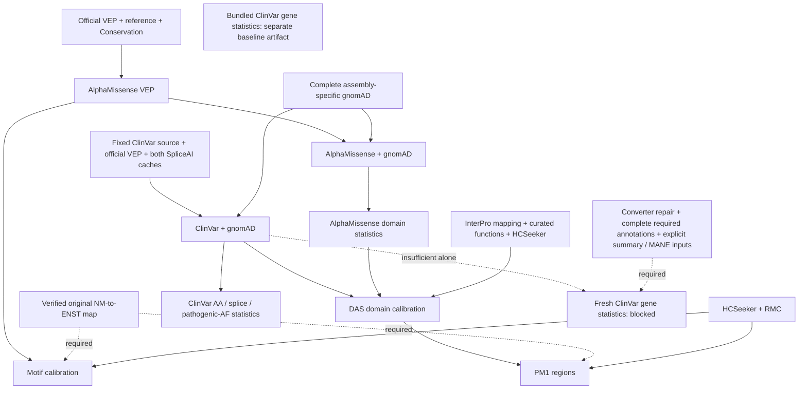

**PriVA installation dependency ledger — frozen scientific source `09223ef`**

This audit identifies which cache-building steps can proceed without PrimateAI, and which require additional inputs or a reviewed implementation repair. It preserves the original scientific order and defaults. **Bundled baseline ClinVar statistics and freshly regenerated statistics are separate provenance claims:** finding a defect in the fresh-build path does not establish that the existing bundled cache is invalid.

Arrows below mean “must be ready before.” Dashed arrows mark unresolved prerequisites; they do not authorize omitting an annotation.



PrimateAI is not consumed by the steps above. Its absence still blocks full-family annotation and acceptance; this ledger proposes no missing-resource policy. ClinVar basic VEP uses SpliceAI, not PrimateAI ([frozen call, lines 1476–1484][clinvar-install]; [basic VEP, lines 1375–1412][basic-vep]).

**Source identity and navigation.** Scientific statements use commit `09223ef5a8b0ceb4c6d61055c6eefe62b51ba903`. The deployment installer examined is `054b4944055054148005016192647a8ed0384eef`; its mapping calls still omit the explicit option ([motif, line 1034][fixed-motif]; [PM1, line 1138][fixed-pm1]). Those two remote links use the byte-identical integrated installer at `f1f628bd0d38397ae421060e26a061bae900f2de`; its SHA256 matches the deployment installer below. Current-tree navigation: [installer](../scripts/install_utils.sh#L1034), [motif parser](../scripts/am_pick_missense_constrained_segments.py#L433), [PM1 parser](../scripts/prepare_pm1_regions.py#L43), [ClinVar generator](../scripts/clinvar_stat_variants.py#L304). These moving links are navigation only; frozen links and hashes below govern the audit.

**Ordered recipe.** `INSTALL` means the reviewed installer script, `SOURCE` the frozen scientific source directory, and `CFG` the qualified hg19 installation configuration. Commands are entrypoint specifications, not a record that these steps ran. Check cache identities, assembly, required fields and complete indexes before using existence/mtime-based reuse guards.

| Order | Entrypoint and required inputs | Dependency or qualification gate |
|---|---|---|
| 1 | `bash "$INSTALL" AlphaMissense_anno "$CFG"` | Official merged VEP cache, reference, plugins, AlphaMissense source and Conservation. Original annotation is independent of PrimateAI and SpliceAI ([lines 947–984][am-anno]). |
| 2a | Original motif Python, with the explicit mapping argument shown below | After AlphaMissense VEP; HCSeeker, RMC and qualified NM→ENST mapping. Preserve original defaults and row/operation order. |
| 2b | `bash "$INSTALL" AlphaMissense_anno_gnomAD "$CFG"` → `bash "$INSTALL" AlphaMissense_stat "$CFG"` | Wait for all required gnomAD chromosome files, not only the configured chrX locator. Annotation precedes statistics ([line 1823][am-gnomad], [line 1024][am-stat]); missing AF otherwise becomes `0.0` ([statistics lines 158–162][am-af-default]). |
| 3 | Fixed ClinVar input → original contig conversion → `basic_vep_annotation -i INPUT -a hg19 -r REF -c VEP_CACHE -t THREADS -p PLUGINS -s SPLICEAI_SNV -d SPLICEAI_INDEL` → `anno_agg_gnomAD_data VEP_VCF THREADS hg19 GNOMAD_CHRX` | The original sequence is at [lines 1471–1493][clinvar-install]. Both SpliceAI caches and indexes must be ready. `ClinVar_VCF_deploy "$CFG"` additionally fetches rolling NCBI URLs with `wget -O`; do not let it replace an already frozen input without an explicit provenance decision. |
| 4 | `bash "$INSTALL" ClinVar_AA_stat "$CFG"`; `bash "$INSTALL" ClinVar_patho_AF_stat "$CFG"` | Use completed ClinVar CSQ + SpliceAI + gnomAD annotations. These independent statistics functions are at [lines 1522–1569][clinvar-stats]. |
| 5 | Qualify InterPro assets → `bash "$INSTALL" AlphaMissense_pick_intolerant_domains "$CFG"` | Requires AM domain statistics, AM VEP, HCSeeker and ClinVar to retain all intended filters. The Python script reads source-relative `data/InterPro/Interpro_entry_mapping.pkl.gz` and `curated_InterPro_func_domains.tsv.gz`, regardless of an unrelated configured directory ([lines 1391–1395][interpro-paths]). `InterPro_parsing` can regenerate the mapping from XML and AM VEP, but its source/output paths and XML identity must be qualified first ([line 1620][interpro-install]). |
| 6 | Original PM1 Python with explicit mapping, shown below | Completed DAS results + HCSeeker + RMC + mapping. `--skip_das` loads existing DAS results; it does not omit that evidence ([lines 273–281][pm1-load]). |
| Held | `ClinVar_Gene_stat` fresh regeneration | Basic ClinVar annotation alone does not satisfy the original generator. See the bounded defects below. |

Do not call the monolithic installer to perform this bounded continuation. The checkpoint decision held AlphaMissense deployment job **1514589** before the unresolved mapping dependency; the coordinator requested the original mapping table. This is a recorded decision, not a live scheduler-status report.

**The NM→ENST contract.** Both consumers use positions, not validated header names. The expected TSV has a header and at least these five columns in this order:

| Column | Intended content | Use |
|---|---|---|
| 1 | Gene stable ID | Ignored by these mapping parsers |
| 2 | Transcript stable ID | ENST target identifier |
| 3 | HGNC symbol | Ignored here |
| 4 | UniProtKB/Swiss-Prot ID | Ignored here |
| 5 | RefSeq mRNA ID | NM source identifier |

| Consumer | Exact version/duplicate behavior | Consequence for qualification |
|---|---|---|
| Motif: [lines 433–449][motif-map] | `pandas.read_csv(..., sep="\t")`; drops null NM, keeps `NM_` prefix; preserves raw NM/ENST strings and duplicate mappings. | HCSeeker lookup strips the NM version ([lines 475–481][motif-lookup]); a table key `NM_123.4` therefore does not match lookup `NM_123`. The docstring says unversioned, but the parser does not normalize it. |
| PM1: [lines 43–77][pm1-map] | Plain-text `open`; skips header; strips field whitespace and NM version; deduplicates ENST per NM. ENST versions are preserved. | Do not replace this with motif behavior or assume gzip input works for both. |

Neither parser pins an Ensembl release. Qualify the original table's provenance/hash, NM lookup coverage and ENST compatibility with the actual AM VEP input. Do not silently normalize the scientific parser. Both default to the old outside-root `refseq_ensembl_convert_table.txt` path ([motif default, line 1148][motif-default]; [PM1 default, line 33][pm1-default]); only the path literals were inspected.

```bash
# Preserve all other original defaults. Values below are qualified explicit inputs.
python "$SOURCE/scripts/am_pick_missense_constrained_segments.py" \
  --vcf_path "$AM_VEP_VCF" \
  --rmc_tsv "$SOURCE/data/gnomAD_RMC/gnomad_v2.1.1_rmc_flat.hg19.tsv" \
  --hcseeker_tsv "$SOURCE/data/HCSeeker/HC_spots.hg19.tsv" \
  --output "$MOTIF_PKL" --processes "$THREADS" --nm_to_enst_tsv "$VERIFIED_MAPPING"

python "$SOURCE/scripts/prepare_pm1_regions.py" \
  --config "$CFG" --output "$PM1_PKL" --assembly hg19 --threads "$THREADS" \
  --skip_das --nm_to_enst_tsv "$VERIFIED_MAPPING"
```

No suitable mapping TSV was found in the approved roots searched: `yangyxt/caches`, `yangyxt/projects/PriVA_upgrade`, and `data/` under `git_repos/{PriVA,PriVA-wt-install}` and `softwares/priva-reference-09223ef`. This is a bounded search, not a claim that the table exists nowhere. Bundled `MANE.GRCh38.v1.4.summary.txt.gz` is not a drop-in substitute: columns 2/5 are Ensembl gene/name, and MANE-only coverage has not been shown equivalent to the original table. No outside-root file or symlink target was read.

**Fresh ClinVar gene-statistics defects versus the bundled baseline.**

| Path | Verified behavior | What this establishes |
|---|---|---|
| Reuse bundled baseline | `ClinVar_Gene_stat` constructs `DATA_DIR/ClinVar/basename(configured_path)` and skips on existence, without checking its input provenance; regeneration then hardcodes `clinvar_2star_stats.pkl.gz` ([lines 1500–1507][gene-install]). | The Git-tracked baseline artifact exists, but this guard does not prove it was regenerated from the newly installed ClinVar. Its historical scientific validity is not disproved by the fresh-build defects. Reuse must be recorded as reuse with its identity. |
| Fresh conversion | The generator calls `convert_vcf_to_tab(vcf, threads)` with default dictionaries ([line 307][gene-main]). The converter requires `CLNCSQ` and calls `.get` on default `cadd_phred_dict=None` ([lines 582, 596, 604][converter]). | Basic CSQ + SpliceAI + gnomAD is insufficient; adding a fake header or silently substituting missing annotations would not be a faithful repair. |
| Fresh gene computation | Direct column access requires `SpliceVault_SpliceAI_delta`, `SpliceVault_top_events`, `LoF`, `NMD`, and SpliceAI donor-loss score ([lines 245–258][gene-fields]). | Basic VEP does not emit all these annotations. Their sources and the conversion interface require a separate reviewed integration. |
| Fresh transcript assignment | The generator calls the default ClinVar summary/MANE loader ([line 311][gene-main]), whose two paths point outside this workspace and whose summary selection uses GRCh38 ([lines 21–28][gene-defaults]). | Explicit qualified inputs and faithful treatment of this original assembly logic are required. The outside data were not accessed. |

Additional omission guards: basic VEP continues without SpliceAI if either cache is absent ([lines 1375–1379][basic-vep]); its reuse guard checks only CSQ and mtime. ClinVar reuse checks CSQ and AF headers, not SpliceAI completion. Domain calibration skips coldspot or benign-ClinVar filters when inputs are absent ([lines 1071–1084][domain-filters]); its metadata cache is existence-based ([line 1403][interpro-paths]). Whole-cache absence must not be treated as ordinary per-variant missingness.

**Exact bytes audited.** SHA256 values below are calculated from Git blobs, not later working-tree edits. All rows use scientific `09223ef` except the explicitly labelled deployment installer.

| File | SHA256 |
|---|---|
| `scripts/install_utils.sh` | `7e4c5e6fa3617d0b74fd5428e7cf0b8e731bd9018de89bdeb6242b7f6972cc7f` |
| `scripts/install_utils.sh` at `054b494` | `80107edcc5ec845e591a87957e230fa586c2a480746c904cac3d4a84e209a81f` |
| `scripts/annotation_vcf.sh` | `6b7ad6fd8eb118841cf36819193f7ce2ee14363432c66f0da75d7788c2d8d280` |
| `scripts/am_pick_missense_constrained_segments.py` | `279b376f2a2b3e669852d8bc72b9934efc919b9b940e1371e76cc136060e5e33` |
| `scripts/prepare_pm1_regions.py` | `44e1c0f6a76ad41c288aab78acac5a72a31c92cc67ffc6f535a9fc5bd7df4312` |
| `scripts/am_pick_intolerant_domains.py` | `97f9ddadba57007fe306435d5cff46abad6cd7eabf1fc97804be900e98cf8bff` |
| `scripts/stat_protein_domain_amscores.py` | `cc7b2d60665e8052e6362107e359cc133e31c398f243589ee63ad7e8f90341c4` |
| `scripts/stat_aachange_clinvar.py` | `72d1e49e318243a9235ffc16b28403cec482de689c5d7304767bfa3ac708f858` |
| `scripts/stat_gene_patho_afs.py` | `0e9dce6d1cd9e193e1549b74ec3ccf83786342c51e80536c050aab816b9710bb` |
| `scripts/stat_exon_patho_afs.py` | `0d41450c7522fd9367d0ccef99c715ff7f1143e95b964a41e17c3cbcdb4940ab` |
| `scripts/clinvar_stat_variants.py` | `b451552c7957295e981612ce66cc99a59b8bace7dce7e167c83289c578881288` |
| `scripts/combine_annotations.py` | `327ca5dca83b9a0262ee9841cf52320c7ef299e25527b1bcf02562c55dca0a5e` |
| `data/ClinVar/clinvar_2star_stats.pkl.gz` (12,723,297 bytes) | `d0dccebb3643b477581e6c93ed6ef2d0db244b749c5e6d7b975205ae1984b13c` |

This ledger records a source audit and installation gates. It changes no scientific code, cache, configuration or job, and claims no family-level acceptance result.

[clinvar-install]: https://github.com/yangyxt/PriVA/blob/09223ef5a8b0ceb4c6d61055c6eefe62b51ba903/scripts/install_utils.sh#L1463
[basic-vep]: https://github.com/yangyxt/PriVA/blob/09223ef5a8b0ceb4c6d61055c6eefe62b51ba903/scripts/install_utils.sh#L1368
[fixed-motif]: https://github.com/yangyxt/PriVA/blob/f1f628bd0d38397ae421060e26a061bae900f2de/scripts/install_utils.sh#L1034
[fixed-pm1]: https://github.com/yangyxt/PriVA/blob/f1f628bd0d38397ae421060e26a061bae900f2de/scripts/install_utils.sh#L1138
[am-anno]: https://github.com/yangyxt/PriVA/blob/09223ef5a8b0ceb4c6d61055c6eefe62b51ba903/scripts/install_utils.sh#L947
[am-gnomad]: https://github.com/yangyxt/PriVA/blob/09223ef5a8b0ceb4c6d61055c6eefe62b51ba903/scripts/install_utils.sh#L1823
[am-stat]: https://github.com/yangyxt/PriVA/blob/09223ef5a8b0ceb4c6d61055c6eefe62b51ba903/scripts/install_utils.sh#L1024
[am-af-default]: https://github.com/yangyxt/PriVA/blob/09223ef5a8b0ceb4c6d61055c6eefe62b51ba903/scripts/stat_protein_domain_amscores.py#L158
[clinvar-stats]: https://github.com/yangyxt/PriVA/blob/09223ef5a8b0ceb4c6d61055c6eefe62b51ba903/scripts/install_utils.sh#L1522
[interpro-paths]: https://github.com/yangyxt/PriVA/blob/09223ef5a8b0ceb4c6d61055c6eefe62b51ba903/scripts/am_pick_intolerant_domains.py#L1391
[interpro-install]: https://github.com/yangyxt/PriVA/blob/09223ef5a8b0ceb4c6d61055c6eefe62b51ba903/scripts/install_utils.sh#L1620
[pm1-load]: https://github.com/yangyxt/PriVA/blob/09223ef5a8b0ceb4c6d61055c6eefe62b51ba903/scripts/prepare_pm1_regions.py#L273
[motif-map]: https://github.com/yangyxt/PriVA/blob/09223ef5a8b0ceb4c6d61055c6eefe62b51ba903/scripts/am_pick_missense_constrained_segments.py#L433
[motif-lookup]: https://github.com/yangyxt/PriVA/blob/09223ef5a8b0ceb4c6d61055c6eefe62b51ba903/scripts/am_pick_missense_constrained_segments.py#L475
[pm1-map]: https://github.com/yangyxt/PriVA/blob/09223ef5a8b0ceb4c6d61055c6eefe62b51ba903/scripts/prepare_pm1_regions.py#L43
[motif-default]: https://github.com/yangyxt/PriVA/blob/09223ef5a8b0ceb4c6d61055c6eefe62b51ba903/scripts/am_pick_missense_constrained_segments.py#L1148
[pm1-default]: https://github.com/yangyxt/PriVA/blob/09223ef5a8b0ceb4c6d61055c6eefe62b51ba903/scripts/prepare_pm1_regions.py#L33
[gene-install]: https://github.com/yangyxt/PriVA/blob/09223ef5a8b0ceb4c6d61055c6eefe62b51ba903/scripts/install_utils.sh#L1500
[gene-main]: https://github.com/yangyxt/PriVA/blob/09223ef5a8b0ceb4c6d61055c6eefe62b51ba903/scripts/clinvar_stat_variants.py#L304
[converter]: https://github.com/yangyxt/PriVA/blob/09223ef5a8b0ceb4c6d61055c6eefe62b51ba903/scripts/combine_annotations.py#L577
[gene-fields]: https://github.com/yangyxt/PriVA/blob/09223ef5a8b0ceb4c6d61055c6eefe62b51ba903/scripts/clinvar_stat_variants.py#L245
[gene-defaults]: https://github.com/yangyxt/PriVA/blob/09223ef5a8b0ceb4c6d61055c6eefe62b51ba903/scripts/clinvar_stat_variants.py#L21
[domain-filters]: https://github.com/yangyxt/PriVA/blob/09223ef5a8b0ceb4c6d61055c6eefe62b51ba903/scripts/install_utils.sh#L1071
