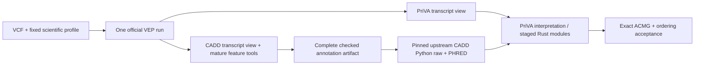

# Nextflow and Rust migration

The target combines one official VEP annotation pass, complete CADD feature
enrichment and the original CADD Python scoring path. PriVA-owned functions move
to one Rust/Polars binary under exact source-order contracts. Shell adapters and
mature scientific tools remain in use.



The current compatibility workflow remains gated for raw annotation. A tested
stub route is not a complete production shared-VEP adapter. Do not activate it
until resource, transcript-selection, model and acceptance gates pass.

## Optional read-only task profile

`Nextflow stages inputs → task_readonly shell → read-only host/cache view + writable task directory → Nextflow publishes outputs`

Add `task_readonly` to the `local` or `slurm` profile list on a Linux host with
working Bubblewrap. The selected profile participates in the run identity, so
changing it cannot silently reuse the same output directory. Staged inputs use
symlinks; pre-existing hard-linked files and special files in the writable task
directory are rejected. Task-local temporary/cache directories remain writable;
shared resources, source, HOME and package/model paths remain read-only. The
child has no network access. A denied write fails explicitly.

Job1524526 completed0:0 on24October2026 CT:35 adapter/boundary tests, actual
filesystem write-denial checks, exact exit-code propagation, raw/resume/annotated
stubs and profile-change rejection passed. Five published synthetic payloads
matched the default profile byte for byte; all four resume tasks were cached.
Failed1524525 is retained: a redundant parameter default disagreed with the
selected profile; identity now derives directly from that profile. No extra
user parameter is needed. Combined Apptainer execution, real scientific/model
tasks, family acceptance and public-data acceptance remain unqualified. The
existing raw-annotation gate remains in place.

Source is here in `bin/priva_task_boundary.py` and `conf/task_readonly.config`.
The maintained run/collect controller is
`/stornext/snfs170/next-gen/scratch/yangyxt/projects/PriVA_upgrade/scripts/nextflow_readonly_check_20261024.py`;
closed synthetic runtime/log evidence is under
`/stornext/snfs170/next-gen/scratch/yangyxt_dt/projects/PriVA_upgrade/validation/nextflow-readonly-check-20261024-v{1,2}/`
and the matching data-side `logs/nextflow-readonly-check-*` files.

<a id="spliceai2-preparation"></a>

## SpliceAI2 GRCh38 preparation and manifest

This route prepares an annotation-only view for the retained official SpliceAI
VEP plugin. It preserves the native 84-column tables and emits top0 scores with
adapter-derived gene context. It does not activate PriVA ACMG interpretation or
replace CADD’s legacy masked-v1 features. GRCh37/hg19 keeps the original v1 route.

```text
Assembly selected once → fresh GRCh37 v1 / GRCh38 v2
                              ↓ decompressed-header detection
Compatible VCF ─────── passthrough ──────────────────────────┐
Native84 TSV + verified GENCODE48 context → narrow adapter ──┤
                                                           ↓
                           indexed VCF pair → two original YAML keys
                                      sidecars + actual cache headers
                                                           ↓
                                     separate scientific acceptance
```

Current installation direction: keep only the original spliceai_snv_prescore and spliceai_indel_prescore YAML keys. Choose assembly once at installation: fresh GRCh37 uses v1 and fresh GRCh38 uses v2. Inspect decompressed headers automatically: an existing compatible VCF passes through; native 84-column SpliceAI2 TSV invokes the narrow adapter. A prepared pair is registered under the two original keys and installation succeeds. Resource/model identity, hashes, schema and qualification remain in sidecars and cache headers, without extra selector or converter YAML switches. Existing compatible GRCh38 v1 VCF pairs pass through; fresh GRCh38 installations select v2. Wrong assembly, mixed input types and failed v2 preparation never trigger a fallback.

```yaml
# Existing PriVA resource keys; point to the installed, indexed VCF pair.
spliceai_snv_prescore: /absolute/SpliceAI/snv.vcf.gz
spliceai_indel_prescore: /absolute/SpliceAI/indel.vcf.gz
```

Run preparation inside a suitable Slurm allocation. The adapter retains the
pinned converter and mature gzip/bgzip/tabix tools; source tables remain intact.
SpliceAI_install invokes scripts/spliceai_cache_input.py install automatically, retaining the existing prompts and two resource keys. The helper detects gzip by magic bytes, then classifies a bounded decompressed header as vcf_v1, vcf_spliceai2 or the exact native 84-column SpliceAI2 TSV schema; filenames, extensions and score magnitudes do not select the predictor. An unmarked VCF receives the legacy-compatible vcf_v1 routing label; that label alone does not prove predictor identity. Existing compatible VCF pairs pass through, including existing GRCh38 v1; fresh GRCh38 selects v2. Wrong assembly, mixed types or failing v2 preparation fail without fallback. SpliceAI2 VCF passthrough additionally requires a completed adjacent adapter.ready.json with exact SNV/indel/index membership and complete published-catalogue status. This checks completed-publication metadata and recorded membership, not a new full VCF/index-body checksum; it performs no conversion. Reject .partial or .building path components, including symlink targets, and refuse in-progress preparation or staged outputs. A final VCF renamed before receipt publication is not ready. V1 VCF passthrough requires no additional adapter receipt.

```bash
python scripts/spliceai_cache_input.py install --config CONFIG --cache-dir CACHE_DIR --snv SNV --indel INDEL
```

For native TSV, the helper discovers the fixed adjacent SpliceAI2_GRCh38.downloads-complete.json sidecar. The selected SNV/indel inputs must match their manifest roles and the full 47-shard catalogue. The existing low-level SpliceAI2_install preparation/reuse path performs full checksum verification and prepares or reuses a validated receipt, then updates only spliceai_snv_prescore and spliceai_indel_prescore. The installation driver builds/reuses the standalone scripts/spliceai2_converter.rs tool; no production priva executable or extra YAML option is required. Provenance and scientific qualification remain in sidecars/cache headers. The fixed adjacent sidecar is published at yangyxt/caches/SpliceAI2_GRCh38.downloads-complete.json, SHA256 fbc6c9fcd1859d6f1605f9343d5659b8420d7397c4152da19daab34c6194e49d. Historical conversion used the PATH entry yangyxt/softwares/bin/priva and the optimized225aa4a converter; new preparation records the separate installation tool identity. This changes no YAML keys beyond the original two paths.

Two-key interface qualification: code 35779c4578509ce01218a052a8e7e1d8a785a75b passed 239 Python tests, zero failures/errors/skips, in 190.848 seconds: 39 helper, 25 installer, 14 runtime-guard, 21 Nextflow-adapter and 140 existing deployment/driver/BGZ tests. The installer-shell cases mock the helper boundary; they are not real conversion evidence. Log: yangyxt_dt/projects/PriVA_upgrade/logs/spliceai-two-key-integration-20261016.log. This supersedes the earlier 197-test interface checkpoint without adding its count; unchanged Rust evidence remains 41 tests and the earlier real-projection evidence remains 512 unique rows.

Actual resource checks used final helper SHA256 f69d6ea8d6179d68ae44cad849b3c6c7912a879f05e305a36acffba09c81bb88: all 47 native TSV and four v1 VCF headers classified correctly, including assembly metadata. Real SpliceAI_install reused the existing v1 pair for hg19/GRCh37 and hg38/GRCh38 with configuration bytes, inode and mtime unchanged and resource stat identities unchanged. Receipt: yangyxt_dt/projects/PriVA_upgrade/validation/spliceai-two-key-real-install-20261016/receipt.json. These are bounded header/reuse checks, not new body checksums, full VEP execution or model/scientific qualification.

Nextflow stub verification passed all four scenarios: raw input, resume with all four tasks cached, preannotated input and stale-environment rejection. Log: yangyxt_dt/projects/PriVA_upgrade/logs/spliceai-two-key-nextflow-20261016.log; retained validation/log artifacts: validation/spliceai-two-key-nextflow-20261016/ under that data project. The run used code 35779c4 plus the documentation state at execution; its recorded source_digest identifies that exact state. Subsequent documentation edits are not attributed to the run.

Frozen-run boundary: job 1514732 continues unchanged with installer f8de4b3 and the previously verified converter. Its prior explicit-manifest/six-key interface is historical execution provenance, not the new installation contract. After successful completion, validated output artifacts may be imported through the two original keys; do not attribute those artifacts or the 197 Python tests to the new dispatcher. The new two-key interface is qualified separately at 35779c4; full scientific acceptance remains pending.

The frozen preparation sidecar records these fields; this is provenance metadata,
not a new set of user-facing YAML options:

| Field | Required type/value |
| --- | --- |
| `schema_version` | Integer `1` |
| `resource`, `version`, `assembly` | Strings `SpliceAI2`, `2.0`, `GRCh38` |
| `source_revision` | `cd1b8b82bcef9c97ac3b3b9a24f0de3a5bbf77f9` |
| `status`, `confirmed_by` | `downloads_complete`; nonempty owner confirmation string |
| `files` | Array of 47 unique shard objects; each has `kind` (`snv` or `indel`), `chrom`, absolute `path`, positive integer `bytes`, lowercase 64-hex `sha256` |
| `scored_regions` | Object with absolute `path`, positive integer `bytes`, lowercase 64-hex `sha256` |
| `gencode_gtf` | Same file identity object, plus `release: GENCODE48` |
| `vep_spliceai_plugin` | Same file identity object, with pinned plugin SHA256 below |

All 24 SNV chromosomes (`chr1`–`chr22`, `chrX`, `chrY`) and 23 indel chromosomes
(the same set without `chrY`) are mandatory for full preparation. Source basenames
are exactly `SpliceAI2_GRCh38_{snv,indel}_chr*.tsv.gz`. Partial names/targets,
downloading inventories, missing/extra/duplicate shards and wrong hashes fail.
The scored-region parser requires exactly
`gene_id,chrom,gene_start,gene_end,strand` as tab-separated columns; the complete
real publisher table has now passed the exact interval qualification below.

Match each publisher stable gene ID uniquely to the exact GENCODE v48 gene feature, requiring identical contig, bounds, strand and protein-coding biotype. Only the numeric version in ENSG IDs is removed for lookup; preserve any _PAR_Y suffix and retain the full versioned GTF ID in the context. Reject aliases, ambiguous versions and mismatches. One coordinate convention must match every region; the complete real table is verified as 1-based closed.

The declared GTF grammar is `(ENSG[0-9]{11})\.[0-9]+(_PAR_Y)?`; for
example, `ENSG00000123456.7_PAR_Y` maps to stable key
`ENSG00000123456_PAR_Y`, while retaining the full versioned ID. Exact-ID
matches are also accepted. This is not gene-symbol aliasing.

Join each source POS and model strand to every containing verified gene. Retain all gene IDs and intervals; coalesce only same-chromosome, same-strand context labels to one VCF line per distinct symbol per native prediction, in lexical symbol order. Never merge or omit source prediction rows. Reject opposite-strand same-symbol contexts, unmapped records and duplicate variant+strand inputs. POS containment does not imply that the whole deletion span or predicted splice sites lie inside the gene. Cross-chromosome symbols do not collide in plugin lookup.
GENCODE documents [version and PAR identifiers](https://www.gencodegenes.org/pages/data_format.html).

Rust validates every native column and streams ascending positions. It attaches
each source POS/model strand to all containing verified genes, emits symbols in
lexical order, and preserves source POS/REF/ALT and selected numerical strings.
The projected INFO contains only one `SpliceAI=ALT|SYMBOL|eight-values` entry per
VCF line, ordered AG/AL/DG/DL scores then AG/AL/DG/DL distances. It does not apply
masking, normalization, strand flipping, cutoffs or score recalculation. The
native top3/junction/reference/alternate/summary fields remain in the originals.
Ref/alt probabilities are checked in [0,1], directional deltas in [-1,1]; this
retains the original signed top-k calculation and literal `-0.0` values.

The pinned model takes sequence, strand and allele lengths, not gene identity.
The attached gene label is derived context, not gene-conditioned inference; a
predicted splice site may lie outside the containing gene. V2 metadata thresholds
0.1/0.25/0.5 are not ACMG evidence strengths. Missing coverage is not zero and does
not trigger a v1 fallback.

Verified GTF acquisition: job **1514725** completed successfully. File
`/stornext/snfs170/next-gen/scratch/yangyxt/caches/gene_annotations/gencode.v48.annotation.gtf.gz`
is **58,971,717 bytes**, SHA256
`37a298c2b57e41988cfe12667134106523c69c24a1807347679d19e88aa1f4a9`.
Publisher MD5 `3eb94f7f200b42eb85d56b3afae5b0e7`, gzip integrity and release/header
checks passed. Resource receipt:
`yangyxt_dt/projects/PriVA_upgrade/deployment/spliceai2-gencode48.ready.json`.
Download job 1514724 completed with exit 0 in 36m59s: all 47 final score shards are present and no partial files remain. The complete 20,083-row scored-region table passed a separate exact GENCODE48 metadata check under Slurm: 20,083 unique stable-ID mappings, 1-based-closed coordinates, ten same-strand duplicate-symbol groups and zero ID/bounds/strand/biotype mismatches. All versioned gene IDs remain in the context. The 840,490-byte region file has SHA256 293d2b45ac19778fb907aaa3cb8bfc7c10f518855c5096d36f9061b413109d76 and also matches pinned publisher Git blob 6d293e9e2f694f33115ce94bf18b786d6dcb8d5f. Closed metadata evidence is under yangyxt_dt/projects/PriVA_upgrade/validation/spliceai2-real-context-20261015/. The complete execution manifest is constructed and saved in DataLad commit 5f5946b. Frozen job 1514732 has passed all 47 full source SHA256 checks. At the bounded 2026-10-16 ~08:45Z scheduler/log check it was RUNNING on c81o-03 and its log had reached SNV chr4. Complete score conversion and real indexed-VEP qualification remain pending; source verification is not scientific readiness.

The earlier anonymous publisher inventory is retained at yangyxt_dt/projects/PriVA_upgrade/deployment/spliceai2-publisher-inventory-cd1b8b8.json: 47 shards total 348,102,852,751 bytes, with content hashes redacted in that API response. The checksum handoff is now resolved: caches/README.md records all 47 expected SHA256 values recovered from authenticated raw Git-LFS pointer metadata at the pinned dataset revision, plus complete VERIFIED acquisition receipts. Every full download matched the expected bytes/hash before its final rename. Content SHA256 values are distinct from Git pointer-blob OIDs. Frozen job 1514732 has now passed full source SHA256 revalidation; completed conversion remains a separate pending result. The publisher gene-table construction code was not available in the inspected source, so stable-ID matching is an explicit validated adapter rule, not a claim about the publisher’s stripping algorithm.
Sources: [GENCODE v48](https://www.gencodegenes.org/human/release_48.html),
[publisher MD5 inventory](https://ftp.ebi.ac.uk/pub/databases/gencode/Gencode_human/release_48/MD5SUMS).

The installed official plugin is release113 commit
`10054085053745b62ab20129f13cd02f06f7e183`, SHA256
`500a534c403bcbcc15753718768f0a1f352cc6b93f9119e5eba25745f7205b9a`.
The separately inspected SpliceAI2 source is commit
`1dcd2a1882a8223095e7529982ae70bcb658340a`; it is not established as the code
revision that produced the pinned dataset. Original and derived score resources
retain [Illumina's terms](https://github.com/Illumina/SpliceAI2/blob/1dcd2a1882a8223095e7529982ae70bcb658340a/LICENSE),
including redistribution/public-tool restrictions; this route does not publish
resources or enable a public lookup service.

Successful full preparation publishes
`SpliceAI2_GRCh38.{snv,indel}.vep.vcf.gz{,.tbi}` and
`SpliceAI2_GRCh38.gene_context.tsv`, followed by `adapter.ready.json` last.
The receipt records source/driver/converter/tool identities, row counts, mapping
convention, hashes and `status: prepared_annotation_only`,
`coverage: complete_published`, `scientific_qualified: false`. The latter coverage
means the published catalogue, not every possible indel or genome region.
The simplified registration verifies output/index identities and writes only
`spliceai_snv_prescore` and `spliceai_indel_prescore`. All additional resource and
qualification metadata stays in sidecars/cache headers. The running f8de4b3 job
uses its frozen earlier registration contract; it is not retroactively changed.

For bounded fixtures only, the direct driver accepts `--validation-subset` with
at least one SNV and one indel shard. It emits
`status: validated_subset_annotation_only`, `coverage: validation_subset`;
the full installer rejects this as an installation receipt. It is not a way to
activate an incomplete cache. Converter/source/compression/index failures prevent
a completion receipt; PID-only cancellation behavior is not qualified here.

Frozen pre-simplification qualification: Rust source 225aa4a (integration 32212d7) passed 32 projection plus 9 existing tests. The frozen f8de4b3 Python suite passed 197 tests, zero failures/skips, in 190.847 seconds at f8de4b32beaf3bf5185ef53f75be162833055153: 169 installer/deployment tests (including 25 driver tests), 20 Nextflow adapter tests and 8 BGZ-validator tests. Bash/YAML/diff checks passed. Its log is yangyxt_dt/projects/PriVA_upgrade/logs/spliceai2-final-integration-20261015.log.

Bounded real-cache check: 256 SNV plus 256 indel prefix rows from chr1, all positive-strand, passed an independent column-name-based full-record/order oracle and real bgzip/tabix queries with zero mismatches. Verifier f8de4b3 first checked the debug converter from 225aa4a; receipt: yangyxt_dt/projects/PriVA_upgrade/validation/spliceai2-real-projection-225aa4a-debug/receipt.json. The same 512 source rows were independently rechecked against the installed optimized release with zero mismatches; this remains 512 unique rows, not 1,024. This is real precomputed-row conversion, not model inference, whole-cache coverage, full VEP execution, public-sample or supplied-family acceptance.

Optimized converter installed: source 225aa4aa774b4be7f53576e1cde56af71e67bd2c, executable SHA256 bbc3b7288ed2ea63f1f8455ed87b8a9d08c7bc1fe0a562c1d6134525e2a12dc6, at yangyxt/softwares/priva-tools-225aa4a/bin/priva. Installation checks detected a stale shared Cargo release artifact before deployment; a forced package rebuild and installed smoke check corrected it, and the receipt retains the failed attempt. All 25 driver cases passed again against the installed release. That frozen checkpoint had 197 Python and 41 Rust tests; the separately tested 35779c4 interface had 239 Python tests with the same 41-test Rust evidence. Reruns are not additional cases. Full preparation job 1514732 is running on c81o-03 with 4 CPUs, 16 GB and a seven-day limit. It freezes installer f8de4b3 and the installed optimized converter; the submitted wrapper SHA256 is 3914a77aa9972a1f1a74e48b727fee74af92c9763e2da900fa9e9bc978395263. It writes yangyxt/caches/VEP_plugin_cache/SpliceAI2/GRCh38 using the isolated config yangyxt/softwares/priva-cluster-grch38-spliceai2/config.yaml. The complete execution manifest yangyxt_dt/projects/PriVA_upgrade/deployment/spliceai2-GRCh38.downloads-complete.json and its handoff were saved in DataLad commit 5f5946b before launch. The frozen job passed all 47 full source SHA256 checks; the bounded 2026-10-16 ~08:45Z check confirmed RUNNING and a log through SNV chr4. No complete conversion receipt exists yet. Full conversion and real VEP/scientific acceptance remain pending.

The [official-plugin harness](spliceai2-plugin-audit.md) passed 11 subtests / 38
assertions using real plugin/Ensembl allele matching and synthetic candidates.
Its tabix and light VEP objects are fixtures; no reference, real index or full VEP
execution is exercised. Historical checks before the stable-ID/same-strand-symbol
policy update: Rust source `428ce4c` (integrated as `c432668`) passed
30 projection plus 9 existing tests. The combined Slurm run passed **165 tests**
with zero failures/skips in 85.702 seconds: 119 existing/route, 14 runtime guards,
21 driver and 11 deployment tests. The driver suite uses real Rust, bgzip and
tabix with synthetic scores/context/plugin identity, including full 47-shard
concatenation and CRC/mutation failures. Log
`yangyxt_dt/projects/PriVA_upgrade/logs/spliceai2-install-integration-20261015.log`
records integration `ad9af5d` and exact driver/test content hashes; those
uncommitted-file hashes, not a later checkout, identify the tested driver.
Bash/YAML/diff checks also passed. No completed real 47-shard conversion,
v2 ACMG/CADD activation or supplied-family parity is claimed.

Scientific boundary for the simplified installer: inspect the actual selected cache headers and sidecar provenance to prevent unqualified v2 scientific use, including preannotated import and resume; no new enable/disable YAML toggle is introduced. Successful installation is separate from v2 ACMG/ClinVar, full VEP, public-sample and supplied-family acceptance. Unmarked external annotations still require pinned scientific provenance because predictor version cannot be inferred from numeric values. The runtime guards now inspect actual cache headers at the two original keys, including preannotated launch/task paths; the earlier 35779c4 checkpoint included 21 Nextflow-adapter and 14 runtime-guard tests once in its 239-test total. The later 25 focused PED-adapter tests are separate evidence; the full suite has not been rerun. Earlier f8de4b3 checks remain historical; scientific acceptance is still pending.

## Frozen source and branch

- Branch: `feature/nextflow-rust-migration`.
- Reference commit: `09223ef5a8b0ceb4c6d61055c6eefe62b51ba903`.
- Reference incorporates the eight previously reviewed local changes on top of
  `810e60165a663bd2e1223809af9f32d664a9d543`.
- Development worktree: `/stornext/snfs170/next-gen/scratch/yangyxt/git_repos/PriVA-nextflow`.
- The original `PriVA` checkout keeps its original uncommitted changes.

The branch and worktree serve complementary purposes: the branch records the
migration; the worktree keeps its files separate from the current checkout.
The HTML design is in `projects/PriVA_upgrade/migration_plan.html` under the
approved `yangyxt` root. See [Rust scope and parity](rust-migration.md).

## Current acceptance gate

The supplied GRCh38 trio has been delivered for **input/implementation testing**;
input staging and packet metadata checks are complete.
Delivery is separate from
scientific acceptance. The packet has separate single-sample small-variant VCFs,
not a jointly genotyped family VCF; it does not establish structural-variant validation.

**Delivered packet → intake / input contract → qualified GRCh38 profile → exact comparison.**

The workflow currently accepts **one multi-sample family VCF**; multi-sample import
remains to be implemented and validated. No merge or missing-call imputation has
been performed. A tested genotype-preserving merge can support implementation
parity when missing calls stay unknown and the output is labeled nonjoint. A union
of sample-header IDs is metadata validation only; clinical genotype confidence
remains a separate gate. PED unknown codes remain unknown:
phenotype `0`/`-9` is neither patient (`2`) nor control (`1`), and sex `0` is unknown.
The narrow adapter correction for unknown affection passed 25 focused tests;
eight actual-packet metadata checks also pass. The in-memory union of header IDs
passes PED validation, while every single-sample VCF correctly rejects full-PED
membership. This does not import genotypes or create a merged VCF. The six audited
scientific files remain unchanged from `09223ef`.
Original annotation requires phenotype-1 controls; supply an external control VCF
or separately qualify a `control_vcf_optional` profile choice before that stage.
No control setting has changed. Preserve source behavior, including Y-based sex
inference in phase code and the de novo non-male branch; documented sex remains
a gate for sex-dependent acceptance.

| GRCh38 component | Existing evidence | Gate before scientific use |
| --- | --- | --- |
| Profile, reference and VEP | Official VEP 113.2 is installed; the full local profile and merged cache are hg19/GRCh37. A GENCODE50 primary FASTA exists separately. | Qualify the input-reference relationship, GRCh38 FASTA/index and merged VEP cache; create a locked GRCh38 scientific profile. Do not select the GENCODE50 FASTA or hg19 cache by assembly label alone. |
| Splicing | All 47 SpliceAI2 v2.0 shards are acquired. Preparation 1514732 was RUNNING on c81o-03 at the 09:06Z scheduler check; no final adapter receipt exists. GENCODE48 readiness covers the GTF only. | Finish conversion/index publication, then real VEP and v2 scientific/threshold qualification. Retained hg38 v1 originals do not authorize a fallback; CADD legacy masked-v1 features remain separate. |
| Other plugin resources | UTRannotator hg38 table and SpliceVault GRCh38 source exist; SpliceVault has no tabix index. PrimateAI hg38 original exists without its formatted/indexed view. | Prepare/verify matching-assembly lookup views and missing AlphaMissense, Conservation, LOFTEE, pext and Ensembl CDS/peptide resources. |
| Population and derived caches | gnomAD v4.1 GRCh38 source/index receipt lists all 48 files; bounded filename/size checks matched 876,878,719,126 bytes. | Qualify profile use and complete ClinVar/AlphaMissense/domain/PM1 calibration. Original NM-to-ENST mapping remains unresolved; AlphaMissense 1514589 stays held. Bundled baseline statistics are separate provenance. |
| Complete CADD annotation | GRCh38 annotation archive and prescore pairs are absent locally; the shared-VEP113 transcript choice and 151-column feature contract remain unqualified. | Supply the full matching reference, feature tracks and ESM/RegSeq/MMSplice assets, then qualify shared annotation. GRCh37 completed receipts do not qualify GRCh38. |
| CADD calculation | Upstream v1.7.2 source includes GRCh38 v1.7 imputation/model/PHRED assets; 18-row completed-annotation calculation fixtures match original Python. | This is calculation-only evidence, not family annotation or acceptance. Keep standalone `4194be3`, original Python and the disabled experimental backend; existing failure gates remain open. |

This readiness audit used plans/configuration, declared receipts and bounded
host metadata in allocation 1514363 through **2026-10-16T09:07Z**, without a new
resource-body checksum or annotation run. The full deployed configuration remains
hg19; the separate GRCh38 configuration prepares SpliceAI2 only. Official VEP is
113.2, with plugins pinned at `10054085053745b62ab20129f13cd02f06f7e183`.
CADD source v1.7.2 is `1fead0c1e02d3f0a8599bdb04e6b3a2dd70b4866`; original
Python 2.7.13 / NumPy 1.16.5 / pandas 0.24.2 / scikit-learn 0.20.4 remains selected.
The shared official VEP → complete CADD features → original Python design and
standalone `4194be3` pin are unchanged; the experimental backend remains disabled.
The public 1000 Genomes annotation/scoring benchmark is a separate pending gate.

A historic result qualifies as a reference only when its source, software,
parameters and resource identities are established; otherwise regenerate with
the frozen source after the input/resource gates pass.

Use the same input bytes, phenotype/sex/proband context, original cohort/control
context, resource releases, numerical settings and ClinGen override on both sides.
Select a family after cohort annotation when the original cohort defines control
frequencies. Do not silently reduce the cohort before annotation. An invalid PED
is an error. Transcript multiplicity and tied-row order are part of acceptance.

Compare both final tables using `bin/priva-compare --help`. Required equality
includes `sort_index`, `pext_sort_index` when present, `variant_rank`, variant and
transcript row order, every ACMG criterion/strength, combined judgement and score.
The comparator also checks all other serialized fields; it does not hide numeric
differences behind a tolerance or silently deduplicate records.

## Storage

Code, installation scripts and narrative remain under `yangyxt`. Inputs, outputs,
work files, build products and retained logs are under the project-scoped dataset:

```
/stornext/snfs170/next-gen/scratch/yangyxt_dt/projects/PriVA_upgrade
  inputs/       selected family and provenance
  results/      reference/candidate results and comparison reports
  validation/   synthetic tests, distinct from scientific acceptance
  logs/         completed setup and validation logs
  work/         ignored Nextflow task work, retained for resume
  build/        ignored Rust build products
  tmp/          ignored temporary files
```

Save named completed results with DataLad and attach project/purpose/status
git-annex metadata after all writers finish. Keep Nextflow controller state and
task work together for resume. Neither an output directory nor a Git commit
contains all state needed to resume an interrupted pipeline.

Save/materialize analysis inputs with DataLad before the first production
launch and keep their storage identity stable. Annexing inputs afterwards can
change resolved paths or modification times and invalidate the recorded run
identity. The synthetic resume assertion was made before evidence archival.

Existing reference/cache directories can remain under `yangyxt/caches`; analysis
must not rebuild or alter them. A host-side metadata check through Slurm job
1514363 on 2026-10-15 found only README files
in `caches/{CADD,ClinVar,gnomAD,VEP}` and no `yangyxt_dt/caches`. The repository
config additionally refers to nonexistent `VEP_cache`, `VEP_plugin` and
`VEP_plugin_cache` folders and old `/paedyl01` paths. Those values are not a
deployed resource bundle. Supply the actual cache set before a real run. This
finding applies to these locations, not every possible PriVA installation.
The agent's filename-filtered directory view alone cannot establish missing
genomic data. Run data-facing commands in authorized Slurm jobs with the existing
filter policy intact; the host check is recorded in `logs/cache-path-check.log`.

## Driver installation

`bash scripts/install_utils.sh main_install CONFIG` now calls the pinned driver
bootstrap after manual-cache/configuration/bundled-snapshot preflight and before
reference/resource acquisition. It derives the destination from the existing
`cache_root` key; no extra YAML setting or shell-startup change is required:

```
CACHE_ROOT/runtime/priva-nextflow-25.10.4/bin/nextflow
```

The modular helper is `bash scripts/bootstrap_nextflow_runtime.sh install --prefix
/absolute/runtime-prefix`; `check --prefix` verifies an existing installation.
The main installer resolves an existing root alias after the shared resolver's
lexical normalization; linked runtime/staging children remain refused. YAML is
not rewritten for this resolution.
The old single absolute-prefix invocation remains compatible. It installs official
Nextflow **25.10.4** and Temurin **21.0.12.1+1** for Linux x86_64 with the same pinned
upstream SHA-256 digests. Installation reuses verified complete bytes, retains
interrupted owned downloads for retry, builds privately and publishes the complete
directory. Invalid or unrelated existing files fail with their contents retained.
Rerun the same install command after an interruption; never treat a partial build
as ready. The historical HGSC launcher under
`/stornext/snfs170/next-gen/scratch/yangyxt/softwares/priva-nextflow-25.10.4/`
remains preserved; it is separate from the new config-derived destination.

It selects strict parser v2, a private `NXF_HOME`, and a bounded driver JVM.
This installs the workflow driver only. The legacy scientific environment,
VEP/plugins, CADD and resource deployment require their own verified identity.
The old Dockerfile and unpinned `acmg_conda_rough.yml` are not a reproducibility
lock and have not been used to claim production readiness. Freeze the actual
reference environment before solving or upgrading its scientific dependencies.

See the official [installation documentation](https://docs.seqera.io/nextflow/install).
An offline run must also have all required plugins, environments/images and
resources available. `NXF_OFFLINE=true` alone cannot stop subprocess downloads.

## Execution contract

Run `nextflow run /absolute/PriVA-nextflow --help` for current parameters.
The compatibility workflow accepts BGZF VCF plus index, a proband-first PED,
one selected family, assembly, legacy YAML, resource manifest, software identity
and a new output directory. Preannotated mode also requires the matching CADD
annotation TSV; an arbitrary score-only table is insufficient.

**Current deployment gate:** real raw-VCF annotation is deliberately refused
until the shared-VEP CADD feature path is qualified with enforced read-only
shared resources and fully prepared software. The installed runtime uses the
original upstream Python calculation without Snakemake. Raw stubs test wiring only. The first
real compatibility run can start from the original annotated cohort VCF and
paired CADD TSV when its complete prioritization caches and software are ready.
This gate is an outstanding implementation/deployment step, not evidence that
raw annotation has passed.

Each task owns mutable VCF/index/config/output/temp files. Reference resources
are read from their existing locations. Paths unsafe for the unchanged shell
scripts are rejected. Source content, config and resource identity are explicit
task inputs. Resource metadata inventory is distinct from content verification;
the final family gate needs a frozen, identified cache set.

VCF hub policy must be identical for reference and candidate. The legacy VCF hub
can carry cohort-specific control frequencies, so a hub from another cohort is
not a valid shortcut. Shared hub writes are isolated from the original caches.
Do not switch only one side to a different hub policy and call it orchestration
parity. All output publication is downstream of task success.

The `local` profile is for an existing allocation or a workstation. `slurm` is
for a verified driver that can submit child jobs, with explicit site resources.
The `apptainer` profile needs an already prepared, identified image; it does not
make the current container recipe deployable. `test` is for synthetic wiring.
Use `-stub-run` only for wiring validation, never scientific acceptance.

Launch-time resource checks run even on a fully cached `-resume`. The output
directory records the input/source/resource/settings identity and rejects a
different analysis, avoiding stale published tables. Per-stage provenance and
the validation contract are published alongside uniquely named run reports.
The software ID identifies a caller-supplied frozen environment/image; it is not
an automatic environment lock. Full production software freezing remains part
of the deployment gate.

## Initial validation evidence

On 2026-10-15, validation passed 15 adapter tests, 14 exact-comparator tests,
60 Rust/Python terminal-order comparisons plus five rejected-input cases, and
the 27 retained environment-bootstrap tests. The Rust oracle executed the
terminal sorting block from the frozen scientific source using pandas 3.0.6;
it did not execute or reimplement all upstream scoring/ACMG decisions.

The pinned Nextflow runtime completed raw and preannotated synthetic workflows,
reused all four tasks with `-resume`, preserved an additional cohort sample,
and rejected output reuse with a changed software identity. Successful evidence
is in the data project's `validation/nextflow-integration-v3/{validation,logs}`;
its `work/` tree remains available for resume. These artificial fixtures are
not a real-family test. GitHub Actions later passed the expanded contract, Rust and both Nextflow
stub suites at `56b7762` ([run 38828310089](https://github.com/yangyxt/PriVA/actions/runs/38828310089)).
The integrated source-digest ordering regression was fixed and 16 adapter checks
passed. These CI checks contain no scientific annotation or real-family analysis.

The driver must run in a valid allocation/approved service. On HGSC analysis
nodes, work exceeding any of 2 CPUs, 4 GB or 2 minutes belongs in Slurm. Local
tasks and the JVM share the parent allocation; set process resources to leave
capacity for the driver. A 12 GB or greater CADD task does not fit the current
10 GB interactive allocation and needs its own adequately sized allocation.

## Shared VEP and original CADD calculation

CADD scripts **1.7.2** are pinned at
`1fead0c1e02d3f0a8599bdb04e6b3a2dd70b4866`; the score model is **1.7**.
Production annotation reuses PriVA's official VEP run, then mature upstream
ESM/RegSeq/MMSplice and non-VEP track enrichment produce the complete feature
artifact. Validate assembly, schema, missingness, all required resources, exact
FeatureID joins and order. Qualify CADD's transcript selection without removing
PriVA transcript rows. The separate original-VEP route is a reference-only
qualification tool. Each VEP/model profile's peptide/GTF compatibility requires
evidence; directory names alone cannot establish it.

`cadd.nf -c conf/cadd.config --cadd_mode full|annotate|calculate` exposes separate
stages. See its `--help` and pinned profile templates under `conf/cadd/` for the
implemented contract. Profiles must be configured and qualified; templates do
not constitute installed resources. Calculate-only consumes a completed artifact
and requires no annotation cache installation. The active calculation route uses
the pinned upstream CADD Python stages directly. The former `cadd-rs` experiment
is suspended and is not an installation, execution or migration dependency.

The Python scorer must run all four original stages: transformation,
prediction, consequence hierarchy and PHRED conversion. The previous standalone
pin `79d767a` included native hierarchy/PHRED and is a historical experiment;
tested integration pin `4194be32320292cb8acd290ee0210c19456e2573` runs all four
original Python stages and passes contract tests. Both 18-row upstream assembly fixtures match direct original Python
exactly through features, raw scores, hierarchy and PHRED, including full rows
and order. Both real Nextflow calculation routes and one cached resume pass.
Shared annotation and broad scientific qualification remain pending.
Keep the original numerical libraries, other scientific packages and model
assets pinned. An optimized Python backend must be explicitly selected.

| Qualification | Required evidence |
| --- | --- |
| Profiling | Per-stage and total elapsed/CPU time, peak RSS, inputs/source/environment/resource/profile hashes, fixed CPU/thread limits. Repeat reference and candidate fairly; report setup and warm/cold effects. |
| Measured changes | NumPy/pandas vectorization, batching or independent parallel work only for an observed bottleneck; source operation/mutation order and failure behavior remain fixed. |
| Exactness | Raw and PHRED scores, full FeatureID rows, cell values/order, duplicates, missingness, intermediate numerics and failures; every mismatch reported with no tolerance relaxation. |
| Edges | Empty/header-only, missing features, duplicates, transcript tiers/ties, PHRED boundaries, nonfinite/malformed values, failures and whole-variant chunk boundaries. |
| Public benchmark — pending | Later pin a 1000 Genomes sample or agreed dataset; record assembly, release/accession, hashes, selection, sample/variant/transcript coverage and exclusions. Validate both annotation and scoring. |
| Family — delivered for input tests; scientific gate pending | Qualify the single-VCF/control/metadata contract and GRCh38 profile, then compare exact ACMG criteria, scores and ranking under identical resources. |

Upstream model fixtures qualify calculation only. They do not satisfy public-data
annotation acceptance or family acceptance. Keep failed optimization experiments
and their mismatch reports; retain the unmodified executable reference.

The nonfinite edge suite found one explicit CLI mismatch: original PHRED code
prints a diagnostic into stdout for raw `nan` and exits zero; the standalone
preserves the output bytes but rejects the malformed table and exits one.
This failure-behavior gate remains failed. Compare original and optimized Python
at the same scorer boundary, retaining stdout/stderr, exit/signal and malformed
outputs. Record artifact validation separately; do not call malformed output a
valid score artifact.

<a id="cadd-baseline-profile-1514598"></a>

**Closed baseline profiling — 1514598:** FAILED (1:0), 2 h 21 m 24 s,
ended **2026-10-16T02:51:05Z** (scheduler 2026-10-15T21:51:05-05:00).
Frozen harness `e3b7818ed4362fda089a6928a184e3c4cf6ea894` completed ten reports:
bundled 18-row fixtures for both assemblies and three repeats at 1,008 / 10,008 /
100,008 rows for each assembly. Across 20 assembly evaluations, **80/80 exact
decompressed-feature/raw/hierarchy/final-table comparisons matched**, with zero
table mismatches. All six recorded implementation/runtime identities stayed
unchanged in all ten reports; executable SHA256 remained
`873e9c1ed784b416027a1b209a60d7ad69bdcdb5d34009c3a0a0b6a279ffda6e`.

Four of five PHRED-only synthetic edges passed. The only recorded mismatch is
`nan`: stdout bytes match, original exit 0 becomes wrapper exit 1, and no
completed score artifact exists. The bundled report records acceptance=false;
nine scaled reports record true only for bounded model inputs. The shell saved
the first failure, completed all nine scaled invocations, then exited 1. The
measurements completed; there was no crash, OOM or timeout. Evidence is retained
under the data project's `validation/cadd-original-profile-e3b7818-1514598/` and
`logs/cadd-original-profile_1514598.log`. The tested integration remains the
pinned original-Python backend above. The NaN CLI and experimental PID-only
cancellation gates remain failed, the experimental candidate stays disabled,
and public-data/supplied-family acceptance remains pending. This reconciliation
does not retry or activate a backend.

DataLad commits `9e0600a` and `1c20795` record 781 closed run artifacts, the job
log and data-project README: 783 selected paths, locally available, with metadata
updated. No scorer rerun or result change was needed.

`CaddSelection.pm` delegates selection to official VEP methods and emits native
ordinals while keeping every PriVA transcript row. `cadd_select_view.py` validates
coverage/context before recovering the CADD view. Its 25 Python and 18 native
method fixture checks establish mechanics only. The policy fragment leaves the
CADD transcript source pool unqualified: Ensembl-only needs RefSeq-only overlap
handling; Ensembl plus RefSeq needs compatible peptide/GTF/model coverage. Neither
is activated by default. PriVA's merged cache and `use_transcript_ref` remain
fixed, and their CADD-derived profile requires separate qualification.

## Current cluster build checkpoint

Installed `priva_acmg` software passed import and executable checks after adding
missing VEP Perl helpers. Its readiness receipt and restorable `environment.conda-explicit.txt` lock are
stored in the data project's `deployment/`. The earlier `environment.explicit.txt`
is a historical URL inventory, not a valid restore file. The pinned resource installers under
`scripts/deploy_cluster_*.py` verify content identity, keep partial downloads
inactive and write stage receipts. `scripts/check_cluster_readiness.py` reports
remaining gaps without equating file presence with scientific qualification.

Reference/VEP **1514579 COMPLETED (0:0)** at
**2026-10-16T03:21:30-05:00 = 08:21:30Z**, after **8 h 39 m 49 s**, with
2 CPUs / 8 GB and batch MaxRSS **28,420 KiB**. It used frozen source
`fc2186901029acc88cd41bb004828778c1fd1cb8`, whose deployment Python and manifest
were byte-identical to the audited files. `deployment/{reference,vep}.ready.json`
both record deployed status, job 1514579 and manifest SHA256
`b61cbeb328bceac5b72b8a7f55205976848de58cb988b78c816c38cdb3769b84`.
This run is independent of later CADD recovery source `20774bd`.

```text
1514579 COMPLETED → reference + VEP113 stage receipts → deployment audit passed
                  ↘ AlphaMissense 1514589 held → original NM-to-ENST still needed
Deployed resources → real VEP/plugins + shared-CADD + public/family gates pending
```

The **08:46:04Z** audit passed full archive hashes, pinned publisher checksums, full FASTA SHA256,
all 93 FASTA headers and 279 first/middle/last indexed-base checks. The reference
contains 3,137,161,264 bases. Canonical VEP cache layout has all 6,278 expected
entries across 25 contigs: 3,114 transcript/regulatory bin pairs plus 25
variation/CSI pairs. Sampled checks passed 146 transcript/regulatory gzip chunk
headers and all 25 variation gzip/CSI magic pairs; extracted payloads were not
fully rehashed. Cache metadata identifies GRCh37, release113, GENCODE19 and
RefSeq105.20220307; the frozen manifest pins official VEP113.2. The isolated
config already uses `yangyxt/caches/references/ucsc.hg19.fasta` and
`yangyxt/caches/VEP_cache`; no config edit was needed. Closed-log command and
frozen source provenance were verified, but the submitted wrapper could not be
retrieved. No real VEP/plugin annotation, scientific, public-sample or family
qualification follows from this installation audit. See the
[detailed reference/VEP audit](../../../projects/PriVA_upgrade/README.md#vep-reference-deployment-1514579).

DataLad **80bb1f0** records five selected closed paths under
`yangyxt_dt/projects/PriVA_upgrade/`: its README,
`deployment/{reference,vep}.ready.json`,
`logs/cluster-reference-vep_1514579.log` and
`validation/vep-reference-receipt-verified-1514579.json`.
Four paths were added/updated; the reference receipt was already tracked and
unchanged. Descriptive metadata was recorded for all five and selected paths
are clean. The read-only audit used Slurm allocation 1514363; no active
SpliceAI2/gnomAD artifacts were included in the save.

Approved CADD prescore recovery **1514744 COMPLETED (0:0)** at
**2026-10-16T08:02:48Z**, after **13 m 15 s**, on analysis-cpa1. It used
1 CPU / 2 GB / 2 h on copy; batch MaxRSS was 25,760 KiB. It ran
frozen source `20774bd56a706d8b82a5640bf23b758216544136` under
`yangyxt/softwares/priva-cluster-tools-20774bd`. The GRCh37 v1.7 manifest now
binds Washington's download root and `MD5SUMs` to historical `09223ef` indel MD5
`3d88f8fde9df07060b4f8fe07a0d5d5d` and matching index MD5
`c583ed9f852c9896081205c3523f9f23`. The earlier failed 1514581 and frozen
`fc21869` cross-mirror manifest remain historical evidence.

```text
Existing SNV + index → full MD5 recheck → reused
Completed indel partial → full MD5 → no HTTP → atomic final publication
Matching Washington index → only download + MD5 → deployed ready receipt
1514744 COMPLETED → real SNV/indel indexed access verified on all 24 contigs
```

The 602,910,809,417-byte SNV file, existing SNV index and 11,003,494,781-byte
indel bytes were fully rehashed and reused. The log contains one curl transfer,
for the matching 2,644,685-byte Washington indel index. Only a full MD5 match
skips partial-file HTTP resume; size gates remain active and every existing
final file is rehashed. `deployment/cadd-prescores.ready.json` records deployed
status, job 1514744 and manifest SHA256
`add789be1ce0180fd0d246175c4289f5f4f2989acd8364e8aa0f36b38c0ff59a`.
Bounded real indexed-pair validation passed in Slurm step 1514363.262 at
08:03:30Z with pysam 0.22.1: 24 contigs per SNV/indel pair, matching 135-column
schemas and RawScore/PHRED in one-based columns 134/135. Every contig's first
row and exact-coordinate refetch passed; bounded queries returned 114 SNV and
41 indel rows. Manifest/receipt/data/index stat identities stayed stable,
expected receipt/pins matched and no `.partial` remained. This bounded audit
did not repeat full-body MD5/CRC; recovery supplies the full MD5 evidence.
The main config already uses matching Washington URLs/MD5s and the recovered
`cadd_base_dir`; no config mutation was required. All 20 deployment and
31 licensed-import fixture tests pass. Initial evidence retains 21 failures
from a missing frozen helper; restoring the exact `054b494` helper preserved
the existing expected SHA256. Closed logs use
`logs/cadd-prescore-recovery-tests-20261016{,-final}.log` under the data project
and record the exact tested source hashes. This is installation validation,
separate from the retained original-Python scorer, real VEP/model and family gates.

SpliceVault **1514603 COMPLETED (0:0)** at **2026-10-16T07:03:13Z** after
6 h 24 m 15 s. `deployment/splicevault-hg19.ready.json` records
`derived_resource_built` for GRCh37, using frozen installer `054b494` and
scientific baseline `09223ef`. Seven stable SHA256 checks cover source, output,
index, reference, chain, converter and job config. Publisher BSD sum
`[57027, 863191]`, full output `bgzip -t` CRC and pysam 0.22.1 exact-coordinate
queries on all 24 indexed contigs passed. The 12-field source/output headers
agree with the plugin layout; no real VEP/plugin run was performed.
144,094,769 source rows minus 8,010 original CrossMap misses give 144,086,759
indexed output rows; the original mapping policy is unchanged. The main config
already points to this output, so the resource is built, verified and configured
without config promotion. Its source URL uses `current_variation`, while the
actual job config pinned release113. Frozen implementation and receipt were
verified; no submitted wrapper-hash archive was found, so full wrapper
reconstruction remains unavailable. Real VEP, scientific and family acceptance
remain pending.

DataLad `80e4163` records the SpliceVault receipt/log/verification record,
data-project README and both closed recovery test logs, with metadata recorded
and all six selected paths clean. That earlier save excluded the then-active
1514744 log and not-yet-published prescore receipt.

DataLad `9e70725` now records five selected closed paths: the data-project README,
`deployment/cadd-prescores.ready.json`, `logs/cluster-cadd-prescores-recovery_1514744.log`,
`logs/cadd-prescore-pair-check-1514744.log` and
`validation/cadd-prescore-pairs-1514744.json`. Metadata is recorded and those
selected paths are clean. Indexed access does not establish real VEP/model,
shared-annotation, public-sample or family qualification.

Recovery source `20774bd56a706d8b82a5640bf23b758216544136` also passed
[CI 38869590348](https://github.com/yangyxt/PriVA/actions/runs/38869590348).
CI success is separate from the completed resource checks and deployed receipt.

Reference/VEP deployment 1514579 is closed; CADD annotations/prescores and
gnomAD inputs have separate Slurm stages. Completed shared-plugin and HPO/pext
stages do not imply full readiness.
The original SpliceAI v1 and PrimateAI collections are acquired under
`yangyxt/caches/{SpliceAI_v1,PrimateAI_v0_2}`. Hg19 SpliceAI import 1514615 and
PrimateAI import 1514620 both completed with exit 0 and valid receipts. The latter
retains the original formatter and exact external source-to-formatted validation,
including every child exit and full decompressed output comparison. The earlier
queued-import checkpoint is superseded; cancelled job 1514618 never ran. Original
hg38 files stay retained and unselected. Separate main-config promotion has now
updated only the three selected hg19 resource-path keys with a receipt; scientific
VEP/family qualification remains pending.

SpliceAI2 download job 1514724 completed and all 20,083 real scored regions
passed exact GENCODE48 context validation; full conversion
and indexed-VEP qualification remain pending. gnomAD job 1514601 failed extension
validation for `.vcf.bgz`; replacement 1514729 is running with the minimal fix
(eight focused tests passed). At the bounded 2026-10-16 ~08:45Z check,
SpliceAI2 1514732 remained RUNNING on c81o-03 with a log through SNV chr4,
and AlphaMissense 1514589 remained PENDING, `JobHeldUser`, for the original
NM-to-ENST mapping. VEP completion does not authorize its release or a
RefSeq/MANE substitution. Hg19 MaveDB policy, derived calibration caches and
shared-VEP/CADD qualification remain explicit gates. Do not duplicate the
owner-managed acquisition or consume partial files. No scientific evidence has
been silently excluded.

The actual original `main_install` was reproduced in Slurm 1514592 with an
isolated copied environment. VEP's update prompt exited zero on batch EOF,
leaving its cache/plugins absent while PriVA continued. The fix disables that
prompt, pins the cache release, retains official Conda VEP/API and checks cache
and plugin outputs. All 28 bootstrap tests pass. Corrected real rerun 1514593
reached the intended VEP113 GRCh37 download, then deliberately timed out (124);
that bounded checkpoint is not a complete installation.

Nine additional installer orchestration regressions pass after correcting the
gnomAD reference argument and all-chromosome scheduling, failure barriers,
Conservation-before-AlphaMissense ordering, Conservation reuse and configured
motif output. Scientific Python calculations remain unchanged.
