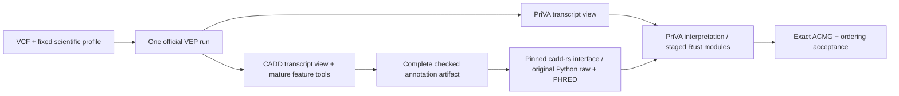

# Nextflow and Rust migration

The target combines one official VEP annotation pass, complete CADD feature
enrichment and the original CADD Python scoring path. PriVA-owned functions move
to one Rust/Polars binary under exact source-order contracts. Shell adapters and
mature scientific tools remain in use.



The current compatibility workflow remains gated for raw annotation. A tested
stub route is not a complete production shared-VEP adapter. Do not activate it
until resource, transcript-selection, model and acceptance gates pass.

## Frozen source and branch

- Branch: `feature/nextflow-rust-migration`.
- Reference commit: `09223ef5a8b0ceb4c6d61055c6eefe62b51ba903`.
- Reference incorporates the eight previously reviewed local changes on top of
  `810e60165a663bd2e1223809af9f32d664a9d543`.
- Development worktree: `/stornext/snfs170/next-gen/scratch/yangyxt/git_repos/PriVA-nextflow`.
- The original `PriVA` checkout keeps its original uncommitted changes.

The branch and worktree serve complementary purposes: the branch records the
migration; the worktree keeps its files separate from the current checkout.
The HTML design is in `projects/PriVA_upgrade/migration_plan.html` under the
approved `yangyxt` root. See [Rust scope and parity](rust-migration.md).

## Current acceptance gate

The user will supply the family VCF/PED, assembly, working configuration and
existing result or its producing software environment. Until then, no real-family
analysis or identical ACMG/ranking result is claimed. A historic result qualifies
as a reference only when its source, software, parameters and resource identities
are established; otherwise regenerate with the frozen source.

Use the same input bytes, phenotype/sex/proband context, original cohort/control
context, resource releases, numerical settings and ClinGen override on both sides.
Select a family after cohort annotation when the original cohort defines control
frequencies. Do not silently reduce the cohort before annotation. An invalid PED
is an error. Transcript multiplicity and tied-row order are part of acceptance.

Compare both final tables using `bin/priva-compare --help`. Required equality
includes `sort_index`, `pext_sort_index` when present, `variant_rank`, variant and
transcript row order, every ACMG criterion/strength, combined judgement and score.
The comparator also checks all other serialized fields; it does not hide numeric
differences behind a tolerance or silently deduplicate records.

## Storage

Code, installation scripts and narrative remain under `yangyxt`. Inputs, outputs,
work files, build products and retained logs are under the project-scoped dataset:

```
/stornext/snfs170/next-gen/scratch/yangyxt_dt/projects/PriVA_upgrade
  inputs/       selected family and provenance
  results/      reference/candidate results and comparison reports
  validation/   synthetic tests, distinct from scientific acceptance
  logs/         completed setup and validation logs
  work/         ignored Nextflow task work, retained for resume
  build/        ignored Rust build products
  tmp/          ignored temporary files
```

Save named completed results with DataLad and attach project/purpose/status
git-annex metadata after all writers finish. Keep Nextflow controller state and
task work together for resume. Neither an output directory nor a Git commit
contains all state needed to resume an interrupted pipeline.

Save/materialize analysis inputs with DataLad before the first production
launch and keep their storage identity stable. Annexing inputs afterwards can
change resolved paths or modification times and invalidate the recorded run
identity. The synthetic resume assertion was made before evidence archival.

Existing reference/cache directories can remain under `yangyxt/caches`; analysis
must not rebuild or alter them. A host-side metadata check through Slurm job
1514363 on 2026-10-15 found only README files
in `caches/{CADD,ClinVar,gnomAD,VEP}` and no `yangyxt_dt/caches`. The repository
config additionally refers to nonexistent `VEP_cache`, `VEP_plugin` and
`VEP_plugin_cache` folders and old `/paedyl01` paths. Those values are not a
deployed resource bundle. Supply the actual cache set before a real run. This
finding applies to these locations, not every possible PriVA installation.
The agent's filename-filtered directory view alone cannot establish missing
genomic data. Run data-facing commands in authorized Slurm jobs with the existing
filter policy intact; the host check is recorded in `logs/cache-path-check.log`.

## Driver installation

`scripts/bootstrap_nextflow_runtime.sh /absolute/new/prefix` installs the official
Nextflow **25.10.4** standalone distribution and Temurin **21.0.12.1+1** JRE for
Linux x86_64, verifying the pinned upstream SHA-256 digests before extraction.
It refuses an existing prefix and makes no shell-startup changes. An interrupted
prefix is incomplete; inspect it and choose a new prefix for a retry.

The installed local launcher is:

```
/stornext/snfs170/next-gen/scratch/yangyxt/softwares/priva-nextflow-25.10.4/bin/nextflow
```

It selects strict parser v2, a private `NXF_HOME`, and a bounded driver JVM.
This installs the workflow driver only. The legacy scientific environment,
VEP/plugins, CADD and resource deployment require their own verified identity.
The old Dockerfile and unpinned `acmg_conda_rough.yml` are not a reproducibility
lock and have not been used to claim production readiness. Freeze the actual
reference environment before solving or upgrading its scientific dependencies.

See the official [installation documentation](https://docs.seqera.io/nextflow/install).
An offline run must also have all required plugins, environments/images and
resources available. `NXF_OFFLINE=true` alone cannot stop subprocess downloads.

## Execution contract

Run `nextflow run /absolute/PriVA-nextflow --help` for current parameters.
The compatibility workflow accepts BGZF VCF plus index, a proband-first PED,
one selected family, assembly, legacy YAML, resource manifest, software identity
and a new output directory. Preannotated mode also requires the matching CADD
annotation TSV; an arbitrary score-only table is insufficient.

**Current deployment gate:** real raw-VCF annotation is deliberately refused
until CADD is qualified with enforced read-only shared resources and fully
prepared software. The unchanged official launcher may otherwise create Conda
environments under the shared CADD tree. Raw stubs test wiring only. The first
real compatibility run can start from the original annotated cohort VCF and
paired CADD TSV when its complete prioritization caches and software are ready.
This gate is an outstanding implementation/deployment step, not evidence that
raw annotation has passed.

Each task owns mutable VCF/index/config/output/temp files. Reference resources
are read from their existing locations. Paths unsafe for the unchanged shell
scripts are rejected. Source content, config and resource identity are explicit
task inputs. Resource metadata inventory is distinct from content verification;
the final family gate needs a frozen, identified cache set.

VCF hub policy must be identical for reference and candidate. The legacy VCF hub
can carry cohort-specific control frequencies, so a hub from another cohort is
not a valid shortcut. Shared hub writes are isolated from the original caches.
Do not switch only one side to a different hub policy and call it orchestration
parity. All output publication is downstream of task success.

The `local` profile is for an existing allocation or a workstation. `slurm` is
for a verified driver that can submit child jobs, with explicit site resources.
The `apptainer` profile needs an already prepared, identified image; it does not
make the current container recipe deployable. `test` is for synthetic wiring.
Use `-stub-run` only for wiring validation, never scientific acceptance.

Launch-time resource checks run even on a fully cached `-resume`. The output
directory records the input/source/resource/settings identity and rejects a
different analysis, avoiding stale published tables. Per-stage provenance and
the validation contract are published alongside uniquely named run reports.
The software ID identifies a caller-supplied frozen environment/image; it is not
an automatic environment lock. Full production software freezing remains part
of the deployment gate.

## Initial validation evidence

On 2026-10-15, validation passed 15 adapter tests, 14 exact-comparator tests,
60 Rust/Python terminal-order comparisons plus five rejected-input cases, and
the 27 retained environment-bootstrap tests. The Rust oracle executed the
terminal sorting block from the frozen scientific source using pandas 3.0.6;
it did not execute or reimplement all upstream scoring/ACMG decisions.

The pinned Nextflow runtime completed raw and preannotated synthetic workflows,
reused all four tasks with `-resume`, preserved an additional cohort sample,
and rejected output reuse with a changed software identity. Successful evidence
is in the data project's `validation/nextflow-integration-v3/{validation,logs}`;
its `work/` tree remains available for resume. These artificial fixtures are
not a real-family test. GitHub Actions later passed the expanded contract, Rust and both Nextflow
stub suites at `56b7762` ([run 38828310089](https://github.com/yangyxt/PriVA/actions/runs/38828310089)).
The integrated source-digest ordering regression was fixed and 16 adapter checks
passed. These CI checks contain no scientific annotation or real-family analysis.

The driver must run in a valid allocation/approved service. On HGSC analysis
nodes, work exceeding any of 2 CPUs, 4 GB or 2 minutes belongs in Slurm. Local
tasks and the JVM share the parent allocation; set process resources to leave
capacity for the driver. A 12 GB or greater CADD task does not fit the current
10 GB interactive allocation and needs its own adequately sized allocation.

## Shared VEP and original CADD calculation

CADD scripts **1.7.2** are pinned at
`1fead0c1e02d3f0a8599bdb04e6b3a2dd70b4866`; the score model is **1.7**.
Production annotation reuses PriVA's official VEP run, then mature upstream
ESM/RegSeq/MMSplice and non-VEP track enrichment produce the complete feature
artifact. Validate assembly, schema, missingness, all required resources, exact
FeatureID joins and order. Qualify CADD's transcript selection without removing
PriVA transcript rows. The separate original-VEP route is a reference-only
qualification tool. VEP113 peptide/GTF compatibility requires evidence; directory
names alone cannot establish it.

`cadd.nf -c conf/cadd.config --cadd_mode full|annotate|calculate` exposes separate
stages. See its `--help` and pinned profile templates under `conf/cadd/` for the
implemented contract. Profiles must be configured and qualified; templates do
not constitute installed resources. Calculate-only consumes a completed artifact
and requires no annotation cache installation. A validated bridge to the pinned
standalone `cadd-rs` interface must preserve both receipt identities and the
identical table; their distinct receipt schemas are not interchangeable.

The standalone scorer must run all four original stages: transformation,
prediction, consequence hierarchy and PHRED conversion. The previous standalone
pin `79d767a` included native hierarchy/PHRED and is a historical experiment;
candidate `4194be3` runs all four original Python stages and passes contract
tests. Both 18-row upstream assembly fixtures match direct original Python
exactly through features, raw scores, hierarchy and PHRED, including full rows
and order. Both real Nextflow calculation routes and one cached resume pass.
Shared annotation and broad scientific qualification remain pending.
Keep the original numerical libraries, other scientific packages and model
assets pinned. An optimized Python backend must be explicitly selected.

| Qualification | Required evidence |
| --- | --- |
| Profiling | Per-stage and total elapsed/CPU time, peak RSS, inputs/source/environment/resource/profile hashes, fixed CPU/thread limits. Repeat reference and candidate fairly; report setup and warm/cold effects. |
| Measured changes | NumPy/pandas vectorization, batching or independent parallel work only for an observed bottleneck; source operation/mutation order and failure behavior remain fixed. |
| Exactness | Raw and PHRED scores, full FeatureID rows, cell values/order, duplicates, missingness, intermediate numerics and failures; every mismatch reported with no tolerance relaxation. |
| Edges | Empty/header-only, missing features, duplicates, transcript tiers/ties, PHRED boundaries, nonfinite/malformed values, failures and whole-variant chunk boundaries. |
| Public benchmark — pending | Later pin a 1000 Genomes sample or agreed dataset; record assembly, release/accession, hashes, selection, sample/variant/transcript coverage and exclusions. Validate both annotation and scoring. |
| Family — pending | User-supplied family with identical fixed resources/profile; exact ACMG criteria, scores and ranking. |

Upstream model fixtures qualify calculation only. They do not satisfy public-data
annotation acceptance or family acceptance. Keep failed optimization experiments
and their mismatch reports; retain the unmodified executable reference.

The nonfinite edge suite found one explicit CLI mismatch: original PHRED code
prints a diagnostic into stdout for raw `nan` and exits zero; the standalone
preserves the output bytes but rejects the malformed table and exits one.
This failure-behavior gate remains failed. Compare original and optimized Python
at the same scorer boundary, retaining stdout/stderr, exit/signal and malformed
outputs. Record artifact validation separately; do not call malformed output a
valid score artifact. Independent profiling of passing model inputs continues.

`CaddSelection.pm` delegates selection to official VEP methods and emits native
ordinals while keeping every PriVA transcript row. `cadd_select_view.py` validates
coverage/context before recovering the CADD view. Its 25 Python and 18 native
method fixture checks establish mechanics only. The policy fragment leaves the
CADD transcript source pool unqualified: Ensembl-only needs RefSeq-only overlap
handling; Ensembl plus RefSeq needs compatible peptide/GTF/model coverage. Neither
is activated by default. PriVA's merged cache and `use_transcript_ref` remain
fixed, and their CADD-derived profile requires separate qualification.

## Current cluster build checkpoint

Installed `priva_acmg` software passed import and executable checks after adding
missing VEP Perl helpers. Its readiness receipt and restorable `environment.conda-explicit.txt` lock are
stored in the data project's `deployment/`. The earlier `environment.explicit.txt`
is a historical URL inventory, not a valid restore file. The pinned resource installers under
`scripts/deploy_cluster_*.py` verify content identity, keep partial downloads
inactive and write stage receipts. `scripts/check_cluster_readiness.py` reports
remaining gaps without equating file presence with scientific qualification.

VEP/cache archives, CADD annotations/prescores and gnomAD inputs are separate
Slurm jobs; completed shared-plugin and HPO/pext stages do not imply full readiness.
The user has confirmed all four licensed SpliceAI v1 VCFs and indexes complete,
with basic parser/index checks, under `yangyxt/caches/SpliceAI_v1/`. Import the
current hg19 pair through the real `install_utils.sh` prompts after full integrity
checks. Keep the acquired hg38 v1 originals without changing the GRCh38 upgrade
profile. PrimateAI acquisition still needs BaseSpace browser sign-in; its approved
root is `yangyxt/caches/PrimateAI_v0_2/`. Resource-specific imports and readiness
checks keep its pending status independent from SpliceAI. Do not duplicate
downloads, require CLI authentication for this acquisition, or use incomplete files.
PrimateAI completion, hg19 MaveDB policy, derived calibration caches and
shared-VEP/CADD qualification remain explicit gates. Current scheduler
status and exact completed test counts are maintained in the project README,
not inferred from this implementation checkpoint.

The actual original `main_install` was reproduced in Slurm 1514592 with an
isolated copied environment. VEP's update prompt exited zero on batch EOF,
leaving its cache/plugins absent while PriVA continued. The fix disables that
prompt, pins the cache release, retains official Conda VEP/API and checks cache
and plugin outputs. All 28 bootstrap tests pass. Corrected real rerun 1514593
reached the intended VEP113 GRCh37 download, then deliberately timed out (124);
that bounded checkpoint is not a complete installation.

Nine additional installer orchestration regressions pass after correcting the
gnomAD reference argument and all-chromosome scheduling, failure barriers,
Conservation-before-AlphaMissense ordering, Conservation reuse and configured
motif output. Scientific Python calculations remain unchanged.
