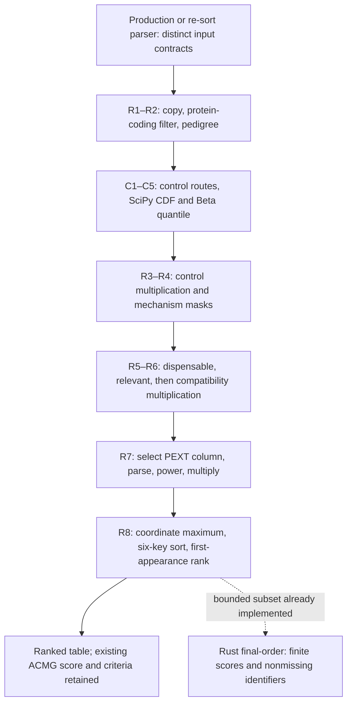
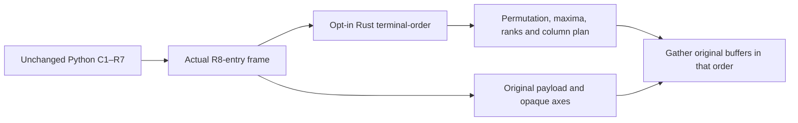
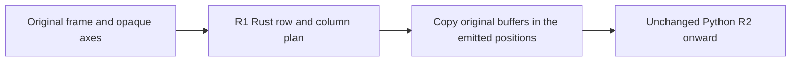

**Remaining PriVA ranking migration: preserve the source before extending Rust**

The remaining work produces `control_common_index` and `sort_index`, then feeds
the final ordering step. Existing Rust scoring/ordering tests cover bounded
interfaces; they do not establish fidelity for the full Python ranking path.
This is an audit and test plan. No scientific Python or Rust was changed.

Solid arrows are execution order. The dotted arrow marks existing limited Rust
coverage, not completion of the preceding steps.

**Pinned evidence**

| Item | Identity / source boundary |
| --- | --- |
| Scientific source | `09223ef5a8b0ceb4c6d61055c6eefe62b51ba903`; line numbers below refer to this commit. |
| Ranking module | [acmg_scoring.py](../scripts/acmg_scoring.py), SHA256 `9111a76e3fc94a064e14d97b535bb1dd2132f7c61836f8e8892477d4c5e69646`; `compute_control_common` L390–471; `sort_and_rank_variants` L474–697. |
| Called helpers | [acmg_variant_mechanism.py](../scripts/acmg_variant_mechanism.py) `_variant_mechanism_masks`, implementation L468–591; [acmg_consequence.py](../scripts/acmg_consequence.py) `coerce_pext_value`, L28–49. |
| Probe runtime | Installed `priva_acmg`: Python 3.12.3, NumPy 1.26.4, pandas 2.2.3, SciPy 1.14.1. Small in-memory probes imported the frozen `softwares/priva-reference-09223ef/scripts` source under the approved `yangyxt` root inside Slurm allocation 1514363. No family data or licensed downloads were read. |
| Rust boundary inspected | `6a7761ce19462f927bf95f0901936736154be93d`: `rust/src/acmg_scoring/*` implements four summary/posterior helpers; `rust/src/cli.rs::final_order` implements terminal grouping/order/rank. |
| Existing qualification | Rust worker reports 19,754 exact scoring rows plus 16 failure cases, and 60 ordering fixtures plus 5 error cases. These are existing bounded claims; this audit does not broaden them. |

**C1–C5: control-common mutation ledger**

This helper mutates and returns the supplied DataFrame; it does not copy it.
Defaults are `cutoff=0.01`, `conf_level=0.999`. The docstring's fixed 0.5 penalty
description is outdated: the implementation grades flagged rows using Beta.

| Step / source | Reads and decisions, in execution order | Mutation / observable behavior |
| --- | --- | --- |
| C1, L400–411 | If none of `control_AC`, `control_AN`, `control_AF`, `control_nhomalt` exists, return early. Otherwise apply `pd.to_numeric(errors='coerce')` separately to all four; valid AN means `AN.fillna(0)>0`. | Early path writes `control_common=False`, then `control_common_index=1.0`. A partially absent schema is **not** converted into four null Series: missing `.get()` values become scalar NaN and later Series methods can raise. |
| C2, L413–425 | If the named proband exists, stringify its sample value, split at `:`, and recognize only GT `1/1`, `1\|1`, or `1` as homozygous. Priority: valid AN + homozygous + nonnull nhomalt; otherwise valid AN + nonnull AC; otherwise valid AN + nonnull AF. | Three mutually exclusive masks retain the original index. AF never substitutes for missing/nonpositive AN. |
| C3, L427–447 | Start false. Homozygous route: `k=int(max(nhomalt,0))`, `n=int(max(round(AN/2),1))`. AC route: `k=int(max(AC,0))`, `n=int(max(round(AN),1))`. Call `binom.cdf(k,n,cutoff)>conf_level`, strictly. AF route compares `AF>cutoff`, strictly. | Boolean assignments are index-selected; SciPy receives positional NumPy arrays. Fractional counts truncate after lower clipping; trial counts use pandas ties-to-even rounding. No upper clipping of counts. |
| C4, L449–462 | Write `control_common`. Independently fill original AC/AN nulls with 0 and cast to float. For common rows with positive AN, compute `q=beta.ppf(0.01, AC+1, AN-AC+1)`; other rows keep q=0. | Beta always uses **original AC and AN**, including homozygous/AF routes; it does not reuse rounded trials or nhomalt. No extra shape validation or repair occurs. |
| C5, L463–471 | For common rows use `clip(1-q,0.01,0.5)`; otherwise 1.0. | Write `control_common_index` using positional `np.where`. NaN Beta results remain NaN. Log flagged count and return the same object. |

The CDF asks whether the observed count is already above almost all mass under
the configured frequency. Beta then supplies a lower frequency bound used to
grade the penalty. These are separate calculations: for AN 100, AC missing,
AF 0.9 and nhomalt missing, the AF route flags the row but Beta uses AC 0, and
the resulting penalty is 0.5. Substituting AF×AN or homozygote counts changes
the current behavior.

**R1–R8: ranking mutation ledger**

| Step / source | Exact order and result |
| --- | --- |
| R1, L492–498 | Copy input. Drop only `haplo_insuf_index` and `zygosity_inheritance_mechanism_index` if present. Initialize `sort_index` from `ACMG_quant_score`, then retain exact `BIOTYPE == 'protein_coding'`. Keep surviving row indices; do not reset or deduplicate here. |
| R2, L501–524 | When both PED and family are non-None, select the first matching affected row (`Phenotype` in string/integer 2), obtain its sample column, normalize Sex, and compute heterozygosity by `.str.count('1')==1` on the **entire sample string**. This differs from C2's GT-only parser. With no PED/family, use an index-aligned false Series. Missing affected row/sample can raise; no alternate proband policy. |
| R3, L527–528 | Run C1–C5, then multiply `sort_index *= control_common_index`. Preserve this first floating multiplication and its NaNs. |
| R4, L537–597 | Read required hub mechanism fields through `_variant_mechanism_masks`. Detect X by uppercase chromosome text and removal of leading `CHR`. Dominant LOF/bare dominant history permits a single alternate allele generally; males at X additionally accept X-recessive or X-dominant LOF/bare histories, females at X accept X-dominant LOF/bare histories. Penalty mask: raw `ACMG_quant_score>0.89` AND R2 heterozygosity AND predicted LOF AND not exact GOF AND no compatible history. Write compatibility 1.0/0.9, but defer multiplication. DN-without-LOF is logged, not an independent penalty. |
| R5, L599–611 | If dispensable list is not None: read with `header=None`, `names=['SYMBOL']`, `comment='#'`; exact set membership gives 0.9/1.0, then multiply. If relevant list is not None: same parsing gives 1.2/1.0, then multiply. No whitespace/case normalization. Explicit None disables that branch; existing unused index columns can remain. |
| R6, L613–616 | Multiply by compatibility 0.9 only on the previously computed R4 mask. Do not combine/reorder the three gene/compatibility multiplications. |
| R7, L621–665 | Use only the first nonempty configured tissue, replacing hyphens with underscores. If that column is absent, try `PEXT_MEAN`; do not try subsequent tissues. Validate parameters only if a column is selected. Map `coerce_pext_value`, fill null with 1, clip 0..1, divide by cutoff, clip 0..1, then apply the exact NumPy power expression. Write `pext_sort_index` for all rows; multiply only rows whose **raw** ACMG score exceeds0.89, regardless of predicted-LOF status. |
| R8, L668–697 | Group by typed `(chrom,pos,ref,alt)` and broadcast maximum `sort_index`. Sort by maximum score↓, **raw ACMG score↓**, chrom↑, pos↑, ref↑, alt↑. Factorize existing `variant_id` by first appearance and add 1; if column absent, factorize colon-joined `astype(str)` coordinates. Drop `max_variant_score`; return sorted rows without resetting indices. |

R7's local calculation is `floor + (1-floor) * power(clip(pext/cutoff,0,1),shape)`
below cutoff, otherwise 1. At defaults, pext 0.02 gives 0.8894427190999916 and a
raw score 0.95 becomes 0.844970583144992 when earlier penalties are 1. The exact
operation order matters; the source does not collapse all multipliers into one
product or round the final sorting index.

**Input contracts and pandas behavior that Rust must retain**

| Boundary | Contract / fidelity consequence |
| --- | --- |
| Ranking library | Required: `ACMG_quant_score`, `BIOTYPE`, coordinate fields, `var_plausible_patho_mechs`, `variant_effect`; `SYMBOL` when a gene list is used; named sample when PED selects a proband. Numeric ACMG scores are assumed, not coerced. `variant_id` is optional. Control schema must exercise both no-columns and partial-column behavior. |
| Production CLI | `acmg_scoring.py` has no direct CLI. [acmg_criteria_assign.py](../scripts/acmg_criteria_assign.py) L196 loads annotation TSV with inferred dtypes/default NA handling and drops duplicate complete rows. PED parsing L217–237 explicitly uses strings, preserves NA-like text, and supports headerless six-column PED. The final scorer receives the **post-assignment** frame, not the initial TSV frame. Ranking options include tissues, cutoff 0.1, floor 0.8, shape 0.5, optional relevant list and bundled dispensable list by default. |
| Production outputs | L533–564 writes the criteria matrix before ranking; then sets posterior/class, ranks, and overwrites the annotation TSV with `index=False`. Protein-coding filtering does not retroactively filter that saved matrix. Compare criteria separately and preserve row association. |
| Re-sort CLI | [resort_step3_only.py](../scripts/resort_step3_only.py) reads existing TSV/PED with inferred dtypes, does not support the production PED fallback, removes 10 existing ranking columns first, and defaults dispensable list to None. It skips missing files, successfully parsed empty frames, or frames without `ACMG_quant_score`, and overwrites the supplied TSV after ranking. Parser errors propagate: zero-byte or whitespace-only inputs raise `pandas.errors.EmptyDataError`. These caller differences must not be silently harmonized. |
| Dtypes / missingness | Preserve pandas `to_numeric` coercion, inferred integer/float/object columns, default NA tokens, native typed coordinate sorting and gene-list membership. A numeric-only chromosome column can sort numerically while a mixed X/autosome column sorts as text. Nullable extension dtypes need their own oracle cases; they are not interchangeable with float NaN or Polars null. |
| Alignment / column order | Preserve index labels and a separate row-position identity, including gaps and duplicates. Series `.loc` arithmetic aligns labels; `.values` and `np.where` are positional. Overwriting an existing column keeps its position; newly created columns append. Optional skipped branches do not generally remove stale columns. |
| Grouping / ranking | Default pandas groupby drops null coordinate keys; max skips null scores and all-null groups retain null maxima. Sorting places NaNs last. Equal six-key rows need source-order evidence. Coordinate grouping and `variant_id` factorization are different identities: missing IDs receive code −1 and therefore rank 0; distinct coordinates may share an ID. Absent-ID stringification must match pandas, including null spellings. |
| Helper parsing | Mechanism tags are case-sensitive, semicolon-delimited exact matches without trimming each tag; missing required fields raise. Optional LOF/GOF/DN scores use numeric coercion and null→0. `coerce_pext_value` parses comma/ampersand segments and Python `max`; despite its “finite” comment it accepts infinities and some NaN spellings. Do not replace it with a finite-only or null-ignoring reduction. |

**Numerical boundary: keep the actual SciPy calls**

PriVA calls only `scipy.stats.binom.cdf` and `scipy.stats.beta.ppf` in C1–C5;
it does not fit a distribution or use a beta-binomial test. SciPy 1.14.1's
binomial implementation floors k and calls compiled `scipy.special` `_binom_cdf`;
its beta quantile calls `_beta_ppf`. The latter uses SciPy's Boost inverse-beta
wrapper and error policy. Public distribution wrappers also apply domain and
support handling. Preserve the exact installed build, not only function names.
See [SciPy 1.14.1 binomial source](https://github.com/scipy/scipy/blob/v1.14.1/scipy/stats/_discrete_distns.py),
[beta source](https://github.com/scipy/scipy/blob/v1.14.1/scipy/stats/_continuous_distns.py),
and [compiled beta wrapper](https://github.com/scipy/scipy/blob/v1.14.1/scipy/special/boost_special_functions.h).

An alternative CDF, survival-tail reformulation, inverse solver, count clipping,
or numerical tolerance is not proposed. Preserve comparison thresholds,
ties-to-even rounding, integer conversion, binary floating values, NaN masks,
and NumPy power/multiplication order. A one-bit difference can alter a tie or a
strict threshold. Keep this numerical stage on the pinned Python/SciPy path
until a source-faithful Rust implementation has exact differential evidence.

**Representative oracle observations, already checked**

These are small probes, not a full ranking qualification. All use the pinned
source/runtime above. Full-ranker examples have one protein-coding variant,
raw score 0.95, empty mechanism history, effect `uncertain`, no PED, and explicit
`dispensable_gene_list=None`.

| Input | Observed Python result | Existing Rust `final-order` implication |
| --- | --- | --- |
| No control columns | `False`, index 1.0; helper returns the same frame object. | No upstream computation exists in Rust yet. |
| Only `control_AF=0.9` | `AttributeError: 'numpy.float64' object has no attribute 'fillna'`. | Capture failure parity; do not silently synthesize missing columns. |
| Only `control_AN=100` | `AttributeError: 'numpy.float64' object has no attribute 'notna'`. | Same unsupported upstream scope. |
| AN 2, AC 4, AF 0.9, nhomalt NaN | Common=True, index NaN; full ranker returns `sort_index=NaN`, `variant_rank=1`. | Rust explicitly rejects nonfinite `sort_index`. This is a full-path gap requiring extension/reference tests, **not legitimate full-ranker equivalence**. |
| AN 100, AC NaN, AF 0.9, nhomalt NaN | Common=True, index 0.5. | Needs the original AF-route/Beta combination. |
| PEXT `NAN&0.02` | Parser NaN→fill 1; sort 0.95, hex `0x1.e666666666666p-1`. | Terminal Rust accepts the finite prepared score but does not compute it. |
| PEXT `0.02&NAN` | Parser 0.02; sort 0.844970583144992, hex `0x1.b09ffbf9612c1p-1`. | Order-sensitive parser is an unported upstream dependency. |
| PEXT `inf&0.2` / `-inf` | Parser returns +∞ / −∞; ranker later clips to 1 / 0. | Parser's nonfinite value is not itself grounds to reject the full Python path. |

Current Rust additionally requires nonmissing `variant_id`/coordinates, positive
integer positions, finite raw/final scores, unique headers, and explicit
`--chrom-type string|integer`. Python's absent/missing-ID branch, null grouping,
nonfinite scores and broader inferred dtypes are outside that validated subset.
Existing bounded results remain useful; they must not be advertised as full
ranking or family parity.

**Differential-test plan and the next independent module**

| Work | Required capture / acceptance |
| --- | --- |
| Freeze the oracle | Record scientific commit and module hashes, exact Conda lock/build identities, SciPy/NumPy native-library identities, parameters, and gene-list bytes/hashes. Capture the actual ranking-entry DataFrame with ordered columns, index labels, dtypes, null masks, row-position IDs and float bit patterns. Retain caller-specific parsing evidence; TSV alone loses that state. |
| Capture C and R checkpoints | Use a separate harness against unchanged frozen source: capture route masks, k/n arrays, CDF outputs, Beta inputs/outputs, every newly assigned column and each sequential `sort_index` state. Use independent deep copies for isolated helper cases; also test helper in-place mutation and ranker input preservation. Record exceptions and their first failing stage. |
| Controls matrix | All 16 present/absent column combinations; bad numeric text; zero/negative/missing AN; fractional/half-integer counts; AC>AN; infinities; all three route collisions/priorities; GT suffixes; values around strict cutoffs; large counts; binary-float neighbors of resulting thresholds. Compare booleans, integer arrays, float bits/NaN masks and failure behavior exactly. |
| Ranking matrix | Filtered rows with gapped/duplicate indices; empty frame; PED first-affected selection and caller dtype differences; full sample strings containing additional 1s; male/female/unknown Sex at X/autosomes; every exact history/effect tag; missing mechanism fields; list None versus empty/missing files and NA-like symbols; overlap of both gene lists; raw-score neighbors of 0.89; tissue fallback; PEXT strings/nulls/infinities/NaN token order; invalid parameters with/without a selected column. |
| Terminal extension | Include group ties/all-null groups, null coordinate keys, string versus numeric chromosomes/positions, missing or absent IDs, repeated IDs across coordinates, stale columns and output column positions. Preserve full row order and every rank; compare against the full Python function, not only already normalized Rust inputs. |
| First independent Rust piece | Port `_variant_mechanism_masks` as its own source-mapped module **after** capturing its exact masks/coercions/errors. It is a Boolean/string/numeric-coercion boundary without CDF/PPF or PEXT power. Qualify it independently, then call it at R4; moving it before C1 changes which error happens first. The scalar `coerce_pext_value` parser is a second separable candidate once order-sensitive NaN cases are frozen. |
| Integration gate | No reassociation, parallel reduction, null-policy improvement or approximate acceptance. Require exact intermediate/output equality on the declared supported domain before extending that domain. Preserve Python for unsupported cases; later compare the supplied family against the same complete cache snapshot, including exact `sort_index`, ordering/rank, criteria matrix and criteria judgments. |

Only the representative in-memory probes above were executed during this audit.
The comprehensive oracle capture, Rust extensions, complete family run and
scientific equivalence checks remain to be performed.

---

**Current progress addendum — 24 October 2026 CT**

The preceding audit retains its original scope. The synthetic full-ranking and
control Python oracle is now captured by
[ranking_control_oracle.py](../rust/tests/ranking_control_oracle.py), exposing
named `prepare`, `capture` and `validate` procedures. It freezes fourteen actual
`09223ef` modules and the separate harness, imports the unchanged ranking and
control functions, and observes original source frames and real SciPy
CDF/PPF calls. Production parser evidence executes five original AST statements;
the re-sort cases execute the complete original `resort_family` function.
Criterion assignment is outside this capture.

Final `ranking-control-oracle-20261024-v3` contains 165 cases: 117 successful
results and 48 original exceptions. Every case matches an independent untraced
execution, including ordered columns/index/dtypes/null masks/scalar float bits,
immediate pre/post-execution input pickle hashes, returned-object identity and
file effects. All 341 validation checks passed. The source checkpoints retain
route masks, actual k/n arrays, SciPy CDF/Beta arguments and returns, sequential
ranking multiplications, PEXT selection/transform, coordinate maxima, sort and
factorization results, and the first uncaught source failure phase. The matrix
covers all 16 control-column presence patterns, fractional/negative/missing and
nonfinite routed inputs, strict threshold neighbors, R1–R8, duplicate/gapped
indices, PED/full-sample-string behavior, overlapping gene lists, tissue
fallback, null coordinate groups/IDs and existing column positions.

The installed runtime is Python 3.12.3, pandas 2.2.3, NumPy 1.26.4 and SciPy 1.14.1.
The record pins 528 installed Conda package/build metadata entries, 141 loaded
native files, four SciPy public/private wrapper functions and the two compiled
CDF/PPF ufunc identities. Gene-list fixture bytes and resolved scientific
arguments are retained per case. Source manifest SHA256
`9e63fb73e49c9f8ce700b0abd3e588702d2489c5430059e76c5d5b723eabb46a`;
capture SHA256
`db919b02f8738da60f85d16e0a7ed2bb53f8eaaf6047ed8f4db912fe4938508c`;
native/package identity record SHA256
`4875c99bc4acb58ff78c0210942561383bcb31839eee4ade2e0eae280237d9bc`.
Native capture 1514363.3175 and validation 1514363.3182 completed 0:0;
validation finished at 7:44:59 PM CDT. Source text/function/AST hashes, complete
typed observations, pickles, traces, source logs and validation receipts reside
under
`/stornext/snfs170/next-gen/scratch/yangyxt_dt/projects/PriVA_upgrade/validation/ranking-control-oracle-20261024-v3`;
outer logs use the corresponding data-side `logs/ranking-control-oracle-*`
pattern. Maintained harness and documentation remain in this checkout.

Two observations refine the future integration contract. In mixed count/AF
fixtures, the original AF assignment at L447 produces an object-dtype `common`
Series and a FutureWarning; C4 then raises IndexError at L460 after writing
`control_common`. This partial mutation/failure is retained. Separately, pandas
deep copies share lazy dtype caches: preliminary v1 exposed an input-pickle
observer mismatch at nullable Float64. Final paired executions load the same
prepared pickle bytes into independent objects, retain the cache mutations and
compare immediate pre/post-source serialization. Actual exception objects are
retained while tracing, so a handled PEXT ValueError cannot be confused with a
later uncaught R8 failure. Failed v1 capture/diagnostic logs and the superseded
v2 preparation remain preserved alongside final evidence.

This is Python oracle groundwork. The existing optional Rust helpers remain
separate; full ranking/control Rust integration, complete criterion assignment,
installation, family and public scientific qualification remain pending. No
scientific Python, installer or production backend changed in this task.

---

**R8 procedure addendum — 24 October 2026 CT**

The opt-in `priva terminal-order` procedure extends the terminal boundary only.
Its input is the actual frame after R7, with all earlier scores already computed.
The existing `final-order` command retains its original interface and body.

The procedure returns source-row positions rather than reconstructing pandas
payloads. Its generic index tokens and opaque axis descriptor survive unchanged;
duplicate/gapped labels and MultiIndex labels never become join keys. The test
adapter gathers the original frame, overwrites/appends `variant_rank` at the
source position and removes `max_variant_score`, then compares complete ordered
columns/index/dtypes/null masks/float bits/attrs with the actual Python output.
The original R8 excerpt's temporary-column mutation is retained separately.

| Boundary | Declared supported domain and behavior |
| --- | --- |
| Scores | `sort_index`: NumPy `float64`, `int64`, `uint64`, or nullable `Float64`, `Int64`, `UInt64`. Reduction retains native integers. Only source-observed NumPy integer transform promotion for excluded coordinate groups converts maxima to float64; nullable integer masks retain their native dtype. Raw ACMG scores retain their declared primitive dtype for the second sort key. |
| Coordinate keys | Homogeneous text (`object`/`string`), 64-bit signed/unsigned/float primitives, their listed nullable forms, or NumPy bool. Missing keys exclude the group maximum; every source row remains. Object text keys support None and float NaN, with `Cell::Null` meaning None; object-coordinate `pd.NA` requires Python. Unmasked nullable-float NaN and inconsistent dtype/cell pairs fail closed. |
| Variant IDs | Optional; primitive text/numeric/bool columns with source missingness and first-appearance ranking. Missing IDs rank zero and consume no rank. Repeated IDs can span coordinates. Absent IDs preserve exact colon-join collisions for text/integer/bool coordinates. Floating-coordinate equality preserves signed zero/NaN spelling; floating coordinates combined with colon-bearing text explicitly defer to Python. |
| Order and columns | Maximum score↓, raw ACMG score↓, chrom↑, pos↑, ref↑, alt↑; fully tied rows retain source order. Maxima skip NaNs, all-missing groups remain missing, and the first tied zero retains its sign. Overwritten columns keep their positions, a new rank appends, and the temporary maximum is removed. |
| Fallback | Mixed arbitrary objects, duplicate/nonstring column labels, categorical/Arrow/time/complex/float32 and other undeclared key/score dtypes require unchanged Python. A deferral is never counted as an exact Rust match. Payload buffers remain caller owned; this is an opt-in primitive transport and permutation contract. |

The first R8 oracle contains 91 cases: 85 successful full-ranker checkpoint/final
pairs (including additional unchanged full-ranker cases) and six original R8-only
missing-column failures. Its source and package identities come from the closed
full-ranking oracle above. A separate 15-case integer supplement retains the
actual nullable-Int64 full-ranker checkpoint and executes the original R8
statements on signed/unsigned 64-bit limits, neighbors above 2^53, excluded
coordinate groups, all-missing nullable groups and empty frames. These extra
isolated R8 inputs do not establish that preceding scoring stages produce them.

`rust/source_functions.tsv` now also records the already implemented
`_variant_mechanism_masks` function's verified SHA256
`687cd5b4932fb29b07726133fe9c4fa1c6f70fa884655019eecd05a713fbb86b`
(full function L343–591, file `c7e8da80…`). Its existing 27-mask primitive contract
is unchanged. The R8 row records the full ranker function hash `8aa29d9a…` while
explicitly limiting its source statements to L668–697. Neither row activates
ranking integration, Python/family dispatch or a production backend.

Final comparison closure 1514363.3253 completed 0:0 at 8:25:25 PM CDT. Primary
R8 results are **84 exact outputs, six original failures, one deliberate Python
fallback** (mixed object chromosome keys). The integer supplement has **15 exact
outputs, zero failures and zero fallbacks**; it includes a repeat of the actual
Int64 full-ranker checkpoint. No deferred case is counted as a Rust match.

All 97 Rust tests (including 13 R8 tests), 5,786 PEXT scalar results/18 source
errors, condition/mechanism comparisons, 19,754 scoring rows/16 failure cases and
the existing 60 `final-order` fixtures/five rejections passed. The compiled
binary is SHA256
`89906494b5918727d7a980383efd25105352d898e909c8cc1418a535e80cb68d`.
Compilation/Rust tests used source manifest
`7087433f95b682302277a59c4d9b816f856591dc5bff763453f898794249077f`;
the final comparator/closure harness manifest is
`39fc412a2d1a2f2dfa8b9a0ec8daef2224f6afacb47acc294b7c6c20da835ac5`.
The harness verifies unchanged Rust/scientific source before reusing that binary.

Failed 1524435 (unsupported integer checkpoint) and 1524441 (empty RangeIndex
expanded by the test adapter), the narrower successful 1524440, and all earlier
extractor attempts remain separate. The empty-frame adapter now retains the
actual source axis; no Rust numeric change was needed for that correction.
Whole job 1524441 remains FAILED even though its compilation/Rust tests passed.
Final evidence is under
`/stornext/snfs170/next-gen/scratch/yangyxt_dt/projects/PriVA_upgrade/validation/rust-terminal-order-20261024-v{1,2,3,4,5,6}`,
with logs in the corresponding data-side `logs/rust-terminal-order-*` pattern;
build/Cargo caches are separate under the data-side `build/rust-terminal-order-*`.
These later optional sources are distinct from main installation 1524420's
6:39 PM CT snapshot. Full C1–R7 Rust integration, installation/family/public
scientific acceptance and production activation remain outside this work.

---

**R1 setup procedure addendum — 24 October 2026 CT**

The separate opt-in `priva rank-setup` procedure covers only original
`sort_and_rank_variants` L492–498. Earlier and later ranking arithmetic, PED
selection and the real SciPy/NumPy paths stay in Python.

The plan preserves the original copy, ordered removal of the two legacy fields,
raw `ACMG_quant_score` column copy and exact, case-sensitive `protein_coding`
filter. It returns source row positions and ordered source-column positions;
existing `sort_index` is overwritten in place or appended when absent. The
adapter gathers every emitted column directly from original buffers, including
unrelated duplicate labels. It preserves dtype, null masks, float bits, column
positions, attributes and actual empty/gapped/duplicate/MultiIndex axes; neither
axis tokens nor labels become join keys. Missing score lookup precedes missing
BIOTYPE lookup even on empty frames. Inputs remain unchanged.

The primitive contract accepts `object` containing the existing Cell primitives,
Python-storage `string`, NumPy `float64`/`int64`/`uint64`/`bool`, and nullable
`Float64`/`Int64`/`UInt64`/`boolean`. Scores are copied without float conversion or
arithmetic. Exact text matches alone survive; supported missing and nontext
BIOTYPE values are excluded. Unmasked nullable-float NaN, inconsistent cells,
undeclared dtypes and arbitrary Python objects require unchanged Python.
Duplicate `ACMG_quant_score`, `BIOTYPE` or `sort_index` labels also explicitly
defer; the original pandas duplicate-label broadcast/error behavior is not
claimed as Rust parity. Unrelated duplicate labels retain their positions.

The preimplementation oracle executes the four actual source statements and
checks their boundary against the closed full-ranker's R2-entry checkpoints or
R1 failures. Its 129 cases retain 118 source outputs, 11 source failures and
unchanged immediate input pickle bytes. It adds exact-token, raw-score dtype,
nullable/nonfinite, existing-column and opaque-axis cases without executing
later scientific calculations. `rust/source_functions.tsv` records full function
SHA256 `8aa29d9a…` and explicitly limits this module to L492–498.

Final focused comparison 1514363.3308 completed 0:0 at 9:01:32 PM CDT:
**117 exact outputs, eight original failures and four deliberate Python
fallbacks**, with zero mismatches. Every successful output applies the complete
emitted column plan. The eight supported failures preserve original type/message
and create no output. A fallback is never counted as an exact Rust match.

Build and regressions 1524493.0 completed 0:0: all 105 Rust tests (eight R1 tests),
R8 primary 84 exact outputs/six source failures/one Python fallback, R8 integer
15 exact outputs, PEXT 5,786 scalar results/18 source errors, condition/mechanism
and scoring comparisons, and the existing 60 `final-order` cases/five rejections
passed. Binary SHA256 is
`0cc79a5ec6acf276e34a746b9f5ae8039bfd480b4771d1a44bac67ffdde7cd98`.
The build source manifest is
`6ea71662be654d802d6a708b71174333cb8d0eead3f9012b685b835d0eb81713`;
the final test manifest is
`e6185428c3deaab3c30ad137a8eec06574432ecacff48b174d513cccd91268ca`.
The follow-up changed only the comparator and validation harness, verifies every
Rust/scientific/prior-test source unchanged and reuses the completed binary and
regressions. Both first-pass and strengthened checks remain retained.

Maintained source/tests/docs stay in this checkout. All oracle pickles, typed
states, snapshots, binary, comparison results and logs are under
`/stornext/snfs170/next-gen/scratch/yangyxt_dt/projects/PriVA_upgrade/{validation/rust-ranking-setup-20261024-v1,logs/rust-ranking-setup-*}`;
Cargo/target products stay separately under data-side `build/rust-ranking-setup-*`.
The preceding R8 algorithm/tests and old `final-order` body are unchanged.
These optional sources are separate from main installation 1524420's frozen
6:39 PM CT snapshot. No scientific Python, installer, production dispatch,
R2–R7/C1 numerical integration or family/public qualification changed.

---

