# PriVA native procedures and source map

`priva` groups the pipeline's native procedures in one executable. The shell
orchestration still invokes mature external tools, including official VEP and
upstream `CADD.sh` with its Python scorer. Native cache builders and production
Nextflow migration are separate from the converted runtime procedures.

```text
Shell / task adapter
    ├── priva: preparation → splicing / UTR → ACMG → ranking
    ├── official VEP and other external tools
    └── upstream CADD.sh and its Python environments

Installer
    ├── retained Python builders and optional native builders
    └── cache-install → checked native caches → runtime readers
```

## Invocation and formats

`scripts/common_bash_utils.sh` resolves `PRIVA_BINARY`, then the YAML
`priva_binary`, then `PATH`, and sets the resource directories for the executable.
Use each command's `--help` for its supported input profile and named options.
The shell runtime calls native procedures for preparation, interpretation and
ACMG assignment. An optional builder listed below does not imply that its
installer caller has switched from Python.

Keyed caches use checked `PRIVARKV`/rkyv archives. Builder tables use
Polars/Parquet-zstd; naturally shared text formats remain text. See
[CACHE_FORMATS.md](CACHE_FORMATS.md) for schema versions and conversion commands.
The bundled ClinVar gene pickle is converted under configured `cache_root`
during installation; its larger native archive is not a bundled Git resource.
There is no native pickle writer.

Preserve scientific execution and mutation order, types, missingness, joins and
numerical/failure behavior within the selected profile. Unsupported input
profiles must be explicit. Reusable comparisons live in `tests/` and
`rust/tests/`; run outputs belong outside the source checkout.

## Runtime source map

The tables identify procedure ownership, not whole-pipeline qualification.
Native scientific differences, including residue-aware PM5 and frameshift
handling, remain profile-specific. An available module does not make its
standalone diagnostic or cache-building entry point native.

### Steps that prepare each sample's variants (variant IDs, VCF to table, CADD hub cache, family filtering, SpliceAI version check)

| Python source | Native procedure or current role |
| --- | --- |
| [`scripts/cadd_hub_util.py`](../scripts/cadd_hub_util.py) | `priva cadd-hub`. |
| [`scripts/combine_annotations.py`](../scripts/combine_annotations.py) | `priva combine-annotations`. |
| [`scripts/generate_varID_for_vcf.py`](../scripts/generate_varID_for_vcf.py) | `priva variant-ids`. |
| [`scripts/hpo_penetrance.py`](../scripts/hpo_penetrance.py) | Native `hpo_penetrance`, used by `combine-annotations`. |
| [`scripts/pedigree_filtration_per_fam.py`](../scripts/pedigree_filtration_per_fam.py) | `priva pedigree-filter`. |
| [`scripts/spliceai_cache_input.py`](../scripts/spliceai_cache_input.py) | `priva spliceai-cache-input`. |
| [`scripts/spliceai_cutoffs.py`](../scripts/spliceai_cutoffs.py) | `priva spliceai-cutoffs`. |

### Steps that interpret splicing and UTR effects for each sample

| Python source | Native procedure or current role |
| --- | --- |
| [`scripts/interpro_mapping_io.py`](../scripts/interpro_mapping_io.py) | `priva interpro-mapping inspect`. |
| [`scripts/protein_domain_mapping.py`](../scripts/protein_domain_mapping.py) | `priva interpro-mapping build`. XML-to-mapping builder only; standalone VCF/report caller remains Python. |
| [`scripts/splicing_var_analysis.py`](../scripts/splicing_var_analysis.py) | `priva splicing-analysis`. |
| [`scripts/utr_anno_interpret.py`](../scripts/utr_anno_interpret.py) | `priva utr-anno-interpret`. |

### ACMG decision steps (criterion assignment, scoring and ranking for each sample)

| Python source | Native procedure or current role |
| --- | --- |
| [`scripts/acmg_bs2_bp5_observation.py`](../scripts/acmg_bs2_bp5_observation.py) | Native runtime `acmg_step::acmg_bs2_bp5_observation` through `acmg-assign`. |
| [`scripts/acmg_consequence.py`](../scripts/acmg_consequence.py) | Native runtime `acmg_step::acmg_consequence` through `acmg-assign`. |
| [`scripts/acmg_criteria_assign.py`](../scripts/acmg_criteria_assign.py) | `priva acmg-assign`; runtime orchestration. |
| [`scripts/acmg_inheritance.py`](../scripts/acmg_inheritance.py) | Native runtime `acmg_step::acmg_inheritance` through `acmg-assign`. |
| [`scripts/acmg_pm1_pp2_bp1_missense.py`](../scripts/acmg_pm1_pp2_bp1_missense.py) | Native runtime `acmg_step::acmg_pm1_pp2_bp1_missense` through `acmg-assign`. |
| [`scripts/acmg_pm2_bs1_ba1_frequency.py`](../scripts/acmg_pm2_bs1_ba1_frequency.py) | Native runtime `acmg_step::acmg_pm2_bs1_ba1_frequency` through `acmg-assign`. |
| [`scripts/acmg_pm4_bp3_protein_length.py`](../scripts/acmg_pm4_bp3_protein_length.py) | Native runtime `acmg_step::acmg_pm4_bp3_protein_length` through `acmg-assign`. |
| [`scripts/acmg_pp1_bs4_bp2_pm3_family.py`](../scripts/acmg_pp1_bs4_bp2_pm3_family.py) | Native runtime `acmg_step::acmg_pp1_bs4_bp2_pm3_family` through `acmg-assign`. |
| [`scripts/acmg_pp3_bp4_bp7_insilico.py`](../scripts/acmg_pp3_bp4_bp7_insilico.py) | Native runtime `acmg_step::acmg_pp3_bp4_bp7_insilico` through `acmg-assign`. |
| [`scripts/acmg_ps1_pm5_known_variant.py`](../scripts/acmg_ps1_pm5_known_variant.py) | Native runtime `acmg_step::acmg_ps1_pm5_known_variant` through `acmg-assign`. |
| [`scripts/acmg_ps2_pm6_denovo.py`](../scripts/acmg_ps2_pm6_denovo.py) | Native runtime `acmg_step::acmg_ps2_pm6_denovo` through `acmg-assign`. |
| [`scripts/acmg_ps3_bs3_pp5_bp6_reported.py`](../scripts/acmg_ps3_bs3_pp5_bp6_reported.py) | Native runtime `acmg_step::acmg_ps3_bs3_pp5_bp6_reported` through `acmg-assign`. |
| [`scripts/acmg_pvs1_null_variant.py`](../scripts/acmg_pvs1_null_variant.py) | Native runtime `acmg_step::acmg_pvs1_null_variant` through `acmg-assign`. |
| [`scripts/acmg_scoring.py`](../scripts/acmg_scoring.py) | Native runtime `acmg_step::acmg_scoring` through `acmg-assign`. |
| [`scripts/acmg_variant_mechanism.py`](../scripts/acmg_variant_mechanism.py) | Native runtime `acmg_step::acmg_variant_mechanism` through `acmg-assign`. |
| [`scripts/alternative_start_codon.py`](../scripts/alternative_start_codon.py) | Native `acmg_step::alternative_start_codon` runtime detector; standalone CDS builder is outside conversion scope. |
| [`scripts/clinvar_vcv.py`](../scripts/clinvar_vcv.py) | Native `acmg_step::clinvar_vcv` text input; the installer's XML parsing is `priva gofcards-clinvar-injection`. |
| [`scripts/determine_phase.py`](../scripts/determine_phase.py) | Native runtime `acmg_step::determine_phase` through `acmg-assign`. |
| [`scripts/find_cosegregation_vars.py`](../scripts/find_cosegregation_vars.py) | Native runtime `acmg_step::find_cosegregation_vars` through `acmg-assign`. |
| [`scripts/gene_mechanism_annotation.py`](../scripts/gene_mechanism_annotation.py) | Native runtime `acmg_step::gene_mechanism_annotation` through `acmg-assign`. |
| [`scripts/gene_mechanism_common.py`](../scripts/gene_mechanism_common.py) | Native runtime `acmg_step::gene_mechanism_common` through `acmg-assign`. |
| [`scripts/gene_mechanism_conditions.py`](../scripts/gene_mechanism_conditions.py) | Native runtime `acmg_step::gene_mechanism_conditions`; installation and diagnostic helpers remain Python. |
| [`scripts/gene_mechanism_hub.py`](../scripts/gene_mechanism_hub.py) | Native runtime facade over mechanism modules; standalone diagnostics remain Python. |
| [`scripts/gene_mechanism_resources.py`](../scripts/gene_mechanism_resources.py) | Native runtime `acmg_step::gene_mechanism_resources`; installation and diagnostic helpers remain Python. |
| [`scripts/gene_mechanism_variants.py`](../scripts/gene_mechanism_variants.py) | Native runtime `acmg_step::gene_mechanism_variants` through `acmg-assign`. |
| [`scripts/mavedb_interpreter.py`](../scripts/mavedb_interpreter.py) | Native runtime `acmg_step::mavedb_interpreter` through `acmg-assign`. |

## Installation builders

The "Installer calls" notes in the two tables below name the functions of
the shell installer (`install_utils.sh`) that ran each command until phase 7
removed it (commit 841e200 is the last tree that has it). The install steps
now run the same `priva` commands from their own processes
(`modules/local/install_steps/`; `conf/install_steps.json` names each
step's module and `priva install-task reach --step ID` lists its commands).
A row whose script is gone says so. Optional native procedures can be invoked directly.

### Scripts that build reference data once, at installation

| Python source | Native procedure or current role |
| --- | --- |
| [`scripts/SpliceVault_tsv_vcf_conversion.py`](../scripts/SpliceVault_tsv_vcf_conversion.py) | Optional `priva splicevault-convert`. Installer calls `priva splicevault-convert`; CrossMap remains required. Installed BGZF route; general archive-byte/ZIP64 behavior is outside its qualified profile. |
| [`scripts/alphamissense_annotation_base.py`](../scripts/alphamissense_annotation_base.py) | The original of the header check and file helpers that `priva alphamissense-cache check-annotation`, `clinvar-gene-refresh check-header` and `mapped-artifact` share (`src/alpha_annotation_base/`). `priva alpha-annotation-base` (path, recover, check, capture, publish, restore, motif adoption), which only the installer's `AlphaMissense_anno` ran, was removed in phase 7: C3 runs VEP into its own folder (phase 6). Kept because `mapped_artifact_publish.py` imports it. |
| [`scripts/alphamissense_cache.py`](../scripts/alphamissense_cache.py) | Optional `priva alphamissense-cache {install,validate,check-annotation}` with the script's options; the subcommand comes first. The pinned publisher size and MD5, the bounded schema probe, the install lock, adoption of a supplied or symlinked source, the resumed `curl` download, retained replaced artifacts, the rebuilt `tabix` index with its first-record probe and the ready receipt follow the script; `bgzip -t`, `tabix` and `curl` remain external tools. `check-annotation` is the native header check `alpha-annotation-base` already uses. Installer calls `priva alphamissense-cache install` in `AlphaMissense_install` and `check-annotation` in `AlphaMissense_anno`. Compared by `rust/tests/alphamissense_cache_compare.py` (success paths on the real hg19 publisher file; no case reaches the network). |
| [`scripts/alphamissense_domain_cache.py`](../scripts/alphamissense_domain_cache.py) | Replaced in the installer: `AlphaMissense_stat` calls `priva alphamissense-domain chromosome` for every VCF header contig (completed chromosomes are kept for a resumed run), then `merge`, and reuses a complete Parquet through `check --vcf --builder-sha256` with its recorded identity. Retained for manual use. |
| [`scripts/alphamissense_original_cache.py`](../scripts/alphamissense_original_cache.py) | Legacy/manual helper, outside native conversion scope. The installer no longer reads its receipts; completed Python statistics stay in use only through a valid Python DAS receipt. |
| [`scripts/alphmis_tsv2vcf.py`](../scripts/alphmis_tsv2vcf.py) | `priva alphamissense-vcf build --input TSV --output VCF`, called by `AlphaMissense_anno` (November 2026). The annotation recipe fingerprint counts this line as the original `python "$convert_py"` line, so caches annotated before the switch keep their fingerprint (same recipe and converter fingerprints on the G9 installation). |
| [`scripts/am_pick_intolerant_domains.py`](../scripts/am_pick_intolerant_domains.py) | Optional `priva das-domains lookup/transcripts/benign/coldspot-table/coldspot/scores/common/analyze` component procedures. Transcript projection accepts the explicit native Alpha exon-history companion. `scores` and `common` project the final typed statistics into the ordered domain score arrays and common-missense summaries (`das_projection_compare.py`). `analyze` runs the whole step in `analyze_domain_data` order and writes `domain_tolerance_analysis`, `domain_filter_results`, the native `all_intolerant_domains` set, and the curated-reference and excluded sets as JSON; KS rows follow query order rather than worker completion order (`das_assembly_compare.py`, four generated cases against the sorted-rescue Python reference). Installer calls `priva das-domains transcripts` and `priva das-domains analyze` in `AlphaMissense_pick_intolerant_domains` with `--python-hash-seed` from `priva_python_hash_seed`; `--metadata/--spots` and `--clinvar-vcf` are passed when the Python step would have received `--am_vcf` and `--clinvar_vcf`. The transcript map and `all_intolerant_domains` are written as direct `.rkyv` archives; completed Python DAS outputs with a valid Python receipt are kept for one transition. See the rescue-order and exon-history profiles below. |
| [`scripts/am_pick_missense_constrained_segments.py`](../scripts/am_pick_missense_constrained_segments.py) | Legacy/manual helper, outside native conversion scope. |
| [`scripts/audit_clinvar_gofcards_review_tiers.py`](../scripts/audit_clinvar_gofcards_review_tiers.py) | Legacy/manual helper, outside native conversion scope. |
| [`scripts/audit_condition_scope_inventory.py`](../scripts/audit_condition_scope_inventory.py) | Legacy/manual helper, outside native conversion scope. |
| [`scripts/audit_gofcards_source_coverage.py`](../scripts/audit_gofcards_source_coverage.py) | Legacy/manual helper, outside native conversion scope. |
| [`scripts/biomart_ftp_nm_to_enst.py`](../scripts/biomart_ftp_nm_to_enst.py) | Optional `priva biomart` FTP specification, metadata/XML, projection, identity/verification, `ftp-make-provenance`, `ftp-portable-provenance`, and the FTP path of `atomic-json`, `runtime-receipt`, `external-path` and `fetch`. `fetch --source ensembl-grch38-mart116-ftp` is `install`: the same directory flock, pinned dumps, resume by Range through `curl`, projection and receipts. Installer caller remains Python; see the row below. |
| [`scripts/biomart_nm_to_enst.py`](../scripts/biomart_nm_to_enst.py) | Optional `priva biomart` identity, receipt, pinned-table verification, artifact routing, receipt publication and `fetch` with explicit `--helper-root`. `fetch` takes the script's options and sources, requests through `curl` and records `priva biomart fetch` with the `biomart-fetch` builder identity as receipt producer. Installer calls `priva biomart identity` and `artifact-route` in the AlphaMissense motif and PM1 steps; `nm_to_enst_mapping_install` stays on Python `fetch` and `verify` because `main_install` reaches it before `priva_binary` is recorded. Comparison: `rust/tests/biomart_fetch_compare.py` through a local HTTPS publisher. Python's `RecursionError` on JSON nested about 994 deep has no native counterpart, by design. |
| [`scripts/build_gene_nonlof_mechanism_cache.py`](../scripts/build_gene_nonlof_mechanism_cache.py) | Optional `priva gene-nonlof-mechanism --source-root CHECKOUT` with the script's options. Source freshness and receipts, the selected-URL checks, the G2P, ClinGen dosage, PanelApp and GoFCards readers (the workbook read as openpyxl and pandas read it), the HGNC mapping, the canonical JSON with its Draft 2020-12 schema check, the build lock, the weekly ClinVar VCV acquisition (curl) and the explicit VCV XML check (Expat) follow the script; `build_inputs` keeps the SHA-256 of the checkout's Python builder and `clinvar_vcv.py`, so either one reuses the other's cache. urllib transfers run through `curl --http1.1`; ISO date workbook cells and schema patterns beyond anchors, classes and simple quantifiers are refused. Installer calls `priva gene-nonlof-mechanism` when `gene_nonlof_mechanism_builder_script` is the checkout's script; another configured script still runs with Python. `rust/tests/gene_nonlof_mechanism_compare.py` compares them. |
| [`scripts/build_gene_pathogenic_mechanism_cache.py`](../scripts/build_gene_pathogenic_mechanism_cache.py) | Optional `priva gene-mechanism parse/build/attach` for prepared inputs. Acquisition, refresh, locking and installer orchestration remain Python; see the manual for the supported procedures. |
| [`scripts/build_gofcards_exact_gof_cache.py`](../scripts/build_gofcards_exact_gof_cache.py) | Optional `priva gofcards-exact-gof` with the script's options. The workbook (pandas' default column typing), the summary cache and its retries, the GRCh37 reference check, the bcftools, VEP and CrossMap runs, the endpoint recovery, the HGNC and review rules, the export, the rejects table and the stats file follow the script; the gzip is the same zlib stream, with `gzip.open`'s name and time in the header. Requests run through `curl`, so transport failures carry curl's message; `--summary-endpoint` replaces the script's constant for tests; a workbook with two columns mapping to one source field and a compressed FASTA are refused. Installer calls it in `gofcards_exact_gof_cache_install` when `gofcards_builder_script` is the checkout's own script; a custom script still runs with Python. Compared by `rust/tests/gofcards_exact_gof_compare.py` (no case reaches a publisher). |
| [`scripts/build_hpo_condition_mechanism_cache.py`](../scripts/build_hpo_condition_mechanism_cache.py) | Optional `priva hpo-condition-mechanism --source-root CHECKOUT` with the script's options. The HPO frame and its MONDO merge, the G2P/Orphadata mechanisms and penetrance, ClinGen haploinsufficiency, the GoFCards exact alleles with their ClinVar condition links, the deduced recessive LOF, the scope gate, the payload and provenance checks and the atomic publication follow the script; the default ClinGen table comes from the checkout, and the cache records the checkout's Python builder as its builder source, so either one accepts the other's cache. Input tables are decoded completely before their rows are read. Installer calls `priva hpo-condition-mechanism` when `hpo_condition_mechanism_builder_script` is the checkout's script; another configured script still runs with Python. `rust/tests/hpo_condition_mechanism_compare.py` compares them. |
| [`scripts/build_mondo_disease_scope.py`](../scripts/build_mondo_disease_scope.py) | Optional `priva mondo-scope`. Installer calls `priva mondo-scope build`, and `priva mondo-scope validate` for the finished registry and scoped HPO assertions. |
| [`scripts/clinvar_annotation_contract.py`](../scripts/clinvar_annotation_contract.py) | Replaced in the installer by `priva clinvar-contract`; see the installer helpers table. |
| `scripts/clinvar_gene_refresh.py` (removed in phase 7) | `priva clinvar-gene-refresh {download,check-header,due}`: D0 downloads the release, D1 checks the annotated header and decides whether the gene statistics are rebuilt (`policy.rs`). The other subcommands (plan, install, deploy, retire-owned, retire-shards, acquire, file-date and the candidate phases) ran only inside the shell installer and `annotation_vcf.sh` and went with them, as did the script and `rust/tests/clinvar_gene_refresh_compare.py`. |
| [`scripts/clinvar_stat_variants.py`](../scripts/clinvar_stat_variants.py) | Optional `priva clinvar-gene-stats build/merge` with an explicit Python hash seed and recorded completion order for reference comparisons. Installer calls `priva clinvar-gene-stats build` in `ClinVar_Gene_stat_regenerate` with `--python-hash-seed` from `priva_python_hash_seed` (default 0) and writes the refresh candidate `clinvar_2star_stats.rkyv`; the bundled pickle is still converted by `cache-install publish`. |
| [`scripts/collapse_HPO_anno.py`](../scripts/collapse_HPO_anno.py) | Optional `priva hpo-assertions build`. Installer calls `priva hpo-assertions build`. |
| [`scripts/domain_metadata_cache.py`](../scripts/domain_metadata_cache.py) | Optional `priva domain-metadata`. Installer calls `priva domain-metadata build --assembly` (reused through its `.source.json`) for the DAS coldspot filter and writes `domain_metadata.{asm}.parquet`. |
| [`scripts/inject_clinvar_into_gofcards.py`](../scripts/inject_clinvar_into_gofcards.py) | Optional `priva gofcards-clinvar-injection --source-root CHECKOUT` with the script's options. The streamed VCV reader and matching rules of `clinvar_vcv.py` (the same Expat feed and clear timing as `iterparse`), the injection, the atomic gzip output (Python's bytes), the audit table, the statistics and the log lines follow the script. The cache records the checkout's Python injector as `clinvar.injector_sha256`, so either one accepts the other's cache. Installer calls `priva gofcards-clinvar-injection` when `gofcards_clinvar_injector_script` is the checkout's script; another configured script still runs with Python. Retained for the Python tests. `rust/tests/gofcards_clinvar_injection_compare.py` compares it with the script. |
| [`scripts/validate_gofcards_cache.py`](../scripts/validate_gofcards_cache.py) | Optional `priva gofcards-cache-validate CACHE [KEY=VALUE ...]`. Installer calls it in `validate_gofcards_exact_gof_cache`; the main preflight, which runs before `priva_binary` is recorded, stays on the script. `rust/tests/gofcards_clinvar_injection_compare.py` compares them. |
| [`scripts/prepare_clingen_map.py`](../scripts/prepare_clingen_map.py) | Optional `priva clingen-map`. Installer calls `priva clingen-map build` and writes `cache_root/ClinGen/clingen_map.{asm}.rkyv`; bundled maps are reused unchanged. |
| [`scripts/prepare_pm1_regions.py`](../scripts/prepare_pm1_regions.py) | Optional `priva pm1-regions`. Installer calls `priva mapped-artifact run --native-producer pm1-regions` (`pm1-regions build`) in `prepare_pm1_regions` and writes `pm1_regions.{asm}.rkyv` (the `.rkyv` sibling of a configured pickle value); `--intolerant-domains` is `priva cache-install resolve --key all_intolerant_domains`, so a Python DAS pickle or a native DAS archive is read. Freshness follows the priva binary. Consumes prepared DAS; does not regenerate it. |
| [`scripts/resort_step3_only.py`](../scripts/resort_step3_only.py) | Legacy/manual helper, outside native conversion scope. |
| [`scripts/stat_aachange_clinvar.py`](../scripts/stat_aachange_clinvar.py) | Optional `priva clinvar-aa-splice`. Installer calls `priva clinvar-aa-splice build` and writes the `.rkyv` siblings of configured pickle values; the pair receipts hash `priva builder-identity clinvar-aa-splice` as the producer. Completed Python pickle pairs stay reusable for one transition. |
| [`scripts/stat_exon_patho_afs.py`](../scripts/stat_exon_patho_afs.py) | Optional `priva clinvar-exon-af`. Installer calls `priva clinvar-exon-af build` and writes the `.rkyv` sibling of a configured pickle value. |
| [`scripts/stat_gene_patho_afs.py`](../scripts/stat_gene_patho_afs.py) | Optional `priva clinvar-gene-af`. Installer calls `priva clinvar-gene-af build` and writes the `.rkyv` sibling of a configured pickle value; an absent archive (no CSQ format) fails the stage. |
| [`scripts/stat_protein_domain_amscores.py`](../scripts/stat_protein_domain_amscores.py) | Optional `priva alphamissense-domain`. Installer calls `priva alphamissense-domain chromosome/merge/check/identity` in `AlphaMissense_stat` and writes the `.parquet` sibling of a configured pickle value. `check` prints the recorded and current `builder_source_sha256`; `--builder-sha256 SHA256` accepts an earlier recorded builder, other checks unchanged. `identity --input PARQUET` prints the recorded value for `das-domains --source-builder-sha256`. |

## Installer helpers

### Installer helpers

Removed in phase 7 with the shell installer and the cluster scripts:
`cache_resources.py` (its `list`, `show`, `refresh-plan` and `validate` are
`priva cache-resources`, which now checks the inventory's routes against
`conf/install_steps.json`), `check_cluster_environment.py`,
`check_cluster_readiness.py`, `deploy_cluster_gnomad.py`,
`deploy_cluster_plugin_inputs.py`, `deploy_cluster_resources.py`,
`prepare_cluster_config.py`, `vep_chromosome_cache.py` and
`vep_chromosome_jobs.py` (the D1 chain splits ClinVar by chromosome itself).

| Python source | Native procedure or current role |
| --- | --- |
| [`scripts/clinvar_annotation_contract.py`](../scripts/clinvar_annotation_contract.py) | Optional `priva clinvar-contract` header, native cache-shape, AF path and AA/splice completion-association procedures. Original source assets remain explicit. `legacy-cache` applies the same shape checks to the Python pickles of an existing installation through the restricted pickle reader; a pickle it cannot read fails the check, so the stage rebuilds. Installer calls `priva clinvar-contract header`, `cache`, `legacy-cache`, `af-paths-check` and `pair-capture`/`pair-check`/`pair-complete` (with `--contract-source` naming the Python contract, whose SHA-256 the pair receipts keep) in the ClinVar VCF deployment, AA/splice, AF, gene-statistics regeneration and PM5 stages. The Python module stays for `clinvar_stat_variants.py` and the tests. |
| [`scripts/conservation_resource_check.py`](../scripts/conservation_resource_check.py) | Optional `priva conservation-resource`. Installer calls `priva conservation-resource validate/publish`. |
| [`scripts/das_input_continuity.py`](../scripts/das_input_continuity.py) | Optional `priva das-input-continuity check/record`; verifies prepared ordered-consumer equivalence proofs and preserves original DAS outputs. Requires the pinned checker source asset, never a Python process. Installer caller remains Python. |
| [`scripts/das_install_state.py`](../scripts/das_install_state.py) | Optional `priva das-install-state capture/check/record`. Preserves completion receipt v3, source-role hashes, metadata identity and bundled existence/nonzero checks. Installer calls `priva das-install-state` for native DAS builds, with `priva builder-identity` output as the source roles; the legacy Python DAS receipt check remains Python. |
| [`scripts/gnomad_cache.py`](../scripts/gnomad_cache.py) | Optional `priva gnomad-cache {members,validate,default-path}` with the script's options; the subcommand comes first. Uses the family naming, header, assembly and first-indexed-record checks that `installer-config-paths` adoption already reproduces, read by the native BGZF and tabix/CSI readers instead of htslib. Installer calls `priva gnomad-cache default-path/validate` in `gnomAD_install`. Compared by `rust/tests/gnomad_cache_compare.py` on generated families (no gnomAD data is read). |
| [`scripts/indexed_plugin_cache.py`](../scripts/indexed_plugin_cache.py) | Optional `priva indexed-plugin-cache ensure-index/format-primate`. Retains bgzip, tabix and GNU sort; installer calls `priva indexed-plugin-cache`. |
| [`scripts/installed_environment.py`](../scripts/installed_environment.py) | Optional `priva installed-environment export/export-installation` for package-only YAML exports. Retains the installed package manager and statically linked libyaml; installer calls `priva installed-environment export-installation`. |
| [`scripts/installer_config_paths.py`](../scripts/installer_config_paths.py) | Optional `priva installer-config-paths {resolve,managed-roots} --config CONFIG --source-root CHECKOUT` with `--check`, `--output` and `--managed-updates-json`, plus the library procedures (`portable-updates`, `resolve-cache-paths`, `defaults`, `resource-groups`, `adoption-plan`, `adopt-sources`, `render` and the path, identity and gnomAD checks) for comparison. Planning, defaults, byte-preserving adoption with companions, retained earlier files, the adoption lock and receipt, and the atomic configuration rewrite follow the script; configuration YAML is read with the script's duplicate-key refusal, and escaped surrogate code points survive. It needs an explicit `PYTHONHASHSEED` (the script's replacement-table set order) and refuses a checkout whose `spliceai_cache_input.py` or `gnomad_cache.py` differs from the built copy. `CADD_install` calls `managed-roots` with `PYTHONHASHSEED=0`; the configuration steps of `priva_prepare_install_config` run before `PriVA_rust_install` records `priva_binary` and remain Python. Compared by `rust/tests/installer_config_paths_compare.py`. |
| [`scripts/installer_prerequisites.py`](../scripts/installer_prerequisites.py) | Optional `priva installer-prerequisites CONFIG --source-root CHECKOUT` with every `--stage` and option; `--source-root` is required. Reads YAML through `yaml_config` (refuses anchors and other unsupported constructs) and reads only plain-data ClinVar pickles; `--allow-pinned-reference-defaults` plans and checks the references with the native `reference-resources` procedures. `--stage manual-inputs --prompt` at a terminal collects unset paths and rewrites the configuration through the native `render_config` of `installer_config_paths.py`. Installer calls `priva installer-prerequisites` for the mapping check of the AlphaMissense motif and PM1 producers, `ClinVar_Gene_stat` and the GoFCards build checks (including the build route's pinned-reference preflight). The main, manual-input, snapshot, NM-to-ENST installation and GoFCards main-preflight calls run before `PriVA_rust_install` records `priva_binary` and remain Python. Compared by `rust/tests/installer_prerequisites_compare.py`. |
| [`scripts/mapped_artifact_publish.py`](../scripts/mapped_artifact_publish.py) | Optional `priva mapped-artifact run/recover/context --kind pm1`: native BioMart checks, literal external producer arguments and pending pair publication. C11 runs `priva mapped-artifact run --native-producer pm1-regions`, which runs this executable's `pm1-regions build` (exact `--name value` pairs bound to the selected assembly, mapping and HCSeeker/RMC anchors) and publishes `pm1_regions.{asm}.rkyv`; the context and receipt record `native_producer`. The AlphaMissense motif kind and `adopt-native` served only the installer's motif step and were removed in phase 7; the script keeps both. `biomart artifact-route/changed-target --artifact-format rkyv` names the archive. `rust/tests/mapped_artifact_compare.py` compares the PM1 kind. |
| [`scripts/mechanism_source_input.py`](../scripts/mechanism_source_input.py) | Optional `priva mechanism-source validate/record-source/check-source` for acquired-source validation and receipts. Retains distinct acquisition/runtime checks and bundled reuse policy. `ClinGen_deploy` and `priva_clingen_download` call it (November 2026). |
| [`scripts/reference_resources.py`](../scripts/reference_resources.py) | Optional `priva reference-resources {sources,preflight,install} [CONFIG] --data-dir DATA` with `--scope`, `--use-cache-root` and `--write-config`; `--data-dir` is required for preflight and install. Planning (managed defaults, legacy-default redirection, cache_root routing, the inspection-root policy), FASTA, index and forward-chain checks, pinned-source receipts, per-resource locks, link-based publication, `samtools faidx` index repair and the configuration rewrite follow the script; YAML is read through `yaml_config` (refuses anchors and flow/JSON documents). The download of a missing pinned UCSC archive runs `curl` with the same URL, Range, status and Content-Range rules; transport failures carry curl's message. Installer calls `priva reference-resources install` in `reference_genome_install`, `assembly_references_install` and `gofcards_reference_install`; the selected-reference preflight in `priva_install_prerequisites` runs before `PriVA_rust_install` records `priva_binary` and remains Python. Compared by `rust/tests/reference_resources_compare.py` (no case reaches the network). |
| [`scripts/spliceai2_to_vep_vcf.py`](../scripts/spliceai2_to_vep_vcf.py) | Optional `priva spliceai2-prepare {prepare,gene-context}` with the script's options; the subcommand comes first. Manifest, input and tool verification, the GENCODE48 gene context with the VEP release's gene names, the gzip, projection and bgzip pipeline, the tabix index with its first-record probe, the receipt and the publication order follow the script. By decision (4 Nov 2026) the projection runs as this executable's `spliceai2-vcf` instead of a converter compiled from `spliceai2_converter.rs` with rustc at installation: `build-converter` is not provided, and the receipt's `converter` (`role` `priva_builtin`) and `driver_sha256` name this executable. `--converter-bin` still runs an explicit standalone converter. Installer calls `priva spliceai2-prepare prepare` in `SpliceAI2_install`. Rust-only `--jobs N` checks and converts the shards N at a time and joins the BGZF parts; `rust/tests/spliceai2_prepare_jobs_compare.py` checks it against one job on real shards. Compared by `rust/tests/spliceai2_prepare_compare.py`. |
| [`scripts/vep_plugins_release.py`](../scripts/vep_plugins_release.py) | Optional `priva vep-plugins {check,install,transition,clear-transition,ensure-utr-reporting} --release RELEASE` with the same options; the mode comes first. Receipt checks, local-patch recognition, staged publication with the release-switch and partial-retry rules, the transition record, and the locked UTRAnnotator 116 reporting transaction (pinned upstream and installed bytes, original and patch backups, the pending recovery receipt) follow the script; the patch is the same `difflib.unified_diff` text. The bundled reporting module is read from `PRIVA_DATA_DIR`. Installer calls `priva vep-plugins check/install/ensure-utr-reporting/clear-transition` in `vep_cache_api_install`, and `transition` in `conda_install_vep`, which builds `priva` first (`priva_bootstrap_binary`) when the environment's VEP release changes. Compared by `rust/tests/vep_plugins_compare.py` (no case reaches the network). |

## Task adapters and bridges

The Nextflow task adapters are converted, and the Python-to-Rust bridges are
removed (G10, November 2026).

| Former Python source | Native procedure or current role |
| --- | --- |
| `bin/priva_task.py` | `priva task {manifest,validate,launch,run}` ([`rust/src/nextflow_task/`](src/nextflow_task/mod.rs)). Same checks, refusal messages, JSON records and exit codes; the per-task configuration is written by editing the original text instead of re-dumping it, with PyYAML-only spellings (such as `yes`) rewritten so `yq` reads the values PyYAML loaded. Compared with the Python adapter by `rust/tests/nextflow_task_compare.py` (38 of 38 synthetic cases, check job 1538049; 37 cases since the raw refusal case was dropped with the raw gate); its `--source` must be a revision that still has the Python adapters, such as `918c87f`. |
| `bin/priva_task_boundary.py` | `priva task-boundary {check,exec}`, same Bubblewrap arguments and exit code 125. |
| `scripts/priva_rust_*.py` (nine ranking and criteria bridges) | Removed with their tests. They were the optional `--ranking_binary` path inside the Python ACMG step; the workflow runs `priva acmg-assign`, which accepts and ignores `--ranking_binary`. `scripts/acmg_scoring.py` and `scripts/acmg_criteria_assign.py` match `main` again. |

[`scripts/bootstrap_priva_rust.py`](../scripts/bootstrap_priva_rust.py) stays: the
installer runs it to build `priva` itself, so it cannot be replaced by `priva`.

## Raw mode and the task layout

Raw mode was refused by `priva task` until its annotation phase (VEP, CADD
and the other annotation steps) was compared with the shell workflow. The
refusal was removed after the BH14233 chr19 1–3.5 Mb trio passed (job 1538402
at `a50f82a`, 8 November 2026):

| Run | Compared with the shell workflow |
| --- | --- |
| Local executor | Annotated VCF records and header (dated lines aside), annotation CADD table, filtered VCF records, filtered CADD table, final table and ACMG matrix: all identical |
| Same launch with `-resume` | All four tasks reused |
| Slurm profile, each task its own Slurm job on three nodes | All identical, with 12 annotation CPUs |

Fixes found on the way:

| Problem | Fix |
| --- | --- |
| `--slurm_cluster_options --constraint=X` reached sbatch as `#SBATCH true` | Nextflow reads a value after a space as a separate flag; the launch now refuses it, and the README shows the `--name='value'` form |
| A failed launch check left no message in `.nextflow.log` | Its output joins the Nextflow error |
| Each resource check read 171,914 files one stat and realpath at a time: about 3.5 minutes, eight times per run | One lstat per entry, eight entries at a time; the manifest is unchanged and a pass takes about 55 seconds (raw local run 2,179 s → 1,325 s) |
| `-resume` re-ran three of four raw tasks; one launch was refused with "Resource changed: cadd_base_dir" | This network file system can report a folder's size differently between reads. The bundle passes between tasks as its files, sorted by name, and folder records no longer compare their own size; the refusal now names each changed field |

CADD's RegSeq feature columns differed by 1e-06 in 24 of 13,825 rows when
the Slurm annotation task had 10 CPUs instead of the 12 the shell and local
runs saw; RawScore, PHRED and every family output were unchanged, and with 12
CPUs the table was identical. Keep `--annotation_cpus` fixed to compare runs.

The four tasks stay as they are. The annotation phase is a chain in which
each step reads the previous step's output (the gnomAD allele-frequency
filter decides which variants reach VEP and CADD), so finer tasks would run
one after another anyway. Filtration and prioritization take seconds; the
time a task adds is spent in the resource checks, not in the task layout.
Families run in parallel as their own tasks (next section). Splitting would also
mean breaking `annotation_vcf.sh` into separately callable steps, which the
shell workflow on `main` shares.

Not covered by the trio: raw mode inside the Apptainer image (annotated mode
passed there) and the `task_readonly` profile (the cluster has no Bubblewrap).

## Whole cohorts, and the Snakemake workflow removed

The `Snakefile` ran the phase scripts for a whole cohort: one annotation,
then filtration and prioritization for every PED family, or once without a
family when no PED was given. Nextflow now does the same, and the
`Snakefile` (with the example's `smoke.Snakefile`) is removed. The
`snakemake` package stays in the environments, because upstream `CADD.sh`
is itself a Snakemake workflow.

| Step | Tasks |
| --- | --- |
| Validation | One: the VCF, every PED family (or the one `--family` names), the resources |
| Annotation | One, over the cohort VCF with the full PED |
| Filtration, prioritization | One each per family, in parallel; with no PED, one each without a family |

The task contract records `families` and `family_samples` per family;
`priva task run --family ID` names the family of a family task, and refuses
a family the contract does not list. Each family's first PED row must be its
affected proband. Without a PED, prioritization reads the whole annotation
CADD table, as the Snakefile's no-pedigree rule did.

Compared with the Snakefile at `02d16b6` on the BH14233 trio slice, with its
three samples as three one-person families and again without a PED (job
1538573 at `1a07641`, 9 November 2026): the annotated VCF, the annotation
CADD table, and every family's filtered VCF, filtered CADD table, final table
and ACMG matrix were identical; `-resume` reused all eight cohort tasks.

## Annotation as one task per step

In raw mode with both hubs off, `annotation_vcf.sh`'s functions run as their own
Nextflow tasks, called with the arguments `main_workflow` gives them (since
phase 4, 21 November 2026, as Rust steps that run the same tool commands; see
below): `priva task run --phase annotation-preprocess`, then
`annotation-gnomad`, `-clinvar`, `-control`, `-vep` and `-cadd` side by side on
copies of the preprocessed VCF, then `annotation-merge`. The merge
(`rust/src/nextflow_task/info_merge.rs`) reads the preprocessed VCF and the four
step VCFs record by record and appends each step's new INFO fields and header
lines in the script's order; it refuses a step that kept a different record or
changed QUAL, FILTER, genotypes or an existing INFO field. Each step checks only
the resources it reads (`phase_reads`), so a step does not re-read the 148,287
files of the CADD installation. The gnomAD step removes no variants (`af_cutoff`
is applied later, in filtration), so every step sees the same variants.

Compared with the Snakefile at `02d16b6` (job 1538935 at `d74eef8`, 12 CPUs as the
reference, 10 November 2026): the annotated VCF, the annotation CADD table and
every family's outputs were identical for three families and without a PED;
`-resume` reused all 14 tasks. In a 24-CPU job (job 1538842) only CADD's RegSeq
columns and 3 RawScore values moved by 1e-06, from the CPU count CADD sees.

Thread counts are left out of the AlphaMissense annotation and DAS completion
records (`d9eac64`): the G9 AlphaMissense cache built with 22 threads is now
reused at 8. VEP with 2 and 10 forks differed only in `HGNC_ID`, which PriVA does
not read (`fork_1538819`).

## Prioritization as five tasks, and the annotation hub

Prioritization runs as `PRIORITIZE_COMBINE`, `PRIORITIZE_SPLICING` and `PRIORITIZE_UTR` side by side, `PRIORITIZE_JOIN` (`rust/src/nextflow_task/table_join.rs`) and `PRIORITIZE_ACMG` (the ACMG part of `assign_acmg_criteria`, now `acmg_assign_table`). The script finds its helpers from `BASH_SOURCE`, since the step wrapper sources it. Family tasks no longer check the annotation-only folders (VEP cache, VEP plugin folders, CADD, LOFTEE); every other resource is still checked before and after each task.

`priva annotation-hub lookup|fill|add` (`rust/src/annotation_hub.rs`) keeps one step's results per variant in `HUB/SOURCE/LINEAGE/CHROM/part-SESSION.parquet`; validation records the five lineages in the contract (`rust/src/nextflow_task/hub_lineage.rs`).

| Job | Checked | Result |
| --- | --- | --- |
| 1539590 | Five prioritization tasks against the Snakefile, three families and no PED | Every table and ACMG matrix identical; resume 26/26 |
| 1539604 | Same, after leaving annotation-only folders out of family checks | Identical; three families 1,491 s (2,752 s before, 1,524 s with one task) |
| 1539608 | `--annotation_hub`: empty hub, then a new session with the filled hub, then `-resume` | Both runs identical to the Snakefile (annotated VCF, CADD table, every family table and ACMG matrix); second run 7,761 of 7,761 variants stored for gnomAD, ClinVar, VEP and CADD, no step but control ran; resume 32/32 |

## Annotated mode and the old hub options removed

The whole-script annotation task (`ANNOTATE_COHORT`), annotated mode (`--mode annotated --cadd`) and `--vcf_hub_mode`/`--cadd_hub_mode` are removed from the workflow; setting them stops the launch with a message that points to `--annotation_hub`. Every run annotates one task per step; `--annotation_hub` reuses stored annotation and `-resume` finishes an interrupted run. The `priva task` adapter still accepts the earlier mode values, which the workflow now always passes as `raw` and `off`. `--action hub_refresh` (`priva annotation-hub refresh-plan`) re-annotates the variants of a step's earlier hub folders into its new folder after a resource changes; trio job 1539801 (after hub lineages left paths out and hashed bundled files) filled a fresh hub, changed only the ClinVar resource, and the refresh re-annotated ClinVar alone (7,761 variants; gnomAD, VEP and CADD stayed current); the next cohort run found every variant stored and its outputs were identical to the Snakefile, and a second refresh found nothing to do. Job 1539721, before that change, had also refreshed VEP, because two bundled files changed path and time between checkout copies.

## Hub lineages from the install lock

`--resources_lock resources.lock.json` (from `--action install`) names each annotation step's hub folder from the lineages of the install steps that produced the resources it reads, one record per resource even for a folder such as the VEP cache; resources the lock does not list keep their own identity (content for bundled files; size with digest or modification time otherwise). Trio job 1540195, with the lock of install job 1539537: empty hub then filled hub, both identical to the Snakefile, second run 7,761 of 7,761 stored for gnomAD, ClinVar, VEP and CADD, resume 32/32; every lineage differed from the run without a lock, as expected.

## Hub lineages from each step's own code

Since phase 4 (21 November 2026) a step's code is its Rust file
(`rust/src/pipeline_steps/STEP.rs`) and the crate files that one names, as
`rust_reach.rs` finds them for a `priva` command (below); the `priva` commands
those files run (`context.priva("NAME", ..)`, `context.priva_succeeds("NAME",
..)`, or a tool handed the program as `"PRIVA_CADD_PRESCORE_BIN"`), each with
the Rust files behind it; and the files of `data/` they name
(`context.data("PATH")`). A command the command table does not name stops the
naming. For the source at this commit:

| Step | Files of its code | Commands it runs | `data/` files |
| --- | --- | --- | --- |
| gnomAD, ClinVar, control | `pipeline_steps/STEP.rs`, `pipeline_steps/tools.rs`, `yaml_config.rs`, `json_text.rs` | none | none |
| VEP | those with `vep.rs`, and `pipeline_steps/annotation.rs` | `spliceai-cutoffs` (10 files) | none |
| CADD | those with `cadd.rs`, and `pipeline_steps/annotation.rs` | `cadd-prescore` (2 files) | `liftover/ucsc_to_GRC.contig.map.tsv` |

So a change to one step's file moves that step's folder only, a change to
`tools.rs` (or to the configuration reader) moves all five, and one to
`annotation.rs` moves VEP and CADD. The unit tests in `hub_lineage.rs` check
each of those on a made-up checkout. The installer's code no longer reaches
any step, so `INSTALLER_COMMANDS` is gone. The shell text below describes the
rule until phase 4.

Until phase 4, a step's hub lineage counted only the code that step ran (`rust/src/nextflow_task/hub_lineage.rs`), not the whole text of `annotation_vcf.sh` and `common_bash_utils.sh`: the step's own lines of the annotation step wrapper, the shell functions those lines call and every function they call in turn, the script-level variables those functions name, the script-level lines outside functions (shared by every step; the direct-run block is left out), and the files those functions name under `scripts/` (with the Python files they import) and `data/`. Comment and blank lines do not count. The reach rules are the ones the install steps use (`rust/src/install_task/digest.rs`): in `log`, `echo` and `printf` lines a name counts only where a command can start. They are two implementations of one rule, in shell for the install steps and in Rust here. Where those functions run a `priva` command (`"${PRIVA_BIN}" COMMAND`, or a tool handed the program as `PRIVA_CADD_PRESCORE_BIN=`, which is `cadd-prescore`), the Rust files behind that command count too (`rust/src/nextflow_task/rust_reach.rs`): the file the command table (`run` in `cli.rs`) hands the command to, every crate file that one names (`crate::`, `super::`, `self::`), and those they name in turn; a child module counts when its parent file uses it, or when it implements a trait for a type defined outside itself (that acts without the child being named); embedded files (`include_str!`, `include_bytes!`) count by content. Comment lines, test modules and the command table itself do not count (`cli.rs` counts only above `run`). The reach is by whole file, not by function. `priva annotation-hub lineages --resources RESOURCES.json --legacy-root CHECKOUT [--resources-lock LOCK.json]` prints each step's lineage with the hash of every function, variable and file it counts.

Reason: three commits inside `Calculate_CADD` (`cfcfd0a`, `25c6c9b`, `a995c0a`) gave gnomAD, ClinVar and VEP new, empty hub folders in the TruPath cohort run, although their code and resource records were unchanged. Job 1547787 (15 November 2026, `validation/hub_step_code_lineage_20261115`): 38 `nextflow_task` and 2 `annotation_hub` unit tests pass; between the run sources `e4d8e5d` and `a995c0a` the gnomAD (`6d3de21b88f35a09`), ClinVar (`2e60af9ba375636e`) and VEP (`dda0ab790c97a039`) lineages are equal and only CADD differs (`5ce04639e7fa5660`, then `cb4908f974118d0d`: the text of `Calculate_CADD`, which newly reaches `priva_resolve_binary`). Steps reach 9 (ClinVar) to 27 (VEP) functions. Every lineage differs from the whole-script names, so a hub filled before this commit is read again only after its folders are renamed to the new names (the files do not record the folder name).

With the Rust files counted (job 1547907, 43 + 2 unit tests pass) the names for `a995c0a` are gnomAD `1297500b510111fc`, ClinVar `85671b8e608d0d6d`, VEP `f6362a76140df35f` and CADD `bf394f4ca4166e79`; between `e4d8e5d` and `a995c0a` still only CADD differs (it newly runs `cadd-prescore`: `cadd_prescore.rs` and `cli.rs` above `run`). Commands and files per step: CADD `cadd-prescore` 2 files; VEP `spliceai-cutoffs` 14 files and `clinvar-gene-refresh` 103 files; gnomAD `clinvar-gene-refresh` 103 files (run only in its recovery branch, `retire-shards`); ClinVar none. Of the 306 commits that changed `rust/src` between 15 October and 15 November 2026, 133 changed one of those 103 files (26 one of the 14, 1 `cadd_prescore.rs`), so gnomAD and VEP would get a new hub folder on many Rust changes.

Installer commands are therefore left out (`INSTALLER_COMMANDS` in `hub_lineage.rs`, now `clinvar-gene-refresh`; rule from the user, 15 November 2026: a folder name counts only the code directly responsible for that task, and its input data). The installer annotates the ClinVar file with the gnomAD and VEP functions, and only then (`PRIVA_CLINVAR_RECOVERY_CONFIG` set, or the function entered as `anno_VEP_cache_candidate`) do they call that command, which keeps the installer's journal and receipts and writes no annotation value; a unit test reads `scripts/annotation_vcf.sh` and fails if a call sits outside those conditions. The report lists such commands as `rust_left_out`. Job 1548005 (44 + 2 unit tests pass): names for `a995c0a` are gnomAD `bf2ac54cae1d0332`, ClinVar `c66ad7f2153d2cf9`, VEP `3686e95e39619655`, CADD `d7c0c52198663e21`; between `e4d8e5d` and `a995c0a` only CADD differs.

The child-module rule was then narrowed to trait implementations for a type defined outside the child (job 1548016, all 589 library tests pass, 4 ignored by design): VEP's `spliceai-cutoffs` counts 10 files, not 14, and its name for `a995c0a` is `aba9406d31c83851`; the other three names stay. Rust source was not split to narrow the reach further: `alpha_domain::builder_identity`, `alpha_domain::exon_history::identity` and `das_benign_shards::source_identity` hash whole source files (`python_text.rs`, `json_text.rs`, `vcf_text.rs`, `tabix_index.rs` and others) into the identity an installed cache must match, so moving a function between such files makes the program reject caches whose content is unchanged.

## Hub files written and read one batch of rows at a time

In the TruPath cohort run (127 people, 29,093,889 variants; Slurm job 1545889, relaunched as 1548033) the task that stores the VEP results in the hub was killed twice at its 48 GB limit: `annotation-hub add` held the rows of every chromosome until the end. `lookup` held every stored value of the folder plus a copy of every value it found, and `fill` held the whole file of found values twice. Now `rust/src/annotation_hub.rs` writes Parquet files in batches of at most 100,000 rows or 256 MB of values (`RowWriter`, one row group per batch) and reads them one row group at a time (`RowReader`). `add` writes a chromosome's part file while its records pass and closes it when the next chromosome begins; a chromosome whose records return after its file was closed is refused, so `add` needs each chromosome's records together, as the preprocessed VCF has them. `lookup` holds the stored values of one chromosome at a time and writes the found values in batches; `fill` reads them back in batches. The layout `HUB/SOURCE/LINEAGE/CHROM/part-SESSION.parquet`, the rows and the stored header are unchanged, and the hub code is not counted in any step's lineage, so existing hub folders stay valid and keep their names. Two things still hold more than one chromosome: `add` and `fill` for CADD read the step's whole CADD table (`cadd_rows`; 27.7 GB for the whole cohort when every variant is new, nothing when every variant is stored), and `lookup` still reads the VCF once more beforehand to list its chromosomes.

Validation folder `PriVA_upgrade/validation/hub_one_batch_memory_20261115` on HGSC. Job 1548220: 592 unit tests passed (three new ones for batches, the per-chromosome store and the fill), and on made-up variants (307 thousand, one chromosome larger than a batch) the earlier and the new program gave the same hub rows, the same found and left-over variants and the same filled outputs in 23 of 23 comparisons, including the new program reading a hub the earlier program wrote. On the cohort's real files: storing the VEP results took 20.9 minutes and 1.6 GB (job 1548231; hub folder 7.1 GB), and looking the whole cohort up in them found all 29,093,889 variants with 12.7 GB; storing the gnomAD results again took 0.5 GB where the earlier program took 33 GB, and all 25 chromosome files had the same rows as the run's hub folder (job 1548232); looking the cohort up in the CADD hub folder took 1.8 GB and filling the CADD table from the hub alone 0.1 GB, and the table was byte-identical to the one the run produced (7,409,326,139 bytes; job 1548233).

## Splicing analysis takes the first number of an EXON or INTRON range

VEP writes the EXON or INTRON value of a variant that spans several exons or introns as a range (`4-5/12`). `scripts/splicing_var_analysis.py` read the number before `/` as one integer in nine places (five `int(...split('/')[0])` in the SpliceAI rules and four `map(int, ...split('/'))` in the cryptic donor and acceptor functions) and stopped with `ValueError: invalid literal for int() with base 10: "4-5"`; `priva splicing-analysis` reproduced the stop. In the TruPath cohort run (Slurm job 1548033) one family's table had such a row on that path, and the failed task ended the run. Both now take the first number of the range, as three other places of the same script and the PVS1 script already do (Python: `.split('-')[0]` and the new `position_pair`; Rust: `range_start` inside `first_number` and `number_pair`). A value without a range gives the same result as before, so only rows that stopped before change.

Validation folder `PriVA_upgrade/validation/splicing_exon_range_20261116` on HGSC. Job 1548849: the answers of the Python function for the 160 made-up rows of the unit test `rows_match_the_python_function` were written again with a new generator (`splicing_rows_expected_from_python.py`); with the script before the change they equal the repository's `rust/tests/splicing_rows_expected.tsv` byte for byte, and with the changed script 24 lines change, all of them rows with a range that stopped before (30 rows have a range; none stops now). Rust equals the new answers on all 160 rows, and 593 unit tests pass. Job 1548794, real family tables (counts only): on 16 rows with a range plus 2,000 other rows of the failed family the earlier program stops with the message above and the new one finishes; the family's whole table (7,063,096 rows) is analysed in 5.4 minutes with 38.9 GB; for a family that had finished, the new program's table is byte-identical to the earlier program's. The Python script was not run on the real tables, because the run's caches are in the Rust formats.

## Family table steps: join one record at a time, ACMG holds its table once

In the TruPath cohort run (Slurm jobs 1548033 to 1550268) the peak memory of every prioritization task grew in proportion to the family's table, with no growth over time (no leak): for 40 families, about 4.5 times the combine table's size for combine, 7 times for splicing and 5' UTR, 18 times for join and 16 times for ACMG, up to 118 GB for join and 90 GB for ACMG on a 6.6 GB table; join and ACMG ran out of memory at 48 GB and ended two runs. Recording each task's memory every second next to its progress lines (replays of finished tasks with the same staged inputs) showed where: a table read by `pandas_table` takes about five to seven times its text size (one 5 GB table: about 25 GB, plus the text while it is parsed), and the steps held several whole tables at once. The join read the combined, splicing and 5' UTR tables (three steps of about 25 GB each), wrote the shared columns of two copies to text to compare them, and copied the splicing table before adding the 5' UTR columns. The ACMG step peaked in `sort_and_rank_variants`, which copied the table, then copied the kept rows and then the sorted rows while the earlier copies were alive; `annotate_gene_mechanism_categories` copied the table too.

Now `join` (`rust/src/nextflow_task/table_join.rs`) reads the three files one record at a time. The combined table's columns are copied as written, because the splicing step read and wrote them and the reader gives such text back unchanged; the columns the two steps added are read and written again, because the reader can give them another type than the step held (in one family every non-empty `splicing_affected_exons` value was a single number, which the reader takes as a number, so "4" is written "4.0", as the whole-table join and the original sequential steps wrote it). A header the reader would rename, a record with another number of fields or an empty copy goes to the earlier whole-table join (`join_in_memory`). The refusals keep their order. `sort_and_rank_variants` and `annotate_gene_mechanism_categories` take the table instead of copying it, and rows are kept and sorted column by column (`Table::into_rows`, `Table::into_filtered`), as is the step's `drop_duplicates()` result.

Validation folder `PriVA_upgrade/validation/prioritize_memory_20261116` on HGSC: 597 unit tests pass (new: the record-by-record join equals the whole-table join on writer output with quoted tabs, quotes and line ends, missing-value spellings, integers with gaps and float spellings; added columns that change type when read again; renamed headers; the order of refusals). Replays of the run's finished tasks with the changed program (job numbers in the folder's README) gave byte-identical outputs in every case:

| Family table | Step | Peak before | Peak after | Time before | Time after |
| --- | --- | ---: | ---: | ---: | ---: |
| 2.3 GB | join | 42.8 GB | 1.9 GB | - | 2.4 min |
| 4.8 GB | join | 90.0 GB | 3.6 GB | 22.2 min | 4.1 min |
| 6.6 GB | join | 118 GB | 4.6 GB | - | 4.4 min |
| 2.6 GB | ACMG | 37.6 GB | 26.4 GB | - | 10.8 min |
| 5.4 GB | ACMG | 79.3 GB | 54.4 GB | 22.5 min | 23.2 min |
| 5.4 GB | ACMG | 79.8 GB | 54.6 GB | 23.8 min | 24.0 min |

What still takes memory: the table itself (text cells are separate strings, about five to seven times the text), which sets the floor of combine, splicing, 5' UTR and ACMG; in ACMG also the `drop_duplicates()` frame over every column (about 12 GB more for a 5 GB table), PM2 (about 15 GB more) and the family criteria (about 15 GB more).

## Text columns held in one block per column

The floor the previous section left was the table itself: `pandas_table` held every text value as a `String` of its own (24 bytes, an allocation and the allocator's rounding, about 56 bytes for a value of a few bytes), so a table in memory took five to seven times its file. A text column (`Column::Text(TextColumn)`) now holds its values one after another in a single block of text, with the place where each value ends (4 bytes each; 8 bytes once the column's text passes 4 GiB) and one bit per value that marks a missing one. The reader appends each field to its column's block as it reads; a column that turns out to be text keeps that block (pandas' missing-value spellings are only marked missing), and a number column is parsed from it. Code reads values with `get(row)` and `iter()` (both give `Option<&str>`) and builds columns with `push`, `collect()` or `From<Vec<Option<String>>>`. The SpliceVault builder, which sets single cells, changes copies of those columns as separate values and puts them back after its loop. The combine step has its own reader and is not changed.

Validation folder `PriVA_upgrade/validation/prioritize_memory_20261116` on HGSC: 598 unit tests pass (new: a text column's values, missing values past 64 rows, taking rows, comparing and printing, and the change to 8-byte ends). Replays of the run's finished tasks with the changed program (jobs 1554919 to 1554923) gave byte-identical outputs in every case:

| Family table | Step | Peak before | Peak now | Time before | Time now |
| --- | --- | ---: | ---: | ---: | ---: |
| 4.8 GB | splicing | 33.7 GB | 11.6 GB | 6.6 min | 3.2 min |
| 4.8 GB | 5' UTR | 33.7 GB | 12.0 GB | 6.1 min | 2.9 min |
| 2.6 GB | ACMG | 26.4 GB | 13.2 GB | 10.8 min | 4.8 min |
| 5.4 GB | ACMG | 54.4 GB | 28.1 GB | 23.2 min | 8.6 min |
| 7.4 GB | ACMG | 105.3 GB | 36.0 GB | 31.0 min | 12.3 min |

"Before" is commit 321f8b5 for the first two ACMG rows and revision a995c0a (the cohort run's program, which 321f8b5 did not change for splicing and 5' UTR) for the others; the 7.4 GB row is the run's own task, which was first stopped at 90 GB. A 5.4 GB table now takes about 7.4 GB in memory. The highest point left in ACMG is `drop_duplicates()`, which builds a polars frame of every column: all three ACMG peaks are there; after it the step reaches at most 10.9 GB, 21.9 GB and 29.3 GB for the 2.6, 5.4 and 7.4 GB tables (memory sampled every second).

## Phenotype gene bonus in the ACMG ranking (Rust only)

A revision of the ranking, not a conversion: the Python script has no such option, and without the new input the step ranks exactly as before. A family with HPO terms gets its genes ranked for them by `hpo-gene-ranking rank-genes` (repository llm_gene_reranker, `<sample>.gene_ranked.tsv`). The ACMG step reads that file from the configuration key `phenotype_gene_ranking`, from the same `--config` file it already reads `assembly` from, so the shell scripts are unchanged. Each gene's share of the file's largest `total_score` gives `phenotype_gene_index = 1 + 0.2 * clip(1 + log10(share) / 2, 0, 1)`: 1.2 for the top gene, 1.1 at a tenth of its score, 1.0 at a hundredth or below and for genes not in the file; a gene listed twice keeps its larger index. In `sort_and_rank_variants` the index takes the relevant gene list's place (R6): a row's sort index is multiplied by the larger of its relevant gene list weight (1.2) and its index, never by both, and the table gains the column `phenotype_gene_index`. A path that is not a file, or a `total_score` that is not a number, stops the step. `priva task run --phenotype-gene-ranking FILE` (phase `prioritization-acmg` only) copies the file into the task's `result/private_inputs/phenotype_gene_ranking/`, writes the key into `task.yaml` and names the file and its sha256 in the task's provenance. In Nextflow, the bonus has no switch of its own: it is on for each family that `--phenotype_hpo_terms` (columns `sample_id`, the PED family, and `hpo_term`) gives terms for (its proband's). Each such family gets a `RANK_PHENOTYPE_GENES` task, whose ranking goes to that family's `PRIORITIZE_ACMG`; a family without terms, or a run without a PED family, gets an empty list and an unchanged command, and a warning names those families (decided once the validated contract lists the families). The ranking program keeps its own command line (`hpo-gene-ranking rank-genes --reference-dir --hpo-term-table --sample-id --output-dir`), now run as `priva hpo-gene-ranking rank-genes ...` (below).

### The gene ranking built into priva (2026-11-19)

The `hpo-gene-ranking` program of llm_gene_reranker (its `rust/` folder, commit bb2df76) is part of `priva`, so the bonus needs no program or reference option:

| Part | Where it is now | What it does |
| --- | --- | --- |
| Program | `rust/src/hpo_gene_ranking/` (10 files copied with `crate::` renamed to `crate::hpo_gene_ranking::`; `mod.rs` is the program's `main.rs` with `main` turned into `dispatch`) | `priva hpo-gene-ranking {prepare-gene-evidence,build-hpo-graph,rank-genes}` with the program's own options |
| Its checks | `rust/tests/hpo_gene_ranking_parity.rs` and `rust/tests/hpo_gene_ranking/tests/` (the fixtures and stored Python outputs, in the same relative paths as in llm_gene_reranker) | 8 of the 9 parity tests pass, as in llm_gene_reranker; `hpo_graph_tables_match_python` fails there too (the stored Python table of the blank-node fixture lists no linked term for HP:0001250, the program lists UBERON:0001016) and is ignored until llm_gene_reranker settles it |
| Reference | install step F10 `HPO_GENE_RANKING`, function `hpo_gene_ranking_reference_install` | downloads the public inputs into `raw/` (`hpo_gene_ranking_download_public_inputs`, the URLs and file names of llm_gene_reranker's `nextflow/download_public_inputs.sh`), then `priva hpo-gene-ranking prepare-gene-evidence --raw-dir raw --out-dir prepared` and `build-hpo-graph --hpo-owl raw/hp.owl --hpo-only --output-prefix hpo_graph/hp_owl_hpo_only`; sets `hpo_gene_ranking_reference_dir` (default `cache_root/hpo_gene_ranking`) |
| Run | `priva task manifest` lists `hpo_gene_ranking_reference_dir` when the configuration sets it (never copied into a task, and no priva task phase checks it); `main.nf` takes the folder from the resource manifest | `--phenotype_hpo_terms` alone turns the bonus on; without the folder in the manifest the run stops at launch, naming step F10; the removed `--hpo_gene_ranking_binary` and `--hpo_gene_ranking_reference` are refused |

The new crate dependencies are `indexmap` (already in the lock through polars, at 2.14.2 instead of llm_gene_reranker's 2.11.0) and `quick-xml` 0.42.0. Checked on the fixtures: install step F10's function on the fixture downloads (the folders, the key, and a second run that rebuilds nothing), and `priva hpo-gene-ranking rank-genes` with RANK_PHENOTYPE_GENES's command line on the reference it built.

Validation folder `PriVA_upgrade/validation/phenotype_gene_bonus_20261116` on HGSC: 600 unit tests pass (new: the index curve; a two-variant table where the bonus reverses the order, with and without a relevant gene list, a gene listed twice, and a ranking whose score is not a number). Replays of the cohort run's finished ACMG task of one family (2.6 GB table, about 4.4 minutes and 13 GB each):

| Job | Program | Ranking | Result |
| --- | --- | --- | --- |
| 1556988 | fedf17a | none | both outputs byte-identical to the run's own |
| 1557126 | af24fcf | none | both outputs byte-identical to the run's own |
| 1556989 | fedf17a | three made-up HPO terms | criteria matrix unchanged; table checked below |
| 1557088 | ffda071 | the same | byte-identical to 1556989 |

The check of 1556989 against 1556988 (job 1557114, counts only): the same 1,251,597 rows, matched on their 187 other columns; the only new column is `phenotype_gene_index`, equal to the ranking's value in every row; the 376,429 rows of ranked genes have a sort index exactly the plain one times their index and the other 875,168 rows exactly the plain one; both tables are in the ranking's order (rows by their variant's best sort index, then their own `ACMG_quant_score`; `variant_rank` by first appearance of `variant_id`, so one variant's rows need not be next to each other). Variants of boosted genes within rank 100 went from 13 to 67. The made-up terms (seizure, global developmental delay, microcephaly) are broad: 4,100 genes were ranked with a top `total_score` of 0.0086 and 1,062 genes at half the top or more, so such a family's bonus reaches about a thousand genes almost equally. The Nextflow stub tests (`tests/nextflow/run_stub.sh`, job 1557147, commit d4fbc9a) passed every case, including the new one: one `RANK_PHENOTYPE_GENES` task for the family with terms, the ranking named in that family's ACMG provenance and absent from the other family's, the seven rank-genes tables published under `phenotype_gene_ranking/FAM/`, and the terms of a family missing from the PED file reported. Two faults of the strict parser of Nextflow 25.10 were found on the way: a closure held in a variable cannot be called like a function, and a `publishDir` path is evaluated once, before any task, so it cannot name an input. The stub test has two phenotype cases: terms for both families (two ranking tasks, the ranking in both ACMG provenances) and terms for one family only (one ranking task, the ranking in that family's ACMG provenance only, and the warning naming the other family).

Whole cohort, 2026-11-17: the program of af24fcf replayed the ACMG step of all 44 families of the TruPath cohort run with each family's ranking (Slurm jobs 1557152 to 1557195; folder `TruPath/PriVA_Small_Variant_Run_20261111/phenotype_gene_rerank_20261116`, per-family checks in `Rerank_Replay_Summary.tsv`). In the 42 families with HPO terms the rows were the same, `phenotype_gene_index` was the only new column, every other column was unchanged, every sort index equalled the old one times an independently computed index (largest relative difference about 4e-16), the rows were in the ranking's order and the criteria matrices were byte-identical; the two families without terms gave the run's own bytes. A single broad term gave the full bonus to 13,000 to 37,000 variants in three families, while a specific phenotype moved one family's candidate gene from rank 4,096 to 175. The bonus stays inside PriVA's scope, which covers only variants of protein-coding genes with a 5' UTR, splice-altering or coding-changing effect, not non-coding genes and not regulatory effects (stated by the user on 2026-11-17). The ranking's first stage keeps only rows whose `BIOTYPE` is `protein_coding` (as the Python script does), so a non-coding gene never gets a bonus: a variant in RNU4-2, an snRNA gene, is ranked only by its row for the neighbouring protein-coding gene (in the cohort, as upstream of SIRT4), and the bonus is looked up for that gene. The criteria give such a row with only a regulatory position little or no evidence, so its ACMG score stays near the starting probability of 0.1; there the bonus (at most 1.2 times) is smaller than the gain of one more supporting criterion (0.10 to 0.19 to 0.32, 1.7 to 1.9 times), so it cannot lift that row above a variant of similar score that has one more supporting criterion.

## Rows the ranking keeps (Rust only, 24 November 2026)

A revision of the ranking's first stage, not a conversion. Python keeps the rows with `BIOTYPE == protein_coding`; Rust keeps those and, in `kept_rows` (`rust/src/acmg_step/acmg_scoring.rs`):

1. The rows of a relevant gene, whatever the transcript's biotype, when the variant overlaps the transcript, that is, when its consequence is not `upstream_gene_variant` or `downstream_gene_variant`, and the variant has no protein-coding row of that gene (a relevant protein-coding gene's other transcripts would otherwise add a second set of rows to variants that are already ranked: 231,339 rows in one family of the TruPath cohort). The relevant genes are all genes of the family's gene ranking (`phenotype_gene_ranking`) and of the `relevant_gene_list`; a gene in either counts, and without both nothing is added. Genes match by `SYMBOL`, as the bonus and the list weights do. HPO's `genes_to_phenotype.txt` gives NCBI gene IDs and symbols, no Ensembl gene IDs; matching by Ensembl gene ID as well is left for later.
2. The rows with a SpliceAI score of at least 0.3, of a variant without any protein-coding row. The cutoff lies between SpliceAI2's balanced (0.25) and high-precision (0.5) thresholds, so it applies to SpliceAI2 score files only; with SpliceAI v1 no row is added.

No criterion, score or class changes: the criteria matrix is written before the ranking and has every row, as before. A kept row ranks with the same factors as a protein-coding row, so the ranks of other variants can move. The step logs how many rows each rule kept. The comparison harness (`priva acmg-step acmg_scoring sort_and_rank_variants`) keeps Python's rows unless the options `keep_listed_genes` and `spliceai_keep_score` ask for the rules. Example: a variant in the snRNA gene RNU4-2 had only the rows of its protein-coding neighbour SIRT4; in a family whose gene ranking holds RNU4-2, its own row now stays.

Validation, 24 November 2026: the unit tests pass (648; new: a table with a listed snRNA gene beside a protein-coding neighbour, a listed gene whose variant already has its protein-coding row, a listed gene's downstream row, and scores at 0.29 and 0.3). On one family of the TruPath cohort (joined table of 4.2 GB, 2,132,008 ranked rows before the change) the program was compared with the commit before it. Without a gene ranking no row was lost or changed and the score rule added 3 rows (2 new variants). With the family's ranking of 4,416 genes no row was lost or changed and 6,694 rows were added: 6,691 of listed genes (4,723 lncRNA, 1,276 protein-coding transcripts without a defined CDS, 562 nonsense-mediated decay, the rest retained intron and others) and 3 by score; 1,269 variants are newly ranked and 992 of the 1,000 top variants stay in the top 1,000.

## SpliceAI2 scores for variants the published tables do not hold (Rust only, 24 November 2026)

A new optional step, not a conversion. The published SpliceAI2 tables hold all single-base changes of the GENCODE 48 protein-coding genes, but only the insertions, deletions and multi-base substitutions seen in human populations. `priva spliceai2-scores missing` lists a family table's rows with empty SpliceAI columns that are not a single-base change and whose gene (by Ensembl gene ID) is in the gene context with the variant inside its scored interval; `scripts/spliceai2_score_variants.py` scores them with the publisher's `spliceai2` package on CPUs in float32 (the package's own command needs a GPU); `priva spliceai2-scores fill` writes the scores into those rows, as VEP's SpliceAI plugin writes the published ones, and leaves every other byte of the table. The step (`rust/src/pipeline_steps/spliceai2.rs`, phase `prioritization-spliceai2`, Nextflow `SCORE_SPLICEAI2`) runs between the combined table and the splicing step, only with `spliceai2_model_dir` and `spliceai2_python` in the configuration; the manifest then lists the weights, the Python and the gene context, and only this phase checks them. With an annotation hub the scores are kept under `spliceai2/LINEAGE`, where LINEAGE counts the scoring script, the package's version, the weights and the reference genome; new scores are added after every 100 variants. The script stays in Python because the model is a PyTorch program (as CADD's models are).

Validation, 24 November 2026: `scripts/spliceai2_score_variants.py` gave the published scores of 15 of 15 variants taken across the score range (largest difference 0.00, all positions equal); an earlier standalone run of the same prediction step reproduced 200 of 200 published insertions and deletions within 0.01. On one family of the TruPath cohort, listing the 1,513 variants to score among 4,814,568 rows took 14 seconds. On a cut of that table (21,214 rows) the step scored 48 of 49 listed variants in 12.7 minutes with 24 CPUs (3 processes of 8 CPUs, about 17 GB each; one variant lies too close to a chromosome end), filled 745 rows, changed no cell outside the SpliceAI columns, and a second run scored nothing and changed nothing. That is about 16 seconds per variant on 24 CPUs. The Nextflow stub test covers the task's wiring (one task per family when the weights are configured, none otherwise).

## Installation as one task per step

`nextflow run main.nf --action install` runs the installer as Nextflow tasks (`workflows/install.nf`, generated from `conf/install_steps.json`; `tests/install_workflow_check.py` fails when the two differ). Nextflow 25.10's strict syntax refuses `-entry`, so the main workflow selects it by `--action`.

| Part | What it does |
| --- | --- |
| `INSTALL_RELEASE` | `priva install-task release`, once per step with a changing source (registry `release`): the current git commit, or the server's ETag, Last-Modified and size (an answer without ETag and Last-Modified, such as an API, by the SHA-256 of its sorted lines: the ClinGen evidence repository returns the same rows in varying order). Pinned steps run it only when `--refresh` names them or their pin can expire (`max_age_months`) |
| `INSTALL_PLAN` | Copies your configuration without any key an install step writes, and records each step's code digest (described below), its settings and the files you supply |
| A step's own process (registry `module`, every step since phase 6) | the tools' commands and `priva` in its `script:` block, then `priva install-task record` (phase 3 below) |
| `INSTALL_STEP` (removed in phase 7) | `priva install-task run`: a private configuration whose `cache_root` is `resource_root/STEP/LINEAGE/data`, the keys of the input receipts, then the unchanged installer functions with `PRIVA_CACHE_INSTALL_INTERNAL=1`; the output keys were checked and `receipt.json` written; the folder was then made read-only unless the step was marked writable (CADD) |
| `INSTALL_PUBLISH` | One configuration from every receipt, `priva cache-install prepare` and `publish` for the native statistics files, and `resources.lock.json` |

A step's lineage hashes its code digest, settings, supplied files, the release of a changing source (only for steps that have one), the `priva` source identity (only for steps whose results `priva` computes) and the lineage of every step it needs. SpliceVault (B5), MaveDB (B6), UTRannotator (B1) and LOFTEE (B8) are pinned: their lineage uses the release recorded in `resource_root/pins.json` (`initial` before any refresh) until `--refresh B5,B8` checks them again, and publish then records the new release there with the day it was taken (`{"release": ..., "recorded": "YYYY-MM-DD"}`; a release already pinned keeps its day). The ClinVar download (D0) is pinned with `max_age_months: 3`, the original installer's refresh interval: its release is kept until three calendar months after the day it was taken (the day clamped to the month's length, as `add_calendar_months` does), then the current release is used. `storeDir` reuses a lineage folder that holds a receipt, across runs and after the work folder is deleted. A step that rewrites an input in place (`copies`) works on a copy in its own folder. `--adopt_config` with `--adopt all --run_steps ID,...` writes receipts for an existing installation's files instead of building them.

A step's code digest covers what the step runs (`rust/src/install_task/digest.rs`; `priva install-task reach --registry R --step ID --source-root CHECKOUT` lists it). Since phase 7 every step is its own process, and the digest is:

- its registry entry;
- the text of its Nextflow module's process;
- the content of every script file the module names (`${projectDir}/scripts/NAME`), and of the Python files in `scripts/` that such a Python script imports, and those import;
- the content of every data file shipped with the repository that the module names (`${projectDir}/data/PATH`, with `${assembly}` read as hg19 and as hg38). A file counts when the source tree has it and, in a git checkout, git tracks it;
- the Rust files of every `priva` command the module runs (`"$PRIVA_BIN" COMMAND`, or the registry's `priva_commands` when the module picks a command at run time), and the files those reach (`nextflow_task/rust_reach.rs`, also used by the annotation hub lineages), with comments and blank lines left out.

Until phase 7 a step without a module counted the installer functions it reached instead of a module:

- the text of every installer function it reached: from its `calls`, and from its `runs` (installer functions that a program of the step ran itself: `priva clinvar-gene-refresh` ran `ClinVar_VCF_deploy`, `_ClinVar_VCF_deploy`, `ClinVar_AA_stat`, `ClinVar_Gene_stat` and `ClinVar_Gene_stat_regenerate` for D1, and `priva spliceai-cache-input` ran `SpliceAI2_install` for B4), through every function those named. In a `log`, `echo` or `printf` line a name counted only where a command can start (after `$(`, a backquote, `|`, `&` or `;`);
- the lines of `install_utils.sh`, `common_bash_utils.sh` and `annotation_vcf.sh` outside any function (comments and blank lines left out); these three files were otherwise counted by function, not whole;
- the content of every other script file those functions named, by a script file name or as `SCRIPT_DIR/NAME` (so `argparse.bash` and `anno_vep_args` counted for the VEP steps), and of the Python files they import;
- the content of every shipped data file those functions named as `DATA_DIR/PATH` (`step_data`; 9 files over 10 steps, for example the HGNC table for F5 and F6).

Before commit `a1f22c5` every name in a function's text counted, so the message "run main_install" in `priva_resolve_binary` tied most steps to 118 functions and the whole `install_utils.sh` (the same ClinVar release got three D0 lineages in three test runs), while D1's digest missed the ClinVar stages that `priva` ran. Until phase 7, `tests/install_workflow_check.py` failed when a Rust source named an installer function that no step reached. Not counted then: a shipped data file that a function reached another way than as `DATA_DIR/PATH` (through a configuration key, or a path put together while it ran, such as the files `priva_bundled_cache_reuse` named by key); a step whose results `priva` computed counted the whole `rust` tree instead, until phase 1. Never counted: the install runner itself (`priva install-task`, formerly `scripts/install_task.sh`).

Digest test with stub steps (job 1545892, `validation/install_workflow_20261110/digest_1545892`, commit `c85f8ea`): 84 folders on the first run, none new on the second; D0 reaches 5 functions (before: 119), D1 49, a ClinVar VEP piece 29. One no-op line added to a function or script gave new folders for exactly the steps whose reach lists it and the steps that need them: `main_install` none; `_ClinVar_VCF_deploy` D1, C10, C11, D6, D8, D9, F9 and publish; `_priva_run_VEP_command` and `scripts/argparse.bash` those and the 25 ClinVar VEP pieces, not D0 or D1_split; `SpliceAI2_install` those and B4. Imported Python files and shipped data files joined the digest in commit `1ed35f9`; job 1547470 (`digest_1547470`) repeated the test with two more cases and passed: one line added to `scripts/clinvar_vcv.py`, which no function names, and one to `data/hgnc/hgnc_non_alt_loci_set_sha256_890b18743cc8.tsv` each gave new folders for F5, F6, F7, F8, F9 and publish, the steps whose reach lists the file and the steps that need them.

Most steps are one existing installer function. gnomAD and ClinVar are split further:

| Steps | What they do |
| --- | --- |
| `C1_chr1` … `C1_chrY` | `gnomAD_download_chrom`: one gnomAD v4.1 joint sites chromosome each, fetched and indexed in its own lineage folder (1 CPU, 4 GB; `withName` selector). `--adopt` finds an older installation's downloads through the registry's `adopt_paths`, because its configuration names only `gnomad_vcf_chrX` |
| `C1` | `gnomAD_collect_chroms` links the 24 downloads into its folder, then the unchanged `gnomAD_install` finds them complete and records the key, or lifts them over for GRCh37. `gnomAD_install` keeps its own loop through the same per-chromosome function (`_gnomAD_fetch_chrom`) |
| `D0` | `ClinVar_download` (`priva clinvar-gene-refresh download`): detects the latest ClinVar release and acquires its VCF, index, variant_summary and MANE with the existing acquisition code; writes `clinvar_release_inputs` |
| `D1_split` | `ClinVar_vep_split`: renames the contigs of D0's release with the same function as `_ClinVar_VCF_deploy` (`liftover_from_ucsc_to_GRCh`), writes its records into 25 plain VCFs (chr1 … chr22, chrX, chrY; every other contig, such as chrM, in `chrOther`), each with the whole header, and `split.json` with the record counts and a SHA-256 of the records (1 CPU, 4 GB) |
| `D1_chr1` … `D1_chrY`, `D1_chrOther` | `ClinVar_vep_chrom`: the original VEP command (`anno_VEP_cache_worker`) on one piece with 22 forks, the per-chromosome route compared with the whole-release run on 26 October 2026 (jobs 1524533 and 1524532: 4,597,985 ordered rows, 4 differing only in HGNC_ID); VEP 116 starts up to forks + 1 children besides its parent, so each task has 24 CPUs (40 GB); a piece without records skips VEP |
| `D1` | `ClinVar_install` as before, but the refresh plan judges D0's release instead of asking NCBI, the acquisition checks D0's files by MD5 instead of downloading, and the branch that keeps the bundled gene statistics deploys D0's VCF. In `_ClinVar_VCF_deploy`, `clinvar_vep_split` replaces VEP on the whole file: `_ClinVar_vep_gather` checks that its renamed records have the SHA-256 that D1_split recorded and that the pieces' VEP headers agree (apart from VEP's command line and start time), then sorts the outputs into the ClinVar VCF with `bcftools sort`, as the whole-file route sorts VEP's output, between the same candidate `begin` and `complete` records. Without `clinvar_vep_split` (the original installer), VEP runs on the whole file with `threads` forks |

The runner turned `pipefail` off while an installer function ran, as the original installer did: checks written as `bcftools view FILE | head -200` otherwise fail on any VCF longer than 200 lines.

Wiring test with stub steps (job 1540683, 57 steps): 58 folders on the first run, none new on the second; a changed `mavedb_url` gave new folders for exactly B6, C10, C11, D1, D6, D8, D9, F9 and publish; `--refresh B5` the same set with B5 and recorded B5 in `pins.json`, and the next run without it nothing new; D0 pinned to another release taken today gave new folders for D0 and the steps it reaches, and the same pin dated 2020 had expired, so the current release (and the earlier folders) came back. Live release checks of all eleven sources: `validation/install_workflow_20261110/release_live2`, stable on repeat (`release_live4`, `release_live5`).

Real gnomAD test (job 1540694, `validation/install_workflow_20261110/gnomad_1540694`): with every other step adopted from the existing installation, `C1_chrY` downloaded chrY into its own folder with the same bytes as the existing chrY file, `C1` linked all 24 chromosomes (chrY to the new download, the others to the existing files) and ran `gnomAD_install`, and a second launch submitted no step task.

Real ClinVar test (job 1540983, `validation/install_workflow_20261110/clinvar_1540983`, 24 CPUs): with every other step adopted from the existing installation, `D0` found the release dated 2026-11-08 and acquired it, and `D1` annotated it (VEP on the whole file 34 hours, with 24 forks because the whole-file route takes its forks from `threads`, the task's CPUs, although VEP needs forks + 2 CPUs; gnomAD and the AA/splice statistics about 2.5 hours; 37 h 16 min in all). The annotated ClinVar VCF carries D0's fileDate; `D1` kept the bundled gene statistics, so it deployed D0's VCF without an acquisition record. `pins.json` recorded D0 with the day it was taken, and a second launch submitted no step task (128 seconds). Like the existing installation, `D1`'s folder keeps the 24 per-chromosome VEP files (about 5.5 GB). An earlier attempt with 8 CPUs (job 1540692) ran out of its 12-hour limit during VEP.

Real ClinVar test per chromosome (job 1542391, `validation/install_workflow_20261110/clinvar_chrom_1542391`, commit `48306a7`, each step its own Slurm job, at most 8 at a time): D0 and the split ran, 11 VEP pieces finished, then D1_chr16 stopped while its folders were set up ("An explicit cache source changed during adoption") and ended the first launch; the second launch reused the 11 pieces, ran the other 14 (D1_chr16 passed) and D1 (2 h 23 min), and published. The pieces took 13 minutes (chrY) to 3 h 15 min (chr17, peak 35 GB; every other piece below 17 GB), all with `--fork 22`. Against job 1540983's file (VEP on the whole file, 24 forks; check job 1545860): 4,619,144 records against 4,616,009; the 3,135 more are the chrM records, which job 1540983's source (before `e4d8e5d`) lost in the gnomAD step; without chrM the records and their order are the same, and 8,530 records differ, all in `CSQ` only, each with the same number of entries (job 1546211). Of the 83 subfields two differ: `HGNC_ID` in 8,424 records (present on one side and empty on the other: 8,462 entries only in the per-chromosome file, 10,727 only in the whole-file one), which follows how VEP divides its input among forks and which PriVA does not read; and `DOMAINS` in 106 entries, every one the same domains in another order (job 1546321, 48,330,782 entries read on each side).

Supplied files (commit `27e1b7c`): resolving a step's folders copied the files supplied for other steps into every running step, 47 GB for the SpliceAI2 pair (29 step folders in job 1542391). They are now left out of that and put back as configured. Job 1545580 (`supplied_1545580`): D1_split, D1_chr21 and D1_chrY hold no SpliceAI2 or PrimateAI copy (3 to 5 GB each, of which 3 GB is the hg19 reference still copied), VEP read the configured SpliceAI2 files with `--fork 22`, and a second launch submitted no step task. The 546 earlier copies in the test folders (2.23 TB) were removed on 14 November (job 1545758, `remove_adopted_copies.py`: only paths listed as copies in a step's `installer-source-adoptions.json`).

Refresh of the light steps for real (14 November 2026, `validation/install_workflow_20261110/refresh_1545925`, every heavy step adopted from the existing installation). Job 1545925 (commit `c85f8ea`) finished A1, A4, A5, B1, B3, B5, B6, B7, B8, B9, C8, D0, D1_split, F1, F4, F5 and F6 in 1 to 21 minutes each and B2, the 9.6 GB conservation file, in about 4 hours, and showed three faults. (1) F7 failed: the runner copied the GoFCards file shipped with the repository into F7's folder, and `gofcards_clinvar_injection_install` reuses the shipped file only at its own path; the runner now leaves a shipped file where it is, and records an optional output only when the step made it (`c7303d7`). (2) D1_chrY and D1_chr21 had not finished after 55 minutes: `LoFtee_install` never made the block index `human_ancestor.fa.gz.gzi`, which a plain install gets from VEP's first lookup; B8's folder is read-only once the step ends, and there each `samtools faidx` lookup took 12 seconds and ended in a segmentation fault (0.05 seconds with the index). The installer now writes the index (`fae2c54`, with a test); no other finished step lacked a file that sits next to an output of the existing installation. Job 1546329 (`fae2c54`, same folders): B8 8 minutes, D1_chrY 2 minutes, D1_chr21 15 minutes (peak 8 GB), D6, D8 and D9 1 to 5 minutes. (3) F7 failed again: F5's receipt named the shipped file by its path in the source tree of job 1545925, which another source tree does not recognise as its shipped file. A receipt now lists such keys under `shipped` with the path inside the tree, and `receipt_keys` gives readers the file of their own tree (`60328aa`). C10 was taken out of the refresh: with C6 adopted from an installation whose AlphaMissense statistics are a Python pickle, `AlphaMissense_pick_intolerant_domains` stops and asks for `AlphaMissense_stat` first, so a ClinVar update after adopting such an installation needs C6 run once. Job 1546377 (`60328aa`): A5, C8, D9, F4 and F5 ran again to write receipts with `shipped`, F7, F8 and F9 passed (about a minute each) and the configuration was published; the second launch then ran F4 and F9 again. (4) F4's release differed between launches: Orphadata sends `Content-Length` with some answers and not with others, and the size was part of a web source's release. The size is now left out (`311aeef`); ETag and Last-Modified name the release, and a source with neither is still named by its content. Job 1546486 (`311aeef`) PASSED: the steps whose release string lost the size (C8, D9, F5, F6) and the steps that need them ran again, no task failed, and the second launch submitted no step task. Against the existing installation, the outputs in the same format are identical (or, above 2 GB, of the same size); the others differ as expected: `ref_genome` (the test let A1 download the UCSC reference, 455 contigs, where the existing installation has a supplied GENCODE primary reference, 194 contigs), the HPO and MONDO files of F1 (newer upstream releases), and the native `interpro_mapping_pickle`, `clingen_map` and D6 statistics against their Python forms (D6 also from a newer ClinVar release). The contents of these files of another format were not compared in this test.

Adopted steps (15 November 2026, `validation/install_workflow_20261110/adopt_shipped_1547529`, commit `2b967fe`, every step adopted from the existing installation except F7, F8 and F9, all tasks inside one 4-CPU job). Three changes. (1) The existing installation names the files shipped with the repository by their path in the source tree it was installed from, which the installer's functions of another source tree do not take for their shipped file. `install-task adopt` now lists an adopted key under `shipped` when the file lies in the `data` folder of another PriVA source tree and this source tree has the same bytes at the same place (`shipped_twin`, `6acb2db`); a file with other bytes stays as the installation names it. (2) The existing installation's configuration names an hg19 reference for the GoFCards step, and resolving a step's folders copied it into every running step (3 GB each). `gofcards_hg19_fasta`, `gofcards_hg38_fasta` and `gofcards_hg19_to_hg38_chain` are now `user_inputs` of F5, so like the SpliceAI2 pair they are left out of that for every other step and count in F5's lineage (`acbd27f`). (3) An adopted step only writes its receipt, yet asked for its step's resources, 24 CPUs and 64 GB for a ClinVar VEP piece (job 1547520 stopped on that); it now asks for 1 CPU, 1 GB and 30 minutes (`2b967fe`). Job 1547529 PASSED: 80 adopted receipts; nine keys listed under `shipped` (C8 `interpro_mapping_pickle`, D1 `clinvar_gene_stat`, D9 `clingen_map` and `gene_dosage_sensitivity`, F4 `ddg2p_mechanism_evidence`, F5 `gofcards_exact_gof_cache`, and the outputs of F7, F8 and F9); F7, F8 and F9 ran on the adopted receipts in about 3 seconds each and hold no file above 1 GB; the published configuration names this source tree's file for the six shipped keys it was asked about; the second launch submitted no step task.

## Installer and pipeline: from shell to `priva` and Nextflow

Goal: `nextflow run main.nf --action install` is the only installer, every
task of the install and the analysis is a Nextflow process, and PriVA's own
shell glue (`install_utils.sh`, `annotation_vcf.sh`,
`filtration_vcf_per_fam.sh`, `prioritization_vcf_per_fam.sh`,
`common_bash_utils.sh`) and the Python it calls are gone. Phase 7 reached it
(below).

The rule for every step: **mature tools keep their own commands.** VEP,
upstream `CADD.sh`, bcftools, tabix, bgzip, samtools, CrossMap, curl, git and
conda run as they are, as lines of a Nextflow process's `script:` block.
What moves into `priva` is PriVA's own logic around them: checks, receipts,
reuse decisions, configuration keys. That is what the shell functions did.

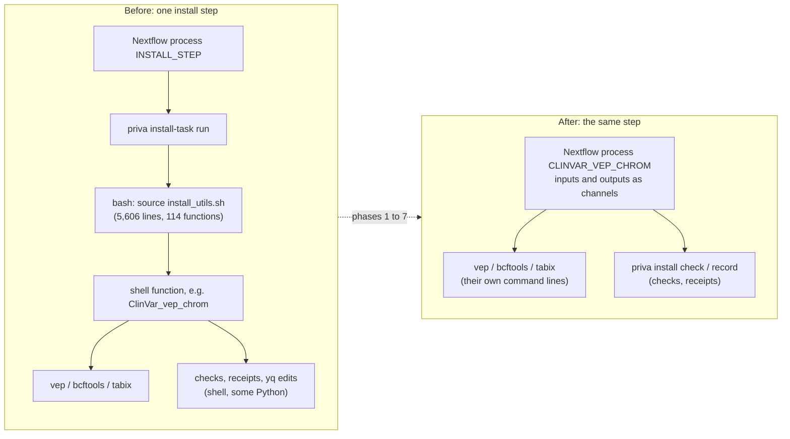

### Done: the install runner (`priva install-task`, 17 November 2026)

`scripts/install_task.sh` (574 lines of shell, jq and yq) is replaced by
`priva install-task {plan,release,run,adopt,publish,reach}`
([`src/install_task/`](src/install_task/mod.rs)), called by
`modules/local/install.nf` with `--source-root` (the checkout). It writes the
same plan, releases, receipts, `pins.json` and `resources.lock.json`, so every
lineage folder an earlier installation made is found again:

| Check | Result |
| --- | --- |
| `reach` for all 83 steps against `install_task.sh reach` | Same functions, scripts, data files and digest for every step (11 s instead of 54 s) |
| Stub run of plan, releases, every step, adopt (A1, B9), publish, outside Nextflow | Same 436 files; JSON equal with key order, apart from times and the stub files' mtimes |
| `nextflow run main.nf --action install -stub`, the original branch against this one | Same 84 lineage folders (83 steps and PUBLISH) and the same `resources.lock.json`; 17 s instead of 1 min 54 s |
| Real F1 (HPO and MONDO downloads, `priva hpo-assertions` and `mondo-scope`) | Same receipt, configuration changes and file contents (gzip headers aside) |
| `release` for A2 and B8 (git), and HTTP sources on a local server (Last-Modified; no headers, so the sorted-lines SHA-256 of a body without a final newline) | Same release text |

Two details keep the digests: the installer functions' text is still what
`bash` prints for them (`declare -f`) after sourcing `install_utils.sh`, with
the shell runner's `identity` function defined first, because B4, C6, C8, C10,
C11, D1, D6 and D9 reach the word `identity` and so counted that function; and
functions, scripts and data files are ordered by the system's `sort` in the
environment's locale, as the shell runner ordered them. Phase 1 removed both.

A step's installer calls still run in one `bash` that sources
`install_utils.sh`; each call's arguments come from `priva install-task
call-args`, so they are read from the private configuration as the calls
before it left it, as before. Folder resolution (`installer-config-paths
managed-roots` and `resolve`) and the reuse check for shipped files are native.

### Why one small change can rebuild 40 steps

A step's lineage hashes its own code digest **and the lineages of the steps
it needs**, so a change anywhere upstream gives every step below it a new
folder, even when the upstream output is byte for byte the same. From the
registry's `needs`:

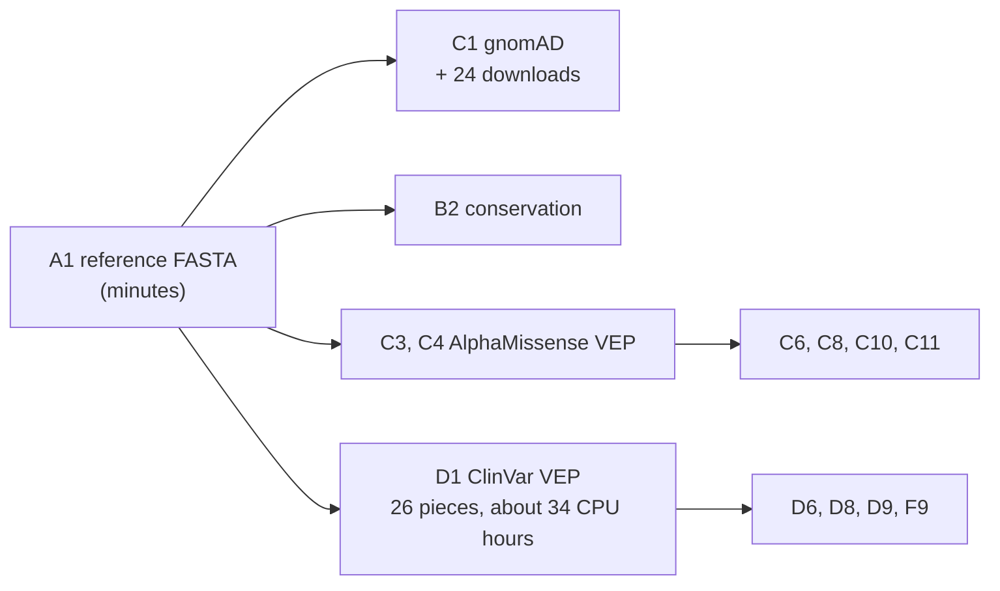

| Change in | Steps that run again |
| --- | --- |
| A1 (reference download) | 40, including C1, C3, C4 and all of D1 |
| A2 (VEP cache) | 40, including all of D1 |
| D0 (ClinVar download) | 33, including all of D1 |
| B9 (pext) | 32, including all of D1 |
| A4 (CDS FASTA) | none |
| F1 (HPO and MONDO) | 2 (F4, F9) |

Two remedies, both in phase 1:

- **Follow the output, not the code.** Each receipt records the SHA-256 of
  its output files, and a step's lineage hashes those instead of the upstream
  lineage. An upstream rewrite that produces the same bytes then rebuilds only
  itself.
- **Bundle.** Changes that alter lineages go out together, so an existing
  installation pays at most one rebuild, and `--adopt all` carries the
  unchanged results over instead.

### Phase 1: content-keyed step versions (done, 18 November 2026)

A step downstream now keys on **what its inputs hold**, not on how they were
made. Each receipt of a step that others need records a `content` key: the
SHA-256 of a listing of its data folder and output keys, which never names
the step's own (lineage) folder.

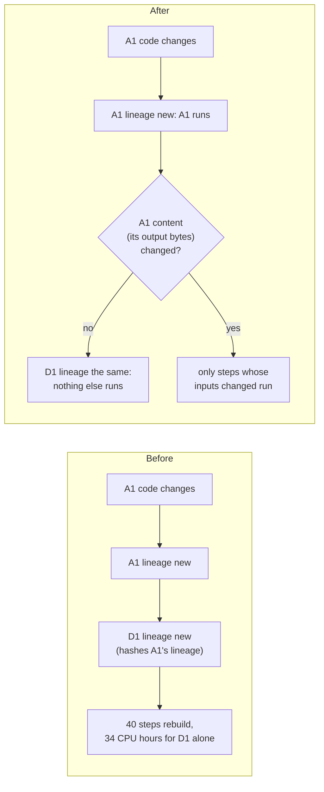

The content listing, one line per entry in byte order
([`src/install_task/content.rs`](src/install_task/content.rs)):

| Line | Entry | Why this form |
| --- | --- | --- |
| `f REL SHA256` | a file in the data folder | its bytes, hashed on all threads (`INSTALL_THREADS`) |
| `d REL` | a folder | an empty folder still counts |
| `l REL input ID REL2 CONTENT` | a link into an input step's folder | names the input's content, not its lineage path |
| `l REL own REL2` | a link inside this step's folder | no lineage in the text |
| `l REL tree REL2 SHA256` | a link to a file shipped in the checkout | the checkout path differs between machines |
| `l REL other IDENTITY` | a link elsewhere | path, size and modification time, as before |
| `k KEY ...` | an output key's value | one of the link forms above |

What changed, all in one lineage switch (an existing installation pays it
once, or not at all with `--adopt all`):

| Item | Before | After |
| --- | --- | --- |
| Input of a step's lineage | each input's lineage | each input's `content` (an adopted receipt, or one written before this change, counts by its lineage) |
| Order inside a digest | the system `sort` in the machine's locale: a laptop and the cluster could compute different lineages | byte order, the same everywhere |
| The shell runner's `identity` function | counted in 8 steps' digests | dropped |
| Rust code in a digest | the whole `rust/` tree's git object, for the 16 steps flagged `native`, so any Rust edit rebuilt all 16 | for every step, the Rust files its `priva` commands reach (`priva C`, `rust FILE SHA` lines of `reach`); `native` is gone, and `priva_commands` in the registry names commands a function picks at run time (C6, C10, F1) |
| Wrapped cache builders | the 11 builders `priva_wrap_cache_builders` renames to `_priva_cache_builder_NAME` were reached only through a variable, so their bodies were not in any digest | counted |
| Publish | keyed on every step's lineage | the same, plus the Rust files of `priva cache-install` (`publish_digest` in the plan and in `resources.lock.json`) |
| AlphaMissense motifs, DAS completion | `alphamissense_annotation_base.py`, `mapped_artifact_publish.py`, `das_install_state.py`, `das_input_continuity.py` | `priva alpha-annotation-base`, `mapped-artifact`, `das-install-state`, `das-input-continuity` (the checkers' sources stay hashed in their receipts, never run) |

A step nobody needs (for example a gnomAD chromosome join used only by
publish) is not hashed: hashing its folder would cost minutes for nothing.

| Check | Result |
| --- | --- |
| `cargo test --lib` | 610 passed (new: content of moved and changed folders, command detection) |
| `tests/install_workflow_check.py` | workflow regenerated, check passes |
| Stub install twice | 83 receipts, the second run reuses every folder |
| Cascade: a no-op line added to A1's `reference_genome_install` | A1 and publish run again; nothing else (before: 40 steps) |
| `das_install_state_compare.py`, `das_input_continuity_compare.py` | 121 and 91 cases, no mismatch |

### Done: installer checks in `priva` (19 November 2026)

The inline `python - <<PY` blocks of `install_utils.sh` that check or record
an install step are now `priva` commands. The frozen blocks are kept in
[`tests/fixtures/install-checks-8070d3d/`](../tests/fixtures/install-checks-8070d3d/)
as the reference.

| Shell function | Was | Now |
| --- | --- | --- |
| `validate_cds_fasta` (A4) | inline Python: FASTA records, `GRCh37`/`GRCh38` in the headers | `priva cds-fasta validate --fasta F --assembly A` ([`src/cds_fasta.rs`](src/cds_fasta.rs)) |
| `validate_loftee_resources` (B8) | inline Python: ancestor FASTA and `.fai`, chr1 length, GERP SQLite `quick_check` | `priva loftee-resources validate --ancestor F --conservation DB --assembly A` ([`src/loftee_resources.rs`](src/loftee_resources.rs), the vendored SQLite read only) |
| `validate_gene_pathogenic_mechanism_evidence` (F4) | inline Python: 18 columns, G2P and Orphadata row counts | `priva mechanism-evidence validate --evidence TSV` ([`src/mechanism_evidence.rs`](src/mechanism_evidence.rs)) |
| `validate_mondo_hpo_scope_cache` (F1) | inline Python: registry and scoped HPO assertions | `priva mondo-scope validate --registry R --hpo-assertions H` ([`src/mondo_scope_check.rs`](src/mondo_scope_check.rs)) |
| `SpliceAI2_install` (B4) | two inline blocks: identities before, configuration record after | `priva spliceai2-install check` and `register` ([`src/spliceai2_install.rs`](src/spliceai2_install.rs)): the same lock, SHA-256 checks, atomic config rewrite and receipt |
| `conda_install_vep` release switch | inline Python pins, then `vep_plugins_release.py transition` | `priva vep-release pins --packages FILE` ([`src/vep_release.rs`](src/vep_release.rs)) and `priva vep-plugins transition`; `priva_bootstrap_binary` builds `priva` with `bootstrap_priva_rust.py` first, so this works before `PriVA_rust_install` |

The package manager (`conda`/`mamba install --file PINS ensembl-vep=R.*`),
`gzip -t`, `samtools` and the downloads stay the tools' own commands.

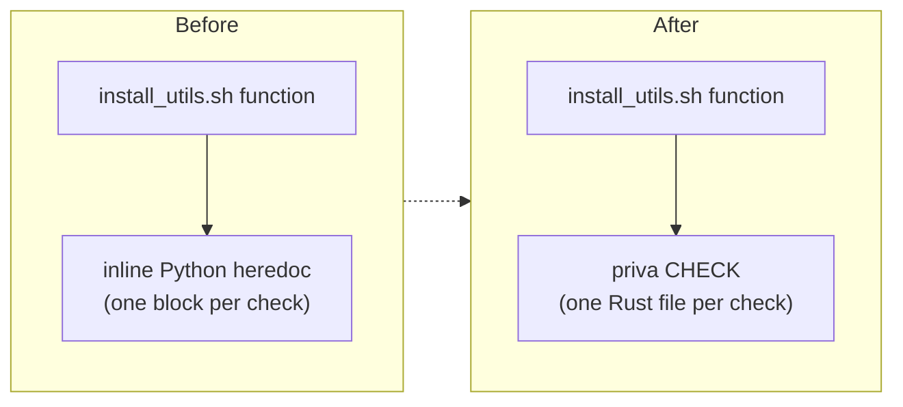

| Check | Result |
| --- | --- |
| [`tests/install_checks_compare.py`](tests/install_checks_compare.py): each case run through the frozen block and through `priva` | 149 cases (49 successes, 95 failure messages), no mismatch in exit, output, message or written bytes |
| `cargo test --release --lib` | 619 passed (new: an output changed after its checksum is refused before the config write, as the removed Python test checked) |
| `tests/install_workflow_check.py` | passes: the new commands are reached by A4, B4, B8, F1 and F4 |
| Python suite (`pytest tests`), this change against 8070d3d | the same 104 failures on both, all from what this sandbox lacks (the `Bio::DB::BigFile` Perl module, the pinned pandas); the MONDO and LOFTEE tests now expect the new calls, and the SpliceAI2 race test is the Rust test above |
| `mapped_artifact_compare.py`, `alpha_annotation_base_compare.py` (with bcftools) | 121 and 167 cases, no mismatch; `alpha_annotation_base` records the thread count as left out of the comparison on purpose (d9eac64) |

Each check is a file of its own, so a step's digest reaches only the Rust it
runs: A4, B4, B8, F1 and F4 get new lineages; no step they feed rebuilds
unless their output bytes change (phase 1).

### Phase 2: a bootstrap without `install_utils.sh` (started, 19 November 2026)

`main_install` creates the conda environment, installs Nextflow and builds
`priva` before any resource. The README's "Install as Nextflow tasks" now
gives the same as four commands, each the tool's own:

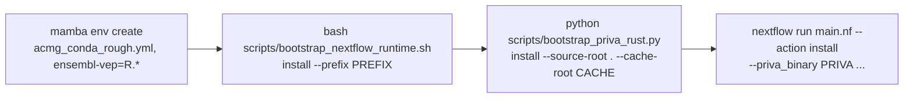

`bootstrap_priva_rust.py` stays Python (it builds `priva`, so it cannot be
`priva`). What `main_install` does before `PriVA_rust_install`, and where it
is now:

| `main_install` stage | Nextflow install |
| --- | --- |
| `priva_install_basic_paths` (`cache_root`, `tmp_dir`, assembly, VEP major) | each step's private configuration names its own folders; the assembly and VEP major are step settings |
| `conda_install_vep`: create `priva_acmg` | command 1 (`ensembl-vep=R.*` in the environment file, as `conda_install_vep` writes it) |
| `conda_install_vep`: change an existing environment's VEP release | still `main_install` (`priva vep-release pins`, `priva vep-plugins transition`, then the manager's `install`) |
| `priva_manual_cache_inputs` | `INSTALL_PREFLIGHT`: `priva install-task preflight` checks the files you supply for every step that will run (adopted steps left out); SpliceAI and PrimateAI publisher files must be set |
| `bundled_snapshot_install` | `INSTALL_PREFLIGHT`, through `priva installer-prerequisites --stage snapshots` |
| `priva_prepare_install_config` (folders, prerequisites, NM-to-ENST mapping) | `install-task run` (folders), step A5 (mapping); A1 checks and installs the selected reference (`priva reference-resources install`), F5 runs the GoFCards checks |
| `CADD_conda_install`, `Nextflow_runtime_install`, `PriVA_rust_install` | step E1; commands 2 and 3 |
| `priva_export_installed_environment` (after the last resource) | not yet a task |

`INSTALL_PREFLIGHT` takes the plan and passes it on, so no step starts before
it passes. Its file rules are those of `installer-prerequisites --stage
manual-inputs`, kept in [`src/install_task/preflight.rs`](src/install_task/preflight.rs)
rather than shared: `installer_prerequisites` is reached by the digest of 37
steps, all of the ClinVar VEP chain among them, so editing it would give them
new lineages, while no step runs `install-task`.

| Check | Result |
| --- | --- |
| `nextflow run main.nf --action install -stub`, then again with the preflight | the second run starts `INSTALL_PREFLIGHT` only: every step folder and the publish folder are reused |
| `install-task preflight` on plans with unset, missing, partial (`.partial`) and complete publisher files, and with B4 and B7 adopted | refuses the first three with the installer's messages; passes the last two |

Left for phase 2: export the installed environments as a task, and make the
README lead with the four commands once a complete installation through the
tasks has been compared with `main_install`; `main_install` stays until
phase 7.

### Phase 3: download steps as their own processes (20 November 2026)

Eleven steps no longer go through `install_utils.sh`. Each is a Nextflow process
in `modules/local/install_steps/` whose script runs the tools' own commands
and `priva` for PriVA's checks, and writes only into its task's work folder:

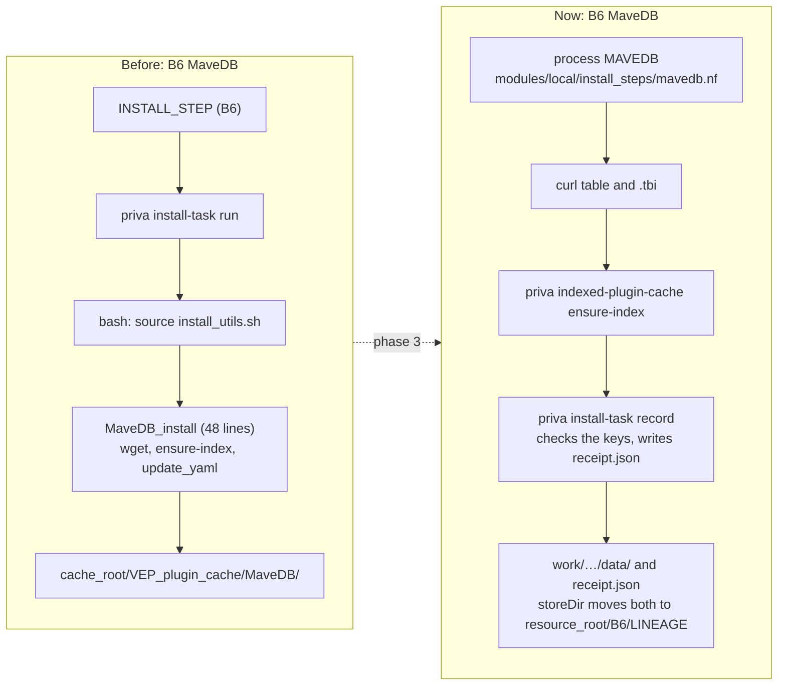

The whole hg38 branch of the process (the `script:` block):

```bash
mkdir -p data/MaveDB
curl -fL --retry 5 --retry-delay 10 -o data/MaveDB/MaveDB_variants.hg38.tsv.gz "$mavedb_url"
curl -fL --retry 5 --retry-delay 10 -o data/MaveDB/MaveDB_variants.hg38.tsv.gz.tbi "$mavedb_url.tbi"
"$PRIVA_BIN" indexed-plugin-cache ensure-index --input data/MaveDB/MaveDB_variants.hg38.tsv.gz --kind mavedb
"$PRIVA_BIN" install-task record ... --key mavedb_file=data/MaveDB/MaveDB_variants.hg38.tsv.gz
```

How such a step is wired:

| Part | What it is |
| --- | --- |
| registry `module` | the process file; it defines `process NAME` (the step's registry name) and replaces `calls` and `runs` |
| registry `stage` | keys of the steps it needs whose files are staged into the task, with their `.fai`, `.gzi`, `.tbi` and `.csi` (B2 and B5 stage A1's `ref_genome`) |
| the task's input | `[id, lineage, plan.json, the receipts it needs, its plan entry, {key: staged file name}, staged files]`, made by `installNative` in `workflows/install.nf`; files you supply (the plan's new `user_paths`) are staged too |
| `priva install-task record` | the script's last line: checks every output key is given and exists, makes the files under `data/` read-only (not the folders: storeDir moves `data/` with `mv`, which a read-only folder refuses for a user who is not root), and writes `receipt.json` with the fields `install-task run` writes and the paths storeDir will give the files. `--relocate data/FILE` rewrites the paths a tool wrote into a JSON file of its own (A1's `.source.json`, B3's `.ready.json`) |
| code digest | the registry entry, the module's text, the scripts and shipped data files it names as `${projectDir}/scripts/…` or `${projectDir}/data/…` (F1's MONDO overrides, B5's chain), and the Rust behind each `"$PRIVA_BIN" COMMAND` it runs. `modules/local/install_steps/common.nf` (the record, adopt and stub lines) is the runner and is not counted |
| adopt and stub | as for every step: `install-task adopt` writes the receipt, `record --stub` writes stub files |

A file you supply is never written. Where the old function wrote an index
beside it (a sorted PrimateAI table or a FASTA without a current index), the
process keeps the new index in its own folder with a link to your file.

Each step was run both ways on the same plan with `tests/install_step_compare.py`
(the old route uses the registry before this change,
`tests/fixtures/install-steps-1879c0c.json`). `tests/fake_net.py` stands in for
curl and wget and serves files from a folder, so both routes download the same
bytes without the network; only GitHub is reachable from the test machine.

| Step | Commands in the process | Cases compared | Result |
| --- | --- | --- | --- |
| A1 reference | `priva reference-resources install` (curl, samtools faidx) | your FASTA with its index; without an index (process only); UCSC download (stand-in for the pinned 900 MB download) | same bytes; your folder is left as it was |
| A4 CDS FASTA | curl, `priva cds-fasta validate` | GRCh38 | same bytes |
| B1 UTRannotator | git clone, git checkout of the pinned commit | real GitHub | same files (without `.git`) |
| B2 conservation | curl, `priva conservation-resource publish` | hg19 wiring (stand-in for the Perl bigWig reader, not installed here) | receipt names the published file |
| B3 AlphaMissense | `priva alphamissense-cache install` (curl, bgzip, tabix) | wiring (stand-in for the MD5-pinned 600 MB object) | receipt and `.ready.json` name the moved file |
| B5 SpliceVault | curl, bgzip, tabix; hg19: `priva splicevault-convert` (CrossMap, shipped chain), sort, bgzip, tabix | hg38; hg19 with real CrossMap | same bytes |
| B6 MaveDB | curl, `priva indexed-plugin-cache ensure-index` | hg38; hg19 records no table | same bytes |
| B7 PrimateAI | `priva indexed-plugin-cache format-primate` | publisher table; sorted table with index; sorted table without index (process only); missing file | same bytes; the missing file stops the step with the download link |
| B8 LOFTEE | git clone and checkout of the pinned commit (master or grch38), curl, gunzip, `priva loftee-resources validate`, for GRCh38 `priva conservation-resource validate`, `bgzip -r` | hg19 (real GitHub); hg38 wiring (stand-in for the GERP bigWig check) | same files and bytes, `.fai` and `.gzi` too (repository without `.git`) |
| B9 pext | curl | hg38, hg19, `pext_enabled: false` | same bytes |
| F1 HPO and MONDO | curl, `priva hpo-assertions build`, `mondo-scope build`, `mondo-scope validate` | real HPO v2026-06-23 and MONDO v2026-07-06 | OBO same bytes; the two `.tsv.gz` the same decompressed bytes (their gzip header holds the write time and a temporary name, as with any two runs of the old function) |

Changes you can notice:

- A1 lists `ref_genome` under `user_inputs`: a FASTA you set there counts in
  A1's lineage and is used where it is (the old route copied it into A1's
  folder).
- F1 reads the MONDO overrides shipped in `data/mondo/`; a
  `mondo_disease_scope_overrides` of your own is not read.
- An unknown name in `pext_tissues` stops B9 when UCSC has no such file
  (the old function checked the names against the list in
  `common_bash_utils.sh` first; the list moves with phase 4).
- B8 no longer writes `PERL5LIB` into your conda environment's variables:
  the annotation already passes `loftee_repo` to VEP with `--dir_plugins`.
- The eleven steps have new code digests, so they and every step that needs
  them get new lineages once. That includes the 26 ClinVar VEP pieces
  (`D1_chr*`, about 34 CPU hours); `--adopt all` keeps an existing
  installation instead.

Still on the shell route: A5 (it picks the shipped NM-to-ENST table or asks
Ensembl BioMart through `priva installer-prerequisites` stages that read the
whole configuration; BioMart is out of the test machine's reach) and D0 (its
`inputs.ready.json` names absolute paths that D1 reads, so it needs
`--relocate` and a cluster run of D1). A5 moves to phase 5, with the other steps whose checks live in `installer-prerequisites`; D0 moves to phase 6, with the ClinVar chain it feeds.

### Phase 4: the analysis tasks without the shell scripts (21 November 2026)

#### The family steps

Filtration and the four prioritization steps no longer run
`filtration_vcf_per_fam.sh` or `prioritization_vcf_per_fam.sh`. `priva task
run` checks the task as before, then runs the step's tools itself
([`src/pipeline_steps/family.rs`](src/pipeline_steps/family.rs)):
bcftools, tabix and priva's own commands, with the arguments the shell
functions gave them.

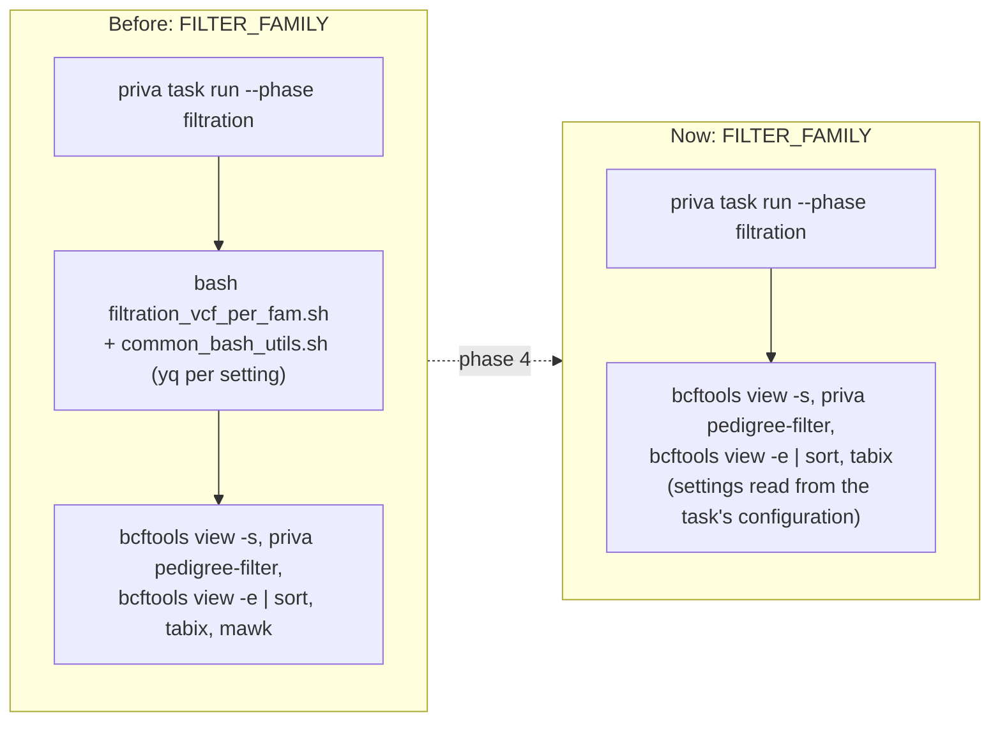

| Task | Shell function before | Commands now, in this order |
| --- | --- | --- |
| `FILTER_FAMILY` (with a PED file) | `main_filtration`: `extract_fam_vcf`, `filter_allele_based_on_pedigree_data`, `filter_af`, `filter_cadd_based_on_vcf` | `bcftools view --threads T --force-samples -s MEMBERS -Oz`, `tabix -p vcf -f`, `priva pedigree-filter -v -p -f -o`, `tabix`, `bcftools view --threads T -e "AF_grpmax_joint > CUTOFF" -Ou \| bcftools sort -Oz`, `tabix`, then the CADD rows of the records left (the `mawk` join, in Rust) |
| `FILTER_FAMILY` (no PED file) | `main_filtration` without a family | the allele-frequency filter on the cohort VCF, then the CADD rows |
| `PRIORITIZE_COMBINE` | `prepare_combined_tab` | `priva combine-annotations -i -c -o -p -t` |
| `PRIORITIZE_SPLICING` | `interpret_splicing_annotations` | `priva splicing-analysis --anno_table --transcript_domain_map --intolerant_domains --interpro_entry_map_pkl --config --threads` |
| `PRIORITIZE_UTR` | `interpret_utr_annotations` | `priva utr-anno-interpret --variants_table --domain_map --intolerant_domains` |
| `PRIORITIZE_ACMG` | `acmg_assign_table` | its file checks, then `priva acmg-assign` with the same 22 options and the same optional ones (`--ped_table`, `--fam_name`, `--alt_disease_vcf`, `--mavedb_metadata_tsv` for hg38, `--pp1_vcf`/`--pp1_ped`, gene lists, `--cds_fasta_path`, `--pext_tissues`, `--ignore_clingen_override`) |

Kept as the scripts had them, so the commands are the same: each setting is
read as `read_yaml` read it (a missing key or null is `null`, a boolean
`true`/`false`), a value the scripts left unquoted is split into words, the
scripts' file checks and their messages, the answers for an empty family (an
empty table, or no table when the CADD table has no row), and the skip of a
splicing or 5' UTR table that already has its columns. Left out: the checks
that skipped a step whose output was newer than its inputs (a task's folder is
new, so its output never exists before it) and the table displays. The
whole-run `prioritization` phase runs the four steps the same way.

`priva task step --step STEP --root CHECKOUT --config CONFIG [--vcf]
[--cadd] [--table] [--family]` runs one of these steps outside Nextflow,
without a contract, to look into one family by hand.

[`tests/family_step_compare.py`](../tests/family_step_compare.py) runs each
case through the shell function (the task's step wrapper before this change is
kept as [`tests/fixtures/family-steps-952811c/prioritization_step.sh`](../tests/fixtures/family-steps-952811c/prioritization_step.sh))
and through `priva task step`, on the shipped test family
(`data/test_example/TEST_FAM`, 20,205 records, with a made-up
`AF_grpmax_joint` and a CADD table made from its records). Filtration runs the
real `priva pedigree-filter`; the other priva commands are a stand-in that logs
its arguments, so the comparison is of the commands, not the science.

| Case | Exit | priva commands | Files |
| --- | --- | --- | --- |
| filtration: PED family; no PED file; no cohort CADD table (another cutoff) | same | same | same records and header (`##bcftools_` lines aside) and the same CADD rows: 1,295, 7,711 and 1,860 records kept |
| combine: normal; empty VCF; one-line CADD table; default HPO table | same | same | same |
| splicing: normal; columns already there; empty table; 5' UTR | same | same | same |
| ACMG: hg38 with every option; hg19 without family, override off, no CDS FASTA; empty values; a missing resource; a missing `clinvar_gene_stat` path; empty table | same (both refuse the missing files) | same | same |
| whole prioritization: normal; empty VCF | same | same (4 commands) | same |

19 cases, no difference. The CI job runs the comparison after the Rust build.

Changes you can notice:

- A plain `.vcf` given as `pp1_vcf` or `alt_disease_vcf` is checked without
  writing a compressed copy beside it (the shell check wrote one to list its
  samples, and in a folder it could not write to it dropped the option).
- A family with no member in the PED file stops with that message (the shell
  stopped on the empty sample list's expansion).
- The log lines start with `[priva task]`.

#### The annotation steps

The six annotation tasks no longer source `annotation_vcf.sh` and
`common_bash_utils.sh`. `priva task run` checks the task as before, then runs
the step in Rust, one file per step in
[`src/pipeline_steps/`](src/pipeline_steps/) (`preprocess.rs`, `gnomad.rs`,
`clinvar.rs`, `control.rs`, `vep.rs`, `cadd.rs`; the assembly checks and the
chromosome renaming they share are in `annotation.rs`, the setting reader and
the command runner in `tools.rs`). Each runs bcftools, tabix, VEP, `CADD.sh`
and priva with the arguments the shell function gave them.

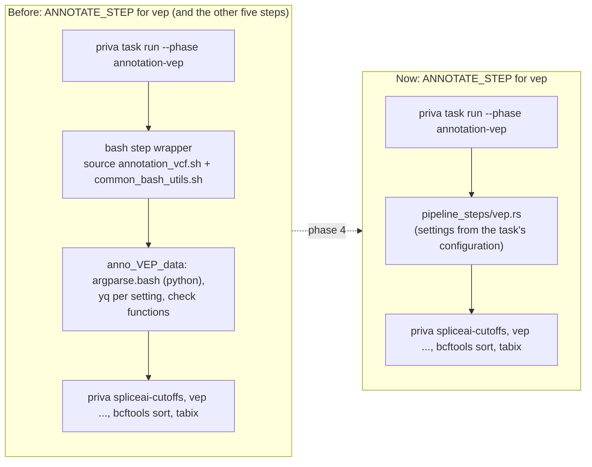

| Task | Shell function before | Commands now |
| --- | --- | --- |
| `ANNOTATE_PREPROCESS` | `preprocess_vcf` | `bcftools view --threads T -r PRIMARY_CONTIGS -Ou \| bcftools sort -Oz`, `tabix`; for NCBI names `bcftools annotate --rename-chrs GRC_to_ucsc.contig.map.txt -Ou \| bcftools sort -Oz`, `tabix`; `bcftools norm -m -both -c s -f REF --atom-overlaps . [--keep-sum AD] -Ou -a \| bcftools norm -d exact \| bcftools filter -i EXPR \| bcftools sort -Oz`, `tabix`; `priva variant-ids -m encode`, `tabix` |
| `ANNOTATE_STEP` gnomad | `anno_agg_gnomAD_data` | per chromosome `bcftools view -r CHR -Ou \| bcftools sort -Oz`, `tabix`, then `bcftools annotate -a GNOMAD_CHR -c 43_FIELDS -r SPAN -Oz`, `tabix` (chrM copied with `bcftools view -r chrM -Oz`); `bcftools concat -Ou \| bcftools sort -Oz`, `tabix` |
| `ANNOTATE_STEP` clinvar | `anno_clinvar_data` | `bcftools annotate --threads T -a CLINVAR -c .INFO/CLNDN,...,.INFO/CLNCSQ:=INFO/CSQ -Ou \| bcftools sort -Oz`, `tabix` |
| `ANNOTATE_STEP` control | `anno_control_vcf_allele` | without a control VCF, `bcftools view --force-samples -s UNAFFECTED \| bcftools +fill-tags -- -t AC,AN,AF,AC_Hom`; a control VCF without those tags, `bcftools +fill-tags`; then `bcftools annotate -a CONTROL -c INFO/control_AC:=INFO/AC,... -Oz`, `tabix` |
| `ANNOTATE_STEP` vep | `anno_VEP_data` | `priva spliceai-cutoffs`, then the same `vep` command line (every plugin, MaveDB on GRCh38, the pext tracks when `pext_enabled`), `bcftools sort -Oz`, `tabix` |
| `ANNOTATE_CADD` | `Calculate_CADD` | the Conda frontend check (`scripts/cadd_conda.py check`, now in Rust), `bcftools annotate --rename-chrs ucsc_to_GRC.contig.map.tsv -Ou \| bcftools sort -Oz`, `tabix`, `bcftools view --threads T -G -t ^MT -Oz`, `CADD.sh -c T -a -p -m -d -g GENOME -o OUT.gz` with the same `PATH`, `TMPDIR`, `PRIVA_CADD_MMSPLICE_EXON_CACHE` and `PRIVA_CADD_PRESCORE_BIN`, `gunzip`, the table without its `##` lines |

Kept as the scripts had them, so the commands are the same: the settings as
`read_yaml` read them; the wrapper's values passed through argparse for VEP
(`--threads` read as Python's `int()` reads it, so an empty or `null` value
stops the step); unquoted values split into words; the assembly from the
VCF header as `check_vcf_assembly_version` found it (its `grep ID=chr1` and
the `>` its awk kept); every file check, skip (tags already there, a CSQ
newer than the program) and refusal; the gnomAD worker counts (the split with
`min(threads, SLURM_CPUS_PER_TASK) / 2`, stopping new pieces after a failure,
the annotation with `threads`) and its publication markers; pipelines that
report only their last command's status, except where the script set
`pipefail`. Left out: the checks that skipped a step whose output was newer
than its inputs, the displays, and, in a task, the installer's branches
(`PRIVA_CLINVAR_RECOVERY_CONFIG`, `anno_VEP_cache_candidate`), which stay in
the shell for D1 until phase 6.

`priva task step --step {preprocess,gnomad,clinvar,control,vep,cadd} --root
CHECKOUT --config CONFIG --vcf VCF [--output PATH]` runs one of them by hand
(preprocess and CADD write `--output`; the others change the VCF in place).

[`tests/annotation_step_compare.py`](../tests/annotation_step_compare.py) runs
each case through the shell function (the task's step wrapper before this
change is kept as
[`tests/fixtures/annotation-steps-cd91ec2/annotation_step.sh`](../tests/fixtures/annotation-steps-cd91ec2/annotation_step.sh))
and through `priva task step`, on made-up data: a small reference named as
hg38; a cohort VCF of three samples in UCSC and in NCBI names, with records off
the primary contigs, multi-allelic and duplicate records, `*` alleles, a wrong
REF and a record without an alternative genotype; per-chromosome gnomAD files
with the 43 fields; a ClinVar file; control VCFs and PED files. bcftools and
tabix are the real programs behind a logging wrapper; `vep`, `CADD.sh` and its
Conda are stand-ins that log their arguments and write what the program
writes; `priva variant-ids` is the real one. A case must give the same exit
status, the same commands that write a file (paths and temporary names
masked), the same records and header of the step's VCF and the same CADD
table bytes.

| Step | Cases | Exit, commands, outputs |
| --- | --- | --- |
| preprocess | UCSC names; NCBI names; sites only (no GT, so no `--keep-sum`); assembly unknown; assembly differs from the reference; missing reference | same; 49 or 55 records kept |
| gnomAD | 2 threads; 1 thread; tags already there; chrM only; no records; a missing gnomAD chromosome file; a plain `.vcf` | same (25 commands for the full run) |
| ClinVar | normal; no `threads`; tags already there; missing ClinVar file | same |
| control | control VCF with counts; with genotypes only and no index; from the cohort's unaffected samples; none and optional; none and required; PED samples not in the VCF; tags already there | same |
| VEP | GRCh38; GRCh37 (3 forks); pext tracks; pext without its mean file; assembly from the VCF; no `threads`; `threads: " +04 "`; a missing plugin file; no MaveDB file; SpliceAI versions differ; VEP fails; CSQ already there | same |
| CADD | GRCh38 (MMSplice exon tables); GRCh37; no records; Conda 23.10; no Conda; no `CADD.sh`; unknown assembly | same |

43 cases, no difference, in about a minute. With a route changed on purpose
(another thread count for ClinVar, one more line in the CADD table) the
comparison reports both. The CI job runs it after the Rust build.

The hub folders: every annotation step's lineage now counts its Rust file
instead of the shell functions (see "Hub lineages from each step's own code"),
so each of the five sources gets a new, empty hub folder once, and the first
run with `--annotation_hub` after this commit annotates every variant again.
Later runs reuse the new folders as before.

Changes you can notice:

- The annotation, filtration and prioritization tasks no longer run GNU
  parallel, yq, mawk or Python themselves (`CADD.sh` still runs its
  Snakemake, and the standalone CADD workflow, `cadd.nf`, still runs
  `scripts/cadd_conda.py`).
- gnomAD leaves only its output in the task folder: the per-chromosome pieces
  and GNU parallel's job logs were left there before.
- The CADD Conda check gives Rust's messages; the rule is the same (Conda
  24.7.1 or newer, read as `packaging` reads versions; a platform; a prefix
  with `bin/activate`; a readable channel priority; Conda put on `PATH`
  without changing which Python comes first).
- The log lines start with `[priva task]`.

Still shell after phase 4: `--phase annotation` (the whole `main_workflow`,
which the workflow stopped calling when `ANNOTATE_COHORT` was removed), and
the scripts' functions the installer calls (D1 annotates ClinVar with the
gnomAD and VEP functions). They go with phase 6.

### Phase 5: the steps on native builders as their own processes (22 November 2026)

Fifteen more steps no longer go through `install_utils.sh`: A5, C6, C8, C10,
C11, D6, D8, D9 and F4 to F10. As in phase 3, each is a process in
`modules/local/install_steps/` that runs the tools' own commands and `priva`
into its task's `data/` folder, then `priva install-task record`.

Most of them reuse a file the repository ships unless a `PRIVA_FORCE_*`
variable asks for a rebuild. The process makes the same choice the shell
function made, and records the shipped file where it is:

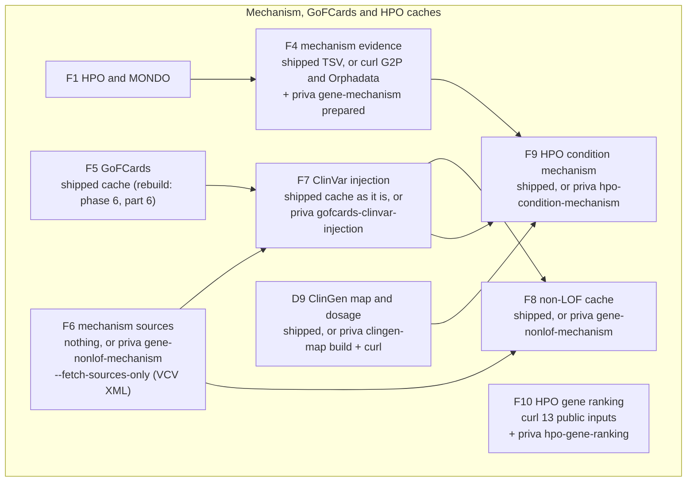

| Step | Default route | Rebuild (`PRIVA_FORCE_*`) or other route |
| --- | --- | --- |
| A5 NM-to-ENST | the shipped table of the assembly and VEP release, or the one you supply (linked with its `.provenance.json`) | `priva installer-prerequisites --stage mapping-source`, `biomart fetch`, `biomart verify` (BioMart is out of the test machine's reach: not run here) |
| C6 AlphaMissense domains | `bcftools view -h` for the contigs, `priva alphamissense-domain chromosome` per contig, `merge`, `check` | |
| C8 InterPro | the shipped mapping | curl InterPro's XML, `gzip -t`, `protein_domain_mapping.py` (still Python) |
| C10 DAS domains | `priva cache-install resolve`, `alpha-exon-history chromosome`/`merge`/`export`, `domain-metadata build`, `das-domains transcripts`/`analyze` | |
| C11 PM1 regions | `priva installer-prerequisites --stage mapping`, `biomart identity`, `mapped-artifact run --native-producer pm1-regions` | |
| D6 ClinVar AF | `priva clinvar-contract`, `clinvar-gene-af build`, `cache --kind gene-af`, the same for exons | |
| D8 ClinVar PM5 | `priva clinvar-contract header`, `clinvar-pm5-index` | |
| D9 ClinGen | the shipped map and dosage table | `priva clingen-map build`; curl the dosage table, `mechanism-source validate` and `record-source`, awk |
| F4 mechanism evidence | the shipped TSV | curl G2P and Orphadata (a selected URL checked by `mechanism-source validate`), `mechanism-source record-source`, `gene-mechanism prepared`, `mechanism-evidence validate` |
| F5 GoFCards | the shipped cache | stops: rebuilding needs the GRCh37 and GRCh38 VEP caches, which come with A2's process in phase 6 (done in phase 6, part 6) |
| F6 mechanism sources | nothing to fetch, no file recorded | `priva gene-nonlof-mechanism --fetch-sources-only`; records the VCV XML, or the `clinvar_vcv_xml` you supply |
| F7 ClinVar injection | F5's shipped cache, as it is | for a cache F5 built: `sha256sum` of F6's XML, `priva gofcards-clinvar-injection`, `gofcards-cache-validate` (twice: the cache, then the XML it cites) |
| F8 non-LOF cache | the shipped cache | `priva gene-nonlof-mechanism` with F7's cache and F6's XML, then `--validate-only` against the shipped schema |
| F9 HPO condition mechanism | the shipped cache | `priva hpo-condition-mechanism` on F1, F4, F7 and D9, then `--validate-only` with the same inputs |
| F10 HPO gene ranking | curl the public inputs (gunzip, gene2go's human rows, unzip the optional Human Protein Atlas tables), `priva hpo-gene-ranking prepare-gene-evidence` and `build-hpo-graph` | |

Each was compared with its shell function with `tests/install_step_compare.py`
on the same plan and inputs. `tests/install_fixtures.py` writes the inputs of
the steps after the hours-long ones: a VEP-annotated ClinVar VCF (D1), an
AlphaMissense VCF (C4), the HPO and MONDO results (F1), a normalized GoFCards
cache (what F5 builds) and, for `tests/fake_net.py`, small G2P, Orphadata,
ClinGen, ClinVar VCV (with its `.md5`, README and XSD) and HPO ranking
downloads.

| Step | Cases compared | Result |
| --- | --- | --- |
| D6, D8, D9 | hg38, GRCh38, hg19; D9 rebuilt | same bytes |
| A5 | shipped hg38 and hg19 tables; a supplied pinned table; a supplied custom table; an invalid table | same bytes; the invalid table is refused both ways |
| C6, C8, C10, C11 | the fixture AlphaMissense VCF (an intolerant and a tolerant domain); C8 shipped | same bytes (C10: all three keys) |
| F4 | shipped; rebuilt from G2P and Orphadata; rebuilt from a selected G2P URL; a selected URL serving another table | same bytes; the wrong table is refused both ways |
| F5, F6, F7, F8, F9 | shipped (the chain F5, F6, F7, F8, F9 on each other's receipts) | same bytes |
| F6 | sources fetched (`PRIVA_FORCE_NONLOF_MECHANISM_CACHE=1`) | the same XML, the same requests both ways |
| F7 | injection into a normalized cache with one matching VCV record | the same decompressed cache, audit and statistics as the shell function run on the same files (the old install route cannot do this, see below) |
| F8, F9 | rebuilt | the same JSON apart from `built_at`, the build time each stamps (`--volatile built_at`) |
| F10 | the 15 downloads (one optional table missing); a required one missing | the same folder apart from the download times in `download_log.tsv` and the manifest's own folder path (`--volatile downloaded_at --own-paths`); the missing input stops both |

Changes you can notice:

- F4's rebuild no longer runs `build_gene_pathogenic_mechanism_cache.py`:
  curl downloads the two sources with the script's options (timeout, retries,
  user agent, `PROXY_URL`) and `priva gene-mechanism prepared` builds the same
  table. A failed download now stops the step; the script built the table
  without that source, which storeDir would then have kept. Each download has
  a `.source.json`; the script's `source_manifest.json`, `source_manifest.tsv`
  and `run_summary.json`, which nothing reads, are not written.
- A forced rebuild of F5 stops with a message until phase 6 (part 6). Before, the
  install workflow could not rebuild F5 either: the function wrote its cache
  to the build folder, not to the key the step records.
- F7 injects when F5 hands it a cache F5 built. Before, the install workflow
  could not inject at all: the function looked for F5's cache in F7's own
  build folder. Forcing the injection with F5's shipped cache stops, as it
  did (that cache already carries its conditions).
- `gofcards_clinvar_reinjection_lag_days` no longer delays a reinjection:
  a step folder never holds an earlier cache to keep. With the shipped caches
  F6 records nothing, so its weekly ClinVar release changes nothing after it;
  with forced caches each new weekly release reruns F6, F7 and F8.
- F6 lists `clinvar_vcv_xml` under `user_inputs`, and F6 and F8 list the G2P,
  ClinGen and PanelApp URLs under `settings`, so they count in the lineage.
- F6 and F8 read the HGNC table and the non-LOF schema shipped in `data/`.
- C10 keeps its exon history and metadata in its own folder (the function
  wrote them beside C6's statistics) and no longer writes the DAS completion
  receipt: storeDir decides reuse.
- `install-task record --relocate` keeps a JSON file's last line as it was
  (F10's manifest has no final newline).
- The fifteen steps have new code digests, so they and the steps after them
  get new lineages once.

Still Python in these steps: C8's rebuild (`protein_domain_mapping.py`).
The native builders hash some scripts they replace and record those hashes
(the non-LOF builder, the ClinVar injector and the HPO condition builder name
`scripts/*.py` as their builder source), so those scripts stay until the
cache formats stop naming them.

### Phase 6: the heavy chains as their own processes (22 November 2026)

Part 1 moves the gnomAD and ClinVar downloads: the 24 chromosome steps
C1_chr1 to C1_chrY, the family step C1 and the ClinVar release step D0.

The 24 chromosome steps share one process, `GNOMAD_DOWNLOAD`: a registry
entry may name the `process` its module defines when several steps run the
same one (`workflows/install.nf` includes it once per step under the step's
name, and the step's code digest reads that process). The chromosome is the
step's id after `C1_chr`.

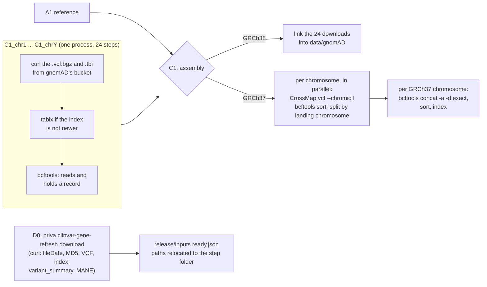

| Step | Commands in the process |
| --- | --- |
| C1_chrN | `curl` the chromosome and its index, `tabix -f -p vcf` when the index is not newer, `bcftools view -h` and one record (the checks of `check_vcf_validity`) |
| C1 GRCh38 | links to the 24 downloads (and their indexes) in `data/gnomAD`, each checked to read and hold a record |
| C1 GRCh37 | `CrossMap vcf --chromid l` with `hg38_hg19_chain` (shipped or an absolute path) and A1's reference, `bcftools sort`, `index`, `query` and `view` per landing chromosome, then `bcftools concat -a -d exact`, `tabix`, `bcftools sort` and `index` per GRCh37 chromosome, as `gnomAD_liftover` did |
| D0 | `priva clinvar-gene-refresh download` on a configuration holding only the assembly; `record --relocate` on `inputs.ready.json` and each `.source.json` |

Compared with the shell functions (`tests/install_fixtures.py gnomad` and
`clinvar_release` write the downloads for `tests/fake_net.py`, which now
answers `curl --include` with a status line and headers):

| Step | Cases compared | Result |
| --- | --- | --- |
| C1_chr1 to C1_chrY | each chromosome; a missing index on the server | same bytes (VCF and index); the missing index stops both |
| C1 GRCh38 | the 24 downloads (`--family`: every member) | same bytes, all 24 members and indexes |
| C1 GRCh37 | the 24 downloads lifted with the shipped chain onto a sparse GRCh37 reference: sites that land on their own chromosome, on another one (chr1 to chr2, chr7 to chr16), on the reverse strand, or nowhere | the same 24 members apart from the provenance lines that name paths and times (`--volatile 'bcftools_*' --volatile originalFile`) |
| D0 | hg38 and hg19; a wrong publisher MD5 | the same release file apart from its times and own folder; the wrong MD5 stops both |

Changes you can notice:

- C1 lists `hg38_hg19_chain` under `settings` (the shell function read it from
  the configuration without counting it).
- C1's GRCh37 route gives CrossMap a link named `.vcf.gz` to each download
  instead of recompressing it with `bcftools view -Oz`: CrossMap copies no
  `##bcftools` lines, so the lifted files are the same, and the step no longer
  writes a second copy of gnomAD. Its work files (the links, the lifted
  pieces) are removed; the step folder holds the 24 members and their indexes.
- C1 keeps no links to the GRCh38 downloads for GRCh37 (nothing reads them).
- As before, a `gnomad_vcf_chrX` in your configuration does not stand in for
  the family (compared: both routes build their own); adopt an existing
  installation with `--adopt`.

Part 2 moves the VEP cache (A2) and the SpliceAI scores (B4).

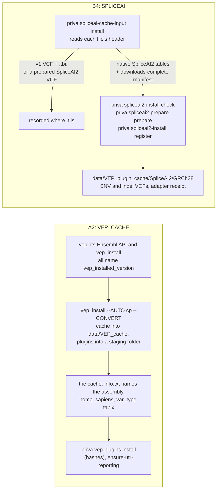

| Step | Commands in the process |
| --- | --- |
| A2 | `vep --help`, Perl's `Bio::EnsEMBL::ApiVersion` and the install helper's `.version` checked against `vep_installed_version`; `vep_install -d SITE_PERL --AUTO cp --NO_UPDATE --CACHE_VERSION R -s homo_sapiens_merged --NO_HTSLIB --NO_BIOPERL --CONVERT --CACHEDIR data/VEP_cache --ASSEMBLY A --PLUGINS ... --PLUGINSDIR STAGING`; the checks of `priva_validate_vep_cache`; `priva vep-plugins install` and `ensure-utr-reporting`; `record --relocate` on the plugins' receipt |
| B4 | `priva spliceai-cache-input install` on a configuration holding the assembly and the two files you set; for native SpliceAI2 tables it runs `spliceai2-install check`, `spliceai2-prepare prepare` and `spliceai2-install register` itself (the steps of `SpliceAI2_install`); `record --relocate` on the adapter receipt |

Compared with the shell functions (`tests/install_fixtures.py vep` writes an
environment of stand-ins for `vep`, `vep_install`, `perl` and `conda`;
`spliceai` writes v1 VCFs and native SpliceAI2 shards; `--old-priva` runs the
old route with the program built from the commit before the change, since B4
also changes `priva spliceai-cache-input`):

| Step | Cases compared | Result |
| --- | --- | --- |
| A2 | GRCh38 and GRCh37 | the same cache (every file) and plugins apart from the plugins' receipt naming its own folder (`--own-paths`) |
| A2 | `vep_installed_version` 115 with VEP 116 installed; a cache whose `info.txt` names the other assembly; `vep_install` failing | each stops both routes |
| B4 | SpliceAI v1 VCFs, GRCh37 and GRCh38 | the same files (both record the files you set) |
| B4 | the 47 native SpliceAI2 shards with a complete manifest (pinned GENCODE 48 GTF, scored regions, a GENCODE 50 GTF that renames a gene, Ensembl's `SpliceAI.pm` of VEP 116) | the same SNV and indel VCFs and indexes; the adapter receipts differ only in the program that converted (two builds) |
| B4 | the native shards without gene-context resources | the same refusal in both (`Pinned GENCODE48 GTF is required`) |

Changes you can notice:

- A2 no longer writes `PERL5LIB` and `PATH` into your conda environment's
  settings (nothing reads them: every VEP command names `--dir_plugins`), and
  keeps no release-transition file in it: a new release is a new step folder,
  not an upgrade of the old plugins folder in place. It no longer refuses to
  run outside a conda environment; `vep_install` is given the first
  `site_perl` folder of the `perl` on PATH.
- A2 always installs into its own new folder, so the reuse of an existing
  cache and the resumption of an interrupted UTRAnnotator change, which the
  function handled in a shared folder, are not needed.
- B4 records the files you set where they are (the shell function did too)
  and never asks: without the two files it stops with where to get them. It
  no longer waits for A2.
- `priva spliceai-cache-input install` prepares native SpliceAI2 tables with
  its own commands instead of running `install_utils.sh SpliceAI2_install`,
  so it no longer needs `PRIVA_SCRIPT_DIR`.

Part 3 moves the AlphaMissense annotation (C3) and its gnomAD frequencies
(C4).

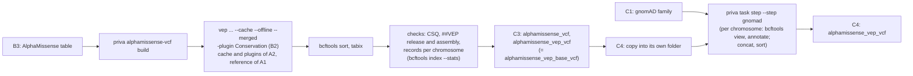

| Step | Commands in the process |
| --- | --- |
| C3 | `priva alphamissense-vcf build`; the `vep` command line of `basic_vep_annotation` (without SpliceAI); `bcftools sort`, `tabix`; `priva alphamissense-cache check-annotation`; `bcftools index --stats` of the converted and annotated VCFs compared |
| C4 | `cp -p` of C3's VCF and index; `priva task step --step gnomad` on the copy, the annotation's own gnomAD step (the commands of `anno_agg_gnomAD_data`) |

Compared with the shell functions (`tests/install_fixtures.py vep` now
writes a `vep` that annotates, and A2 receipts; `alphamissense_inputs` writes
the A1, B2, B3 and C1 receipts):

| Step | Cases compared | Result |
| --- | --- | --- |
| C3 | GRCh38 and GRCh37 | the same converted VCF and annotation (bytes and indexes) |
| C3 | `vep` failing; `vep` losing a record; `vep_installed_version` 115 with VEP 116 | each stops both routes |
| C4 | GRCh38 and GRCh37, on C3's new output | the same VCF apart from the `##bcftools_*` lines (paths and dates) |
| C4 | a gnomAD family without chr2 | stops both routes |

C6 reads C4's new output as before (run on the chain).

Changes you can notice:

- C3 no longer runs `priva alpha-annotation-base` (path, recover, check,
  capture, publish, restore): the step's folder is new for every change of
  its inputs, so the reuse checks, the pending-publication journal and the
  `.annotation-base.json` receipt are not needed. The installer's
  `AlphaMissense_anno` still runs them until phase 7.
- C3 keeps one annotated VCF and records it under both
  `alphamissense_vep_vcf` and `alphamissense_vep_base_vcf`; the function kept
  two copies because C4 changed one in place. C4 now writes its own.
- C3 checks that the `vep` on PATH is `vep_installed_version`, as
  `alpha-annotation-base` did, and that VEP kept every record, chromosome by
  chromosome.
- C3's `bcftools sort` keeps its temporary files in the task folder
  (`-T`), not in `/tmp`.
- VEP runs with the task's CPUs (`--fork`), not the configuration's
  `threads`; C4's gnomAD step is given the task's CPUs as its threads.
- C4 no longer leaves the split pieces and GNU parallel's job logs in its
  folder.

Part 4 moves the ClinVar annotation: the split (D1_split), VEP on each piece
(D1_chr1 to D1_chrOther, 25 steps on one process, `CLINVAR_VEP_CHROM`; the
piece is the step's id after `D1_`) and the gather with its statistics (D1).

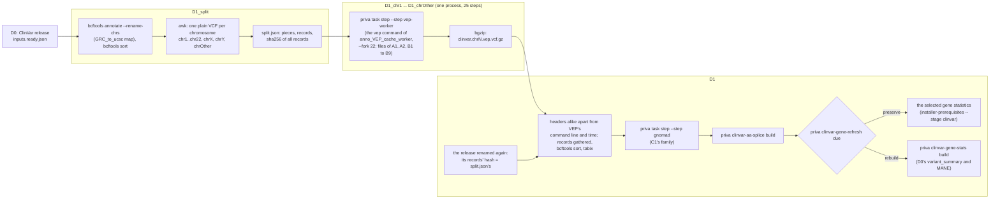

| Step | Commands in the process |
| --- | --- |
| D1_split | `bcftools annotate --rename-chrs` with the shipped `GRC_to_ucsc.contig.map.txt`, `bcftools sort -T`, `tabix`; `awk` writes the 25 pieces and their counts; `sha256sum` of the records; `jq` writes `split.json`; `record --relocate` on it (the commands of `ClinVar_vep_split`) |
| D1_chrN | `priva task step --step vep-worker`: the checks of `anno_VEP_cache_worker` (forks + 2 within `SLURM_CPUS_PER_TASK`, absolute paths, readable inputs, an output and stats file not there yet in a folder of yours), then its `vep` command line with `--fork 22`; a piece without records is copied as it is; `bgzip` |
| D1 | `bcftools annotate --rename-chrs` and `sort` of D0's release, its records' hash checked against `split.json`; the pieces' headers compared; the records gathered, `bcftools sort -T`, `tabix`, `bcftools index -n` (the commands of `_ClinVar_vep_gather`); `priva clinvar-gene-refresh check-header` and `priva clinvar-contract header` (stages vep, complete, aa, gene); `priva task step --step gnomad`; `priva clinvar-aa-splice build` and `clinvar-contract cache`; `priva clinvar-gene-refresh due`, then `installer-prerequisites --stage clinvar` or `clinvar-gene-stats build` and `clinvar-contract cache` |

`priva clinvar-gene-refresh due --config C --source-root R` is new: it prints
the decision `clinvar-gene-refresh install` made inside the shell route, as
JSON (`action`, `reason`, `selected`, `file_date`). The selected gene
statistics stay when you set your own `clinvar_gene_stat`, when the automatic
refresh is off (`cache_resources.json`, `clinvar_gene_statistics.refresh`), or
until D0's release (its `##fileDate`) is `threshold_months` (3) calendar months
newer than the bundled file; a missing bundled file is rebuilt.

```
 bundled clinvar_2star_stats.pkl.gz          D0's ##fileDate
 ──────────────┬─────────────────────────────────┬──────────────▶ time
               mtime ── + 3 calendar months ──▶ boundary
 fileDate < boundary  →  preserve (record the bundled file)
 fileDate ≥ boundary  →  rebuild  (data/ClinVar/clinvar_2star_stats.rkyv)
```

Compared with the shell functions (`tests/install_fixtures.py
clinvar_release` now writes the variants of the `clinvar` fixture, with
`CLNDN`, `GENEINFO` and records on X, Y, MT, an unplaced contig and an ALT of
`.`, plus the variant_summary and MANE rows of its two genes;
`vep_inputs` writes the B1, B4 and B5 to B9 receipts; the stand-in `vep` writes
VEP's `##VEP-command-line`, skips a record whose ALT is `.` and adds the
plugin fields, so C3's comparison now also needs `--volatile
VEP-command-line`):

| Step | Cases compared | Result |
| --- | --- | --- |
| D1_split | GRCh38 and GRCh37 | the same pieces and `split.json` apart from its own folder |
| D1_chrN | all 25 pieces on GRCh38 and GRCh37 (filled and empty pieces, chrM and the contig in chrOther) | the same VEP output apart from VEP's command line (the paths it names) |
| D1_chrN | `vep` failing; no MaveDB file (B6); `SLURM_CPUS_PER_TASK=8` for 22 forks | each stops both routes |
| D1 | GRCh38 and GRCh37, gene statistics kept | the same annotated VCF apart from VEP's command line and the `##bcftools_*Command` lines (paths and dates); the same AA and splice statistics apart from the size of that VCF, which they record (`source_0_bytes`: the paths make the header longer); the same gene statistics (the bundled file) |
| D1 | GRCh38 and GRCh37, the bundled file three months older than the release | both rebuild; the VCF and the AA and splice statistics as above; the gene statistics differ only in the threads they were built with (the old route took the configuration's 20, the new one the task's 1, and the archive records which: `source order` or `unordered worker completion`): built again from the new VCF with 20 threads they are the old route's bytes |
| D1 | a piece missing (chr2); a release other than the one the split was made from (a record dropped) | each stops both routes, with the same reason |

Changes you can notice:

- The pieces are named after their chromosome (`clinvar.chrN.vep.vcf.gz`
  and `clinvar.chrN.vep.stats.html`, not `output.vcf.gz`), so that D1 can
  stage all 25 side by side.
- D1 no longer writes the deployment's candidate and pair receipts
  (`.installation-candidate.ready.json`, `.pair.ready.json`), the builder
  identity file, the lock folder or a second copy of D0's VCF: the step
  folder is new for every change of its inputs, so the reuse checks they
  served are not needed. It keeps no per-chromosome gnomAD pieces or GNU
  parallel logs; its folder holds the renamed release, the annotated VCF, the
  two statistics and, when rebuilt, the gene statistics.
- A `clinvar_vcf` in your configuration is no longer taken as an annotated
  release to reuse untouched; adopt an existing installation with `--adopt`.
- D1_chrN lists `pext_enabled` and `pext_tissues` under `settings` (VEP reads
  them), D1 lists `priva_python_hash_seed` (the gene statistics read it); the
  functions read them from the configuration without counting them.
- The gather reads each piece's records with `awk` rather than `grep -v`,
  which exits 1 for a piece whose records VEP all left out; `bcftools sort`
  keeps its temporary files in the task folder (`-T`). D1's threads (the
  gather, gnomAD and the statistics) are the task's CPUs, not the
  configuration's `threads`.
- Rebuilt gene statistics are written into D1's folder
  (`data/ClinVar/clinvar_2star_stats.rkyv`) and recorded as
  `clinvar_gene_stat`; the bundled file is never replaced, as before.
- C4 and D0 get new lineages, so an existing installation runs them once
  more: C4's code reaches `priva task step` (which gained `vep-worker`), D0's
  reaches `clinvar-gene-refresh` (which gained `due`).

Part 5 moves CADD (E1). With it no install step runs installer functions:
every step is its own process, and `install_utils.sh` is left only for
`main_install` and the cluster scripts (phase 7).

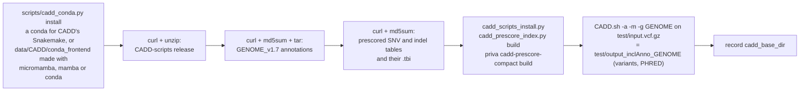

| Step | Commands in the process |
| --- | --- |
| E1 | `python scripts/cadd_conda.py install --frontend-prefix data/CADD/conda_frontend --manager M` (M: the first of `MAMBA_EXE`, `micromamba`, `mamba`, `CONDA_EXE`, `conda`); `curl` of `cadd_zip_download_url`, `unzip`; `curl` of the annotations, `md5sum`, `tar -xzf`; `curl` of each prescored table and its index, `md5sum`; `python scripts/cadd_scripts_install.py`; per table `python scripts/cadd_prescore_index.py build` and `priva cadd-prescore-compact build`; `python scripts/cadd_conda.py check`, then `CADD.sh -c CPUS -a -m -g GENOME` on its test input, its variants and PHRED compared with the expected output (the commands of `CADD_conda_install`, `CADD_install` and `CADD_upstream_check`) |

Conda environments name their own folder in their files and cannot be
moved, so E1 does not build in its task folder for storeDir to move: it
builds in its step folder (`resource_root/E1/LINEAGE/data`, linked into the
task as `data/`), as `install-task run` did, and storeDir keeps only
`receipt.json`. The CADD annotation finds the frontend beside
`cadd_base_dir` (`data/CADD/conda_frontend`), and CADD adds its rule
environments and MMSplice's exon tables to the folder when it runs, so the
folder stays writable (registry `writable`).

Compared with the shell functions (`tests/install_fixtures.py cadd` writes
the release zip, with a stand-in `CADD.sh` that needs conda and writes the
expected test output, and with `--upstream` the reviewed upstream
`extract_scored.py` and `MMSplice.py` of CADD-scripts v1.7.2, which PriVA
replaces; the annotations and prescored tables of both assemblies; their
MD5s as configuration keys; a conda new enough for CADD, and a micromamba
that makes the frontend):

| Step | Cases compared | Result |
| --- | --- | --- |
| E1 | GRCh38 and GRCh37 with a conda on PATH; GRCh38 with only micromamba (both make the frontend) | the same CADD-scripts folder (scripts, PriVA's two replaced files, annotations, tables and their indexes, compact copies, the rule environments' marker), apart from the position indexes (`.posidx`): their checkpoints are every fourth block of each part the table is read in, and the parts follow the threads (the old route had 2, the new task 1). Indexed again with 2 threads, the new tables give the old route's bytes, and lookups through either index find the same rows |
| E1 | a wrong MD5 for the SNV table; no micromamba, mamba or conda | each stops both routes with the same reason |

Changes you can notice:

- E1 always downloads into its own new folder. The function reused a
  `cadd_base_dir` you set, a release already unpacked under
  `cadd_parent_dir`, and any download already in place; adopt an existing
  CADD with `--adopt`.
- The downloads use `curl` (the function used `wget -c` when it was
  installed, to resume a stopped download from `.part`); a failed task starts
  again in a new folder.
- The threads of the index and compact builds and of `CADD.sh -c` are the
  task's CPUs, not the configuration's `threads`; `CADD.sh`'s check keeps its
  temporary files in the task folder, not `tmp_dir`.
- `install_workflow_check.py` no longer writes the include of `INSTALL_STEP`
  into `workflows/install.nf` (no step uses it), and counts the shell part of
  the digest with the code that goes in phase 7.

Part 6 finishes phase 6 with F5's rebuild, which phase 5 left stopping. F5
still records the shipped cache; with `PRIVA_FORCE_GOFCARDS_CACHE=1` or
`PRIVA_FORCE_ALL_CACHES=1` it builds the normalized cache (no ClinVar
conditions yet) that F7 then injects. The build normalizes the GoFCards
variants on both assemblies, so it needs both FASTAs, UCSC's hg19-to-hg38
chain and the VEP caches of both assemblies. F5 now needs A1 and A2 and stages
their `ref_genome` and `vep_cache_dir`: the install's own assembly comes from
them, and only the other assembly is downloaded.

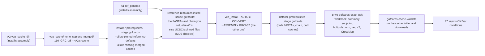

(For an hg19 install the arrows are the other way round: A2 gives GRCh37 and
`vep_install` fetches GRCh38.)

| Step | Commands in the process |
| --- | --- |
| F5 (rebuild) | `priva installer-prerequisites --stage gofcards --allow-pinned-reference-defaults --allow-missing-merged-caches`; `priva reference-resources install --scope gofcards --write-config --use-cache-root`; `vep --help`, the Ensembl API and installer releases (`perl`); `vep_install --AUTO c --NO_UPDATE --CACHE_VERSION R -s homo_sapiens_merged --NO_HTSLIB --NO_BIOPERL --CONVERT --ASSEMBLY OTHER`; `installer-prerequisites --stage gofcards`; `priva gofcards-exact-gof` with the function's options; `priva gofcards-cache-validate` (the commands of `gofcards_exact_gof_cache_install`, `gofcards_reference_install`, `gofcards_vep_caches_install` and `vep_cache_api_install`) |

```
                      shell function                           F5 process (forced)
FASTA, own assembly   ref_genome of the configuration          A1's ref_genome (staged)
FASTA, other one      gofcards_*_fasta, else UCSC download     the same (download into the task folder)
chain                 gofcards_hg19_to_hg38_chain, else UCSC   the same
VEP cache, own        vep_cache_dir/homo_sapiens_merged/R_*    A2's cache, linked
VEP cache, other      vep_cache_api_install into vep_cache_dir vep_install into the task folder
build folder          gofcards_workdir                         data/gofcards/build_work (kept)
recorded              nothing (F7 read gofcards_workdir)       gofcards_exact_gof_cache = the normalized cache
```

Compared with the shell function run on the same files
(`tests/install_fixtures.py gofcards` writes chromosome 1 of both assemblies
at its real length as sparse FASTAs holding bases only around five GoFCards
variants, A1 receipts naming them, a forward chain whose one block covers
four of them, the workbook and a summary endpoint reply for
`tests/fake_net.py`, which now answers curl's `--write-out` and
`--dump-header`, and the transcripts the `vep` fixture's stand-in gives each
variant in `--tab` mode; the old install route could never rebuild F5, see
phase 5):

| Step | Cases compared | Result |
| --- | --- | --- |
| F5 | shipped | same bytes |
| F5 | rebuilt on hg38 (GRCh37 cache downloaded) and on hg19 (GRCh38 downloaded) | the same build folder: workbook, summary cache, reference rejects, VCFs, both VEP tables, CrossMap's unplaced records (one outside the chain, one deletion CrossMap refuses; the endpoint places the first), statistics and the normalized cache, apart from the two folders (the build folder, and the VEP cache folder the cache names as `vep_cache_dir`) and the times tools stamp; the same requests to the server |
| F5 | a reverse chain; `vep_install` failing; no workbook at the server | each stops both routes with the same reason |
| F7 | injection into each route's rebuilt cache | the same cache, audit and statistics apart from `vep_cache_dir` and the SHA-256 of the cache it read (`clinvar.source_cache_sha256`) |
| install workflow | `-stub`, twice on one resource folder | 84 step tasks, then none |

Not compared here: UCSC's pinned FASTAs and chain, whose MD5s the download
checks, so a fixture cannot stand in for them; the process runs the same
`priva reference-resources install` the function ran.

Changes you can notice:

- A forced F5 builds into its own folder and records the normalized cache.
  Before, forcing it with the default configuration stopped ("Force cannot
  overwrite bundled gofcards_exact_gof_cache"): the function rebuilt only when
  you named another `gofcards_exact_gof_cache`. `PRIVA_FORCE_GOFCARDS_CLINVAR_INJECTION`
  alone no longer stops F5; F7 stops on it with the shipped cache, as before.
- F5 needs A1 and A2, so it waits for them and runs again when either
  changes (the shipped route only records the shipped file). It reads the
  shipped review table and HGNC table, which count in its digest, and no
  longer lists `gofcards_refresh_days` (a step folder holds no older cache
  to refresh).
- The other assembly's VEP cache and any downloaded reference live in the
  task folder and are removed after the build; the shell function kept them
  in `vep_cache_dir` and `cache_root`. Only the cache is fetched
  (`--AUTO c`): A2 installs the plugins, so the step neither checks nor
  reinstalls them, nor sets the conda environment's variables, as
  `vep_cache_api_install` did.
- F5 and F7 to F9 and publish get new lineages.

### Phase 7: the shell installer and the shell glue removed (22 November 2026)

Phase 6 left `install_utils.sh` only for `main_install` and the cluster
scripts, and `annotation_vcf.sh` only for `--phase annotation` in raw mode,
which no workflow starts (raw mode runs one task per annotation step since
phase 4). Phase 7 deletes them, the other shell scripts, and the Python and
Rust code that only they ran. The tools keep their own commands in the
processes, as before; nothing that a workflow runs changed its commands.

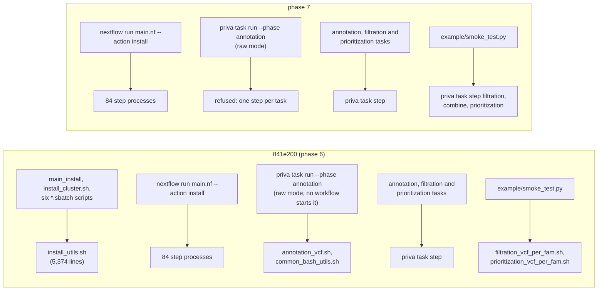

Removed (about 45,800 lines with the tests; commit 841e200 is the last tree that has them):

| Group | Removed | Only caller |
| --- | --- | --- |
| Shell installer | `scripts/install_utils.sh` (5,374 lines), `install_cluster.sh`, `build_cluster_alpha.sbatch`, `build_cluster_gnomad.sbatch`, `build_cluster_splicevault.sbatch`, `diagnose_cluster_install.sbatch`, `import_cluster_licensed.sbatch`, `rerun_cluster_install.sbatch`, `prepare_cluster_config.py`, `deploy_cluster_gnomad.py`, `deploy_cluster_plugin_inputs.py`, `deploy_cluster_resources.py`, `check_cluster_environment.py`, `check_cluster_readiness.py`, `envs/priva-cluster.yml`, `envs/cluster-*.json` | `main_install` and the cluster scripts |
| Analysis shell glue | `annotation_vcf.sh` (1,827), `common_bash_utils.sh` (1,627), `filtration_vcf_per_fam.sh` (356), `prioritization_vcf_per_fam.sh` (430), `anno_main_args`, `anno_vep_args`, `argparse.bash`, `prepare_clinvar_bench.sh` | raw `--phase annotation`, the smoke test, the comparison harnesses |
| Python | `vep_chromosome_jobs.py`, `vep_chromosome_cache.py`, `clinvar_gene_refresh.py`, `cache_resources.py` | `annotation_vcf.sh` and the installer |
| `priva` commands | `alpha-annotation-base` (`motif.rs`, `profile.rs`, `publication.rs`; `header.rs` and `io.rs` stay, shared by other commands); `mapped-artifact --kind motifs` and `adopt-native`; `clinvar-gene-refresh` plan, install, deploy, retire-owned, retire-shards, acquire, file-date and the candidate phases (`profile.rs`, `refresh.rs`; download, check-header and due stay, with the refresh policy in `policy.rs`); `install-task run` and `call-args` (`run.rs`; adopt and publish moved to `publish.rs`) | the installer's functions |
| Workflow and digest | `INSTALL_STEP` (`modules/local/install.nf`); the shell part of the step digest (installer functions, the lines outside them, `SCRIPT_DIR/NAME` and `DATA_DIR/PATH` names); raw `--phase annotation` in `priva task run` | no step since phase 6 |
| Comparisons and fixtures | `rust/tests/alpha_annotation_base_compare.py`, `cache_resources_compare.py`, `clinvar_gene_refresh_compare.py`; `tests/fixtures/installer-054b494/`, `alpha_motif_command_09223ef.sh`, `gnomad_serial_e8_0029d817.sh`, `vep_serial_v7_5be1b946.sh` | the removed commands |

The comparisons that run the old route (`tests/install_step_compare.py`,
`tests/annotation_step_compare.py`, `tests/family_step_compare.py`) take it
from a checkout of 841e200 (`--old-root`; `git worktree add OLD 841e200`);
CI checks that commit out beside the source for the two analysis
comparisons and removes it afterwards.

Tests. Of the 1,799 Python tests of 841e200, 790 drove the deleted scripts
(617 in 39 files that were removed whole, 173 in 24 files that keep their
other tests); they are removed. Two checks found them: the tests that failed
once the scripts were gone, and a second run with stand-ins at every removed
path (a shell stand-in logs the running test and exits 197, and an audit hook
logs every open of a removed path), which found 78 tests that still passed
only because they expected a failure. The other 1,009 tests give the base
run's results (the same 49 environmental failures in this sandbox, no new
one).

| Check | Result |
| --- | --- |
| `cargo test` | 829 passed, 0 failed (5 ignored) |
| `tests/family_step_compare.py --old-root` 841e200 | 0 of 19 cases differ |
| `tests/annotation_step_compare.py --old-root` 841e200 | 0 of 43 cases differ |
| `rust/tests/mapped_artifact_compare.py` (PM1 kind) | 90 of 90 cases (the script's "motif/PM1" in one refusal read as the command's "PM1") |
| `tests/install_workflow_check.py` | workflow generated from the registry, check passes |
| Stub install twice on one resource folder | 84 step tasks, then none |
| Analysis stub (`tests/nextflow/run_stub.sh`) | every case passed: annotation one task per step with cached resume, hub reuse, cohort and no-pedigree runs, phenotype bonus wiring, refusals |
| `tests/nextflow/run_cadd_stub.sh` | `cadd.nf` wrote a CADD table that `main.nf` accepts |
| CI's unittest selections | all 13 pass |

Lineages. A step counts the Rust files its `priva` commands reach, so
removing code from a file a step reaches gives it a new lineage, even where
the commands it runs are unchanged. 33 of the 84 steps get one (51 keep
theirs), and two of the five hub lineages:

| Steps | Edited Rust files they reach |
| --- | --- |
| B3, C3 | `alpha_annotation_base` (`header.rs`, `io.rs`, `mod.rs`; motif, profile and publication removed) |
| C11 | the same, and `mapped_artifact_publish` (motif kind and `adopt-native` removed) |
| D0 | `alpha_annotation_base`, `clinvar_gene_refresh` (the refresh commands removed) and `spliceai_cache_input.rs` (functions only the installer called) |
| D1 | those, `nextflow_task/tasks.rs` (raw `--phase annotation` removed) and `pipeline_steps/cadd.rs` (its messages name step E1) |
| C4, D1_chr1 … D1_chrY, D1_chrOther | `nextflow_task/tasks.rs`, `pipeline_steps/cadd.rs` and `spliceai_cache_input.rs` |
| B4 | `spliceai_cache_input.rs` |
| D8 | `acmg_step/gene_mechanism_resources.rs` (its message names step F9) |

| Hub | Lineage | Edited Rust file it reaches |
| --- | --- | --- |
| `vep` | dddb128a686dc85b to 3f4b5c7e5620d644 | `spliceai_cache_input.rs`, through `spliceai-cutoffs` |
| `cadd` | 503d8fd8983b5214 to d3c9d54dec78067e | `pipeline_steps/cadd.rs` |

Every step reaches `cli.rs`, but a step counts only its lines above the
command table (`run`), and the removed `alpha-annotation-base` dispatch was in
the table, so it changed no lineage. The `clinvar`, `gnomad` and `control`
hubs keep their lineages. As no full installation through the steps exists
yet, these new lineages rebuild nothing anyone has.

Changes you can notice:

- `README.md` describes only `nextflow run main.nf --action install`, and
  exporting the installed environments with `priva installed-environment`;
  `main_install`, `install_cluster.sh` and the `*.sbatch` scripts are gone.
- `priva task run --phase annotation` in raw mode is refused ("Raw annotation
  runs one step per task (annotation-preprocess to annotation-merge)");
  annotated mode still imports the VCF.
- Messages that named installer functions name the install step: CADD's
  conda and `CADD.sh` (step E1, in `priva task step` and `cadd_conda.py`)
  and the gene mechanism resources (step F9).
- `example/smoke_test.py` runs `priva task step` (filtration, combine,
  prioritization) and needs `PRIVA_BINARY` or `priva` on `PATH`, `yq`,
  `bcftools` and `tabix`. It now passes on both assemblies (20 variants; 167
  ranked and 372 ACMG rows on hg38, 112 and 183 on hg19). Since the steps
  read only native caches it had stopped at splicing analysis ("a Python
  pickle must first be converted with priva cache-convert"), on 841e200 too:
  `prepare` now converts the ten pickled fixtures with `priva cache-convert`
  into the run's `resources/` folder (about 30 seconds, most of it the
  bundled ClinVar gene statistics), and the two PM1 fixtures lost the
  `demo_slice_source` label in their metadata, which the converter refuses
  as an unknown field.
- `priva cache-resources validate --check-routes` checks the inventory's
  routes against the step IDs of `conf/install_steps.json`
  (`cache_resources.json` names steps, not functions).
- `priva install-task` refuses a source root without
  `conf/install_steps.json` (it used to look for `scripts/install_utils.sh`).
- `priva mapped-artifact` takes `--kind pm1` only, and its producer refusal
  reads "Use the selected PM1 scientific producer".

### Phases 3 to 7

| Phase | Scope | Shell glue now | Python it still runs | Work (tools keep their commands) |
| --- | --- | --- | --- | --- |
| 3 | Downloads: A1, A4, A5, B1, B2, B3, B5, B6, B7, B8, B9, D0, F1 | 4 to 10 functions each | `alternative_start_codon.py` (A4) | Each a Nextflow process: curl or git, then `priva install-task record` for the receipt. Done for A1, A4, B1, B2, B3, B5, B6, B7, B8, B9 and F1 (above); A4 no longer runs `alternative_start_codon.py`, whose pickle the Rust detector never reads |
| 4 | Pipeline scripts: `annotation_vcf.sh` (1,827 lines), `filtration_vcf_per_fam.sh` (356), `prioritization_vcf_per_fam.sh` (430), `common_bash_utils.sh` (1,627) | run inside every analysis task | an inline `python - <<PY` block in `anno_VEP_cache_worker`, and `cadd_conda.py` (finds CADD's conda) | The annotation, filtration and prioritization tasks already exist per step; each runs VEP, bcftools, `CADD.sh` and `priva` with their own command lines instead of a shell function. `priva task run` keeps the task's checks and runs them, since which commands run depends on the settings. Done (above) for filtration, the prioritization steps and the six annotation steps; the scripts stay for the installer and `--phase annotation` until phase 6 |
| 5 | Steps on native builders: A5 (moved from phase 3), C6, C8, C10, C11, D6, D8, D9, F4 to F10 | 7 to 19 functions each | `protein_domain_mapping.py` (C8's rebuild) | Each a process; F4's acquisition is curl and `priva gene-mechanism prepared`. Done (above), except F5's rebuild, which needs A2's two VEP caches and moves to phase 6 (done there, part 6) |
| 6 | Heavy chains: A2, B4, C1, C3, C4, D0 (moved from phase 3), D1, E1, and F5's rebuild. Done (above): C1_chr*, C1, D0, A2, B4, C3, C4, D1_split, D1_chr*, D1, E1 and F5's rebuild | 13 to 49 functions each | `cadd_scripts_install.py`, `cadd_prescore_index.py` (kept: they belong to CADD) | VEP, bcftools, CrossMap and `CADD.sh` command lines in the process; one change per step |
| 7 | Remove the shell installer and the shell glue | none | none of PriVA's own (`cadd_scripts_install.py` and `cadd_prescore_index.py` belong to CADD) | Done (above): `install_utils.sh`, the cluster scripts, the analysis scripts and the bash part of the digest deleted |

The seven phases are done on the migration branch. What remains before any of it goes to `main` is the end-to-end check: a full installation through the steps and a family run, compared with the existing installation.

## Retained Python tools

CADD scientific packages and model assets remain upstream. The auxiliary data
tools below are separate from the native runtime.

### Kept in Python: PriVA's replacements inside upstream CADD

| Python source | Native procedure or current role |
| --- | --- |
| [`scripts/cadd_prescore_index.py`](../scripts/cadd_prescore_index.py) | Retained Python. |
| [`scripts/cadd_scripts/MMSplice.py`](../scripts/cadd_scripts/MMSplice.py) | Retained Python. |
| [`scripts/cadd_scripts/extract_scored.py`](../scripts/cadd_scripts/extract_scored.py) | Retained Python. |
| [`scripts/cadd_scripts_install.py`](../scripts/cadd_scripts_install.py) | Retained Python. |

### Kept in Python: one-off research tools and examples

| Python source | Native procedure or current role |
| --- | --- |
| [`data/InterPro/gemini_interpro_func_classifier.py`](../data/InterPro/gemini_interpro_func_classifier.py) | Retained Python. |
| [`data/MaveDB/cal_mavedb_neutral_bands.py`](../data/MaveDB/cal_mavedb_neutral_bands.py) | Retained Python. |
| [`data/MaveDB/gpt_mavedb_assay_mapper.py`](../data/MaveDB/gpt_mavedb_assay_mapper.py) | Retained Python. |
| [`data/MaveDB/pretify_json.py`](../data/MaveDB/pretify_json.py) | Retained Python. |
| [`example/smoke_test.py`](../example/smoke_test.py) | Retained Python. |

## DAS rescue-order profile

The explicitly generated Python reference uses `domain-sorted-rescue-v1`: sort the
tolerant domain identifiers before selecting candidates in both rescue passes,
then retain the original `42 + i` / `99 + i` seed assignment, 32-bit wraparound,
permutation count, candidate filters, numerical routines and FDR thresholds.
This makes each domain's seed independent of Python string hashing and KS worker
completion order. It is a deliberate profile difference from the original
unsorted Python behavior. Other DAS stage ordering is unchanged.

Existing caches retain their producing profile and receipts. This change does
not rewrite them or qualify them as outputs of the new profile. A future native
DAS implementation must match the explicitly pinned sorted Python reference.
Generate that reference with `python rust/tests/das_sorted_reference.py render
--source scripts/am_pick_intolerant_domains.py --output /work/sorted_reference.py`.
The generated source is exclusively created; its whole AST differs only at the
two approved iterators. Keep its reported source/output hashes with the selected
profile. The still-active Python installer script remains byte-identical to the
original profile so its source-hash reuse gate does not trigger a new calculation.

## Native Alpha exon-history companion

```text
Annotated Alpha VCF -> per-chromosome first-insertion history
                    -> header-ordered merge with an explicit Python hash seed
                    -> serialized-set history -> DAS transcript mapping
```

`alpha-exon-history chromosome` captures the original observation order without
scores or a Python pickle. Merge all header contigs in their original order,
including empty contigs, with `alpha-exon-history merge --input FIRST --input
SECOND ... --hash-seed UINT32 --output HISTORY.parquet`. The final companion
reproduces CPython 3.12 set construction, worker transport and ordered updates
for that explicit seed. `build --vcf VCF --hash-seed UINT32 --output PARQUET`
uses the original sequential route instead.

Export with `alpha-exon-history export --input HISTORY.parquet --output HISTORY`;
pass that file to `das-domains transcripts --exon-history HISTORY` alongside the
typed statistics and the remaining required options. This retains exon traversal
order that the statistics model's set membership alone cannot recover. It does
not recover an unknown historical hash seed or require the legacy score pickle.
Source/profile guards remain active: do not retag an older companion when a
guard rejects it. The installer (`AlphaMissense_pick_intolerant_domains`) builds
`<statistics>.exon_history.seed<S>.parquet` this way with the
`priva_python_hash_seed` value, keeps completed chromosomes for a resumed run,
and exports the `.lines` file beside it.

Native statistics and history files keep the builder identity recorded when
they were built; rebuild them only on explicit request. `alphamissense-domain
check` and `alpha-exon-history check` print the recorded and current
`builder_source_sha256` and, by default, require the current builder. With
`--builder-sha256 SHA256` they accept exactly that recorded builder; VCF,
producer, extractor and profile checks stay strict. Merge and export still
require the current builder. `identity --input PARQUET` in either family prints
the recorded value without qualifying the file, for `das-domains transcripts`
`--source-builder-sha256` and `--history-builder-sha256`. Installer receipts use
`priva builder-identity NAME`: a SHA-256 over that builder's own embedded source
modules and Cargo.lock, listed by `priva builder-identity --help`. Its
`alphamissense-domain`, `domain-metadata` and `alpha-exon-history` values equal
the identities those builders record in their footers.
